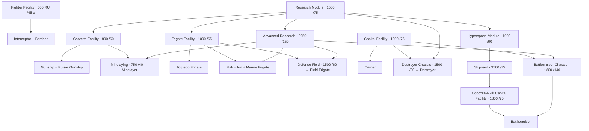
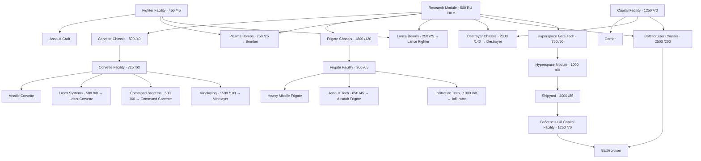

# Исследования HW2 Classic: хиигаряне и вэйгры

20 октября 2026. Справочник для проектирования науки Новокушан/Новотаиидан. Это описание исходной Classic, а не уже принятые цены или дерево новых рас. Исходники мода и установленная игра этим документом не меняются.

Схемы и числовые таблицы восстановлены из уже извлечённых файлов **Steam Homeworld 2 Classic**: `scripts/building and research/{hiigaran,vaygr}/{research,build}.lua` и `subsystem/*.subs`. Полные поля, скрытые строки и SHA256 сохраняются отдельно. Пояснения сопоставлены с авторскими разборами Тена: [хиигаряне](https://www.homeworld3.ru/index.php?name=Pages&op=page&pid=95), [вэйгры](https://www.homeworld3.ru/index.php?name=Pages&op=page&pid=96). У Тена базовая таблица рассчитана на1.1, отличия1.0 отмечены отдельно. Текст статьи не копируется; ниже наша схема по игровым данным.

## Как читать

- **Модуль** строится за RU и занимает место на корабле. **Исследование** занимает общую научную очередь. **Постройка корабля** оплачивается после получения доступа. Это три разные части цены пути.
- Производственный модуль нужен на конкретном строителе; научные условия проверяются по флоту. Наличие технологии не создаёт производственные мощности на каждом новом носителе.
- У обеих рас одна научная очередь. По экспериментам Тена ускорение описывается `t=T/√(n+1)`, где T — исходное поле Time, n — работающие научные модули. В локальном tuning подтверждён показатель0.5; это не наш новый тест движка. Одна секция:0.707T, две:0.577T, шесть:0.378T. При отсутствии науки новые исследования недоступны.
- Все времена ниже **базовые**. Сумма полей времени модулей и исследований не равна длительности развития в матче: есть параллельная постройка, научное ускорение и начальная инфраструктура.
- Ветки независимы: для фрегатов не требуется предварительно открыть корветы; для эсминцев — фрегаты. Цепочки уровней I→II существуют внутри улучшения, но общей лестницы классов нет.

## Основная разница

| Свойство | Хиигаряне / Hiigaran | Вэйгры / Vaygr |
|---|---|---|
| Базовая наука | Research Module:1500 RU /75 с | Research Module:500 RU /30 с |
| Продвинутая наука | Advanced Research Module:2250 /150, после базовой науки | Отдельного Advanced Research нет |
| Корветы и фрегаты | Основная плата за доступ — наука и производственный модуль | Наука → платное шасси класса → производственный модуль |
| Новые проекты | Многие появляются сразу с модулями; отдельные технологии для специальных проектов и сверхтяжёлых кораблей | Больше отдельных технологий проектов внутри класса |
| Улучшения | Обычно на конкретный тип: Gunship отдельно от Pulsar, Torpedo отдельно от Ion | На класс целиком: Corvette, Frigate, Capital и т.д. |
| Число уровней | Обычно два; II требует I и продвинутую науку. Скорость перехватчиков/бомбардировщиков II доступна с базовой наукой | Обычно два; оба с единственным типом Research Module |
| Цена за полный класс | Зависит от числа модернизируемых проектов | Крупный единый платёж, покрывающий весь класс |

## Хиигаряне: открытие боевых проектов

В схеме стрелки, сходящиеся к одному узлу, означают совместные условия. Условия R могут выполняться базовой либо продвинутой наукой там, где это разрешено исходным research.lua; таблица ниже сохраняет точный синтаксис.

У зенитного, ионного и десантного фрегатов есть внутренний допуск **InstaAdvancedFrigateTech:0 RU /0 с** при AdvancedResearch. В пользовательском дереве это появление кораблей после постройки продвинутой науки, без отдельного платного «шасси фрегатов».

Носитель открывает один Capital Ship Facility, без отдельного исследования и без обязательной базовой науки. Линейный крейсер строится только на верфи, имеющей собственное производство крупных кораблей; его исследование можно проводить раньше, используя CapShipProduction другого корабля флота. Эсминец не является предшествующей технологией линейного крейсера.

Платформы: **Platform Control650/70 → Gun Platform**; добавление базовой науки и исследования **Platform Ion Weapons600/100** открывает Ion Beam Platform. Доступные без производственных модулей проекты — разведчик, сборщик, ресурсный контроллер и обычный зонд. Кампания дополнительно ограничивает доступность сценарием.

## Вэйгры: открытие боевых проектов

Базовый Research Module нужен для всех перечисленных платных исследований, в том числе для оружейных проектов подветок. Он не требуется для базового штурмовика, пушечной платформы и носителя при наличии соответствующих производственных модулей.

Платформы: **Platform Control625/70 → Gun Platform**; с наукой и **Heavy Missiles1200/105 → Missile Platform**. Технология Hyperspace Gate750/50 открывает как постройку врат через платформенный модуль, так и возможность построить Hyperspace Module; сами врата не обязательны для модуля/вызова верфи. Корветная технология не требуется для фрегатной; Destroyer Chassis не требуется для Battlecruiser Chassis.

## Что именно улучшается

**Хиигаряне:** две отдельные линии скорости перехватчика и бомбардировщика; отдельные линии прочности/скорости Gunship, Pulsar, Torpedo, Flak, Ion, Destroyer, Battlecruiser, Carrier, Shipyard и Mothership. Для Gun Platform и Ion Platform — отдельная прочность; для сборщика/контроллера — также раздельная прочность. В обычной таблице нет отдельных броневых улучшений истребителей, линий корпуса/скорости Marine и Defense Field Frigate либо массового исследования урона всех орудий.

**Вэйгры:** скорость всего класса Fighter; прочность и скорость всех Corvette, Frigate и Capital; прочность Platform и Utility. Классовая Capital-модернизация задаётся для всего семейства, а не отдельного проекта эсминца или крейсера. Ускорение производства всё равно покупается отдельно для флагмана, носителя и верфи.

| Классовое улучшение вэйгров | I: RU /с → итоговый множитель | II: RU /с → итоговый множитель |
|---|---|---|
| Скорость истребителей | 600 /50 →1.25 | 1000 /70 →1.50 |
| Прочность корветов | 900 /60 →1.30 | 1800 /80 →1.60 |
| Скорость корветов | 800 /60 →1.20 | 1600 /80 →1.40 |
| Прочность фрегатов | 1600 /80 →1.30 | 2800 /100 →1.60 |
| Скорость фрегатов | 1000 /70 →1.20 | 1500 /100 →1.35 |
| Прочность крупных кораблей | 4000 /60 →1.30 | 6000 /80 →1.60 |
| Скорость крупных кораблей | 3500 /60 →1.20 | 5000 /80 →1.35 |
| Прочность платформ | 1000 /50 →1.50 | 1600 /70 →2.00 |
| Прочность вспомогательных | 1200 /50 →1.50 | 2400 /70 →2.00 |

Это абсолютные множители от исходной характеристики. Например, корпуса I и II дают130% и160% исходных HP, а не130% и169%. Каждый II требует свой I. «Броня» в названиях этих исследований изменяет MAXHEALTH; это не переключение ArmourFamily.

Способности и специальные открытия также занимают очередь: ремонт сборщика, EMP разведчика, бомбы против подсистем, тяжёлые торпеды хиигарян, пинг хиигарского разведчика, сенсорные зонды, минные системы и т.д. Полный перечень с ценами и требованиями находится ниже.

## Полная цена доступа с нуля

**Сумма науки, нужного производства и обязательных исследований, без цены самого корабля и без улучшений.** Исходный Материнский/Флагман уже существует; все соответствующие модули отсутствуют. Начальные модули матча эту сумму уменьшают. Для повторного строителя нужно снова оплатить его собственное производство, но известные технологии не покупаются заново.

| Доступ к проекту | Хиигаряне, RU | Вэйгры, RU |
|---|---:|---:|
| Основной истребитель: Interceptor / Assault Craft | 500 | 450 |
| Bomber | 500 | 1200 =500+450+250 |
| Базовый корвет: Gunship/Pulsar / Missile Corvette | 2300 =1500+800 | 1725 =500+500+725 |
| Minelayer Corvette | 5300 =1500+2250+800+750 | 3225 =500+500+725+1500 |
| Базовый фрегат: Torpedo / Heavy Missile | 2500 =1500+1000 | 3200 =500+1800+900 |
| Продвинутый противоистребительный фрегат: Flak / Assault | 4750 =1500+2250+1000 | 3850 =500+1800+900+650 |
| Десантный фрегат: Marine / Infiltrator | 4750 | 4200 =500+1800+900+1000 |
| Carrier | 1800 | 1250 |
| Destroyer | 4800 =1500+1800+1500 | 3750 =500+1250+2000 |
| Battlecruiser, включая вызов верфи и её Capital Facility | 11850 =1500+2250+1000+3500+1800+1800 | 10000 =500+750+1000+4000+1250+2500 |

Пути к крейсерам не включают ненужный для них Capital Facility на Материнском/Флагмане: в минимальном пути нужен один такой модуль на вызванной верфи. Стоимости самих крейсеров здесь не прибавлены.

## Ориентиры для наших двух рас — предложение

1. **Сравнивать суммарную цену доступа**, включая необходимые профильные секции. Если ионный фрегат требует три направления, нельзя каждому исследованию назначить цену полного классического открытия фрегата.
2. **Отделить открытие проекта от его улучшений.** Первое даёт новый инструмент; второе усиливает уже имеющийся флот. Пинг, минные системы и защитное поле — самостоятельные работы, а не проценты корпуса.
3. **Сохранить выбор класса.** Обязательная последовательность всех классов сделает наше развитие длиннее Classic. Наши шасси/двигатели могут иметь осмысленные связи, но их стоимость и задержку придётся компенсировать.
4. **Улучшение всей группы должно стоить дороже частного.** Особенно для нашей пары лёгкие/тяжёлые эсминцы: решить, охватывает модернизация всё семейство или отдельный проект. Разделение модулей по направлениям само по себе этого не определяет.
5. **Шесть дорогих секций не должны стать шестью обязательными платежами до первого перехватчика.** Базовые знания/начальный доступ и свободный выбор первой секции ещё надо определить.

Эти пункты — вывод для дальнейшего проектирования, не автоматическое утверждение цен или нового дерева.

## Исходные модули: цена и базовое время

Модули Материнского корабля/Флагмана. Требования приведены в исходном синтаксисе; F — подсистемы флота, R — уже полученные технологии. Стоимость модулей носителей сохранена отдельно в JSON.

| Модуль RU / EN | Хиигаряне RU / с | Допуск Hgn | Вэйгры RU / с | Допуск Vgr |
|---|---:|---|---:|---|
| Производство истребителей / Fighter Facility | 500 / 45 | — | 450 / 45 | — |
| Производство корветов / Corvette Facility | 800 / 60 | F: Research | 725 / 60 | R: CorvetteTech |
| Производство фрегатов / Frigate Facility | 1000 / 65 | F: Research | 900 / 65 | R: FrigateTech |
| Производство крупных кораблей / Capital Ship Facility | 1800 / 75 | — | 1250 / 70 | — |
| Управление платформами / Platform Control Module | 650 / 70 | — | 625 / 70 | — |
| Наука / Research Module | 1500 / 75 | — | 500 / 30 | — |
| Продвинутая наука / Advanced Research Module | 2250 / 150 | F: Research | — | — |
| Гиперпространство / Hyperspace Module | 1000 / 60 | F: Research | 1000 / 60 | R: HyperspaceGateTech |
| Подавление гиперпрыжков / Gravity Well Generator | 1500 / 60 | F: Research | 1500 / 60 | F: Research |
| Маскировка / Cloak Generator | 750 / 60 | F: Research | 750 / 60 | F: Research |
| Координация огня / Fire Control Tower | 1500 / 40 | F: AdvancedResearch | 1500 / 40 | F: Research |
| Сенсорная батарея / Advanced Sensors Array | 250 / 35 | — | 250 / 35 | — |
| Гиперпространственные сенсоры / Hyperspace Sensors | 250 / 35 | — | 250 / 35 | — |
| Обнаружение маскировки / Anti-Cloaking Sensors | 250 / 35 | — | — | — |

## Полная таблица обычных исследований

Все суммы и времена ниже считаны из локального Classic. Время — поле Time до ускорения. Множители второго уровня указаны относительно исходного состояния, не перемножаются с первым. У хиигарян R означает Research, AR — AdvancedResearch; исходные условия с & и | сохранены буквально.

### Хиигаряне

| Исследование RU / EN | Объект RU / EN | RU | Базовые с | Предыдущее исследование | Подсистемы | Эффект / технический ID |
|---|---|---:|---:|---|---|---|
| Укладка мин / Minelaying Technology | Минный корвет / Minelayer Corvette | 750 | 40 | — | AdvancedResearch & CorvetteProduction | `GraviticAttractionMines` |
| Ионные орудия платформ / Platform Ion Weapons | Ионная платформа / Ion Beam Platform | 600 | 100 | — | Research \| AdvancedResearch & PlatformProduction | `PlatformIonWeapons` |
| Шасси эсминца / Destroyer Chassis | Эсминец / Destroyer | 1500 | 90 | — | Research \| AdvancedResearch & CapShipProduction | `DestroyerTech` |
| Шасси линейного крейсера / Battlecruiser Chassis | Линейный крейсер / Battlecruiser | 1800 | 140 | — | AdvancedResearch & CapShipProduction | `BattlecruiserIonWeapons` |
| Зонд-помехопостановщик / Sensors Distortion Probe | Зонд-помехопостановщик / Sensors Distortion Probe | 500 | 45 | — | AdvancedResearch | `ECMProbe` |
| Датчик приближения / Proximity Sensor | Датчик приближения / Proximity Sensor | 500 | 35 | — | Research | `SensDisProbe` |
| Ремонтные системы / Repair Systems | Сборщик ресурсов / Resource Collector | 750 | 40 | — | Research \| AdvancedResearch | `RepairAbility` |
| Пинг разведчика / Enhanced Scout Sensors | Разведчик / Scout | 500 | 40 | — | Research \| AdvancedResearch | `ScoutPingAbility` |
| Тяжёлые торпеды / Improved Torpedoes | Торпедный фрегат / Torpedo Frigate | 1000 | 60 | — | Research \| AdvancedResearch & FrigateProduction | `ImprovedTorpedo` |
| Противоподсистемные бомбы / Improved Bombs | Штурмовой бомбардировщик / Bomber | 1500 | 45 | — | Research \| AdvancedResearch | `AttackBomberImprovedBombs` |
| Электромагнитное оружие / EMP | Разведчик / Scout | 1500 | 70 | — | Research \| AdvancedResearch | `ScoutEMPAbility` |
| Защитное поле / Defense Field | Фрегат защитного поля / Defense Field Frigate | 1500 | 60 | — | AdvancedResearch & FrigateProduction | `DefenseFieldFrigateShield` |
| Прочность / Hull I | Материнский корабль / Mothership | 500 | 30 | — | Research \| AdvancedResearch | 1.5 × MAXHEALTH; `MothershipHealthUpgrade1` |
| Прочность / Hull II | Материнский корабль / Mothership | 750 | 40 | MothershipHealthUpgrade1 | AdvancedResearch | 2 × MAXHEALTH; `MothershipHealthUpgrade2` |
| Скорость / Engine I | Материнский корабль / Mothership | 500 | 30 | — | Research \| AdvancedResearch | 1.2 × MAXSPEED; `MothershipMAXSPEEDUpgrade1` |
| Скорость / Engine II | Материнский корабль / Mothership | 750 | 40 | MothershipMAXSPEEDUpgrade1 | AdvancedResearch | 1.35 × MAXSPEED; `MothershipMAXSPEEDUpgrade2` |
| Производство / Improved Manufacturing I | Материнский корабль / Mothership | 1000 | 60 | — | AdvancedResearch | 1.3 × BUILDSPEED; `MothershipBUILDSPEEDUpgrade1` |
| Прочность / Hull I | Носитель / Carrier | 750 | 40 | — | Research \| AdvancedResearch & CapShipProduction | 1.3 × MAXHEALTH; `CarrierHealthUpgrade1` |
| Прочность / Hull II | Носитель / Carrier | 1000 | 60 | CarrierHealthUpgrade1 | AdvancedResearch & CapShipProduction | 1.6 × MAXHEALTH; `CarrierHealthUpgrade2` |
| Скорость / Engine I | Носитель / Carrier | 500 | 30 | — | Research \| AdvancedResearch & CapShipProduction | 1.2 × MAXSPEED; `CarrierMAXSPEEDUpgrade1` |
| Скорость / Engine II | Носитель / Carrier | 1000 | 40 | CarrierMAXSPEEDUpgrade1 | AdvancedResearch & CapShipProduction | 1.35 × MAXSPEED; `CarrierMAXSPEEDUpgrade2` |
| Производство / Improved Manufacturing I | Носитель / Carrier | 1500 | 60 | — | AdvancedResearch & CapShipProduction | 1.3 × BUILDSPEED; `CarrierBUILDSPEEDUpgrade1` |
| Скорость / Engine I | Перехватчик / Interceptor | 300 | 30 | — | Research \| AdvancedResearch & FighterProduction | 1.25 × MAXSPEED; `InterceptorMAXSPEEDUpgrade1` |
| Скорость / Engine II | Перехватчик / Interceptor | 500 | 40 | InterceptorMAXSPEEDUpgrade1 | AdvancedResearch & FighterProduction | 1.5 × MAXSPEED; `InterceptorMAXSPEEDUpgrade2` |
| Скорость / Engine I | Штурмовой бомбардировщик / Bomber | 300 | 30 | — | Research \| AdvancedResearch & FighterProduction | 1.25 × MAXSPEED; `AttackBomberMAXSPEEDUpgrade1` |
| Скорость / Engine II | Штурмовой бомбардировщик / Bomber | 500 | 40 | AttackBomberMAXSPEEDUpgrade1 | AdvancedResearch & FighterProduction | 1.5 × MAXSPEED; `AttackBomberMAXSPEEDUpgrade2` |
| Прочность / Hull I | Штурмовой корвет / Gunship | 500 | 40 | — | Research \| AdvancedResearch & CorvetteProduction | 1.3 × MAXHEALTH; `AssaultCorvetteHealthUpgrade1` |
| Прочность / Hull II | Штурмовой корвет / Gunship | 750 | 50 | AssaultCorvetteHealthUpgrade1 | AdvancedResearch & CorvetteProduction | 1.6 × MAXHEALTH; `AssaultCorvetteHealthUpgrade2` |
| Скорость / Engine I | Штурмовой корвет / Gunship | 300 | 40 | — | Research \| AdvancedResearch & CorvetteProduction | 1.2 × MAXSPEED; `AssaultCorvetteMAXSPEEDUpgrade1` |
| Скорость / Engine II | Штурмовой корвет / Gunship | 500 | 50 | AssaultCorvetteMAXSPEEDUpgrade1 | AdvancedResearch & CorvetteProduction | 1.35 × MAXSPEED; `AssaultCorvetteMAXSPEEDUpgrade2` |
| Прочность / Hull I | Корвет-пульсар / Pulsar Gunship | 400 | 40 | — | Research \| AdvancedResearch & CorvetteProduction | 1.3 × MAXHEALTH; `PulsarCorvetteHealthUpgrade1` |
| Прочность / Hull II | Корвет-пульсар / Pulsar Gunship | 750 | 50 | PulsarCorvetteHealthUpgrade1 | AdvancedResearch & CorvetteProduction | 1.6 × MAXHEALTH; `PulsarCorvetteHealthUpgrade2` |
| Скорость / Engine I | Корвет-пульсар / Pulsar Gunship | 300 | 40 | — | Research \| AdvancedResearch & CorvetteProduction | 1.2 × MAXSPEED; `PulsarCorvetteMAXSPEEDUpgrade1` |
| Скорость / Engine II | Корвет-пульсар / Pulsar Gunship | 750 | 50 | PulsarCorvetteMAXSPEEDUpgrade1 | AdvancedResearch & CorvetteProduction | 1.35 × MAXSPEED; `PulsarCorvetteMAXSPEEDUpgrade2` |
| Прочность / Hull I | Торпедный фрегат / Torpedo Frigate | 800 | 60 | — | Research \| AdvancedResearch & FrigateProduction | 1.3 × MAXHEALTH; `TorpedoFrigateHealthUpgrade1` |
| Прочность / Hull II | Торпедный фрегат / Torpedo Frigate | 1400 | 75 | TorpedoFrigateHealthUpgrade1 | AdvancedResearch & FrigateProduction | 1.6 × MAXHEALTH; `TorpedoFrigateHealthUpgrade2` |
| Скорость / Engine I | Торпедный фрегат / Torpedo Frigate | 500 | 50 | — | Research \| AdvancedResearch & FrigateProduction | 1.2 × MAXSPEED; `TorpedoFrigateMAXSPEEDUpgrade1` |
| Скорость / Engine II | Торпедный фрегат / Torpedo Frigate | 750 | 70 | TorpedoFrigateMAXSPEEDUpgrade1 | AdvancedResearch & FrigateProduction | 1.35 × MAXSPEED; `TorpedoFrigateMAXSPEEDUpgrade2` |
| Прочность / Hull I | Ионный фрегат / Ion Cannon Frigate | 800 | 60 | InstaAdvancedFrigateTech | Research \| AdvancedResearch & FrigateProduction | 1.3 × MAXHEALTH; `IonCannonFrigateHealthUpgrade1` |
| Прочность / Hull II | Ионный фрегат / Ion Cannon Frigate | 1400 | 75 | IonCannonFrigateHealthUpgrade1 & InstaAdvancedFrigateTech | AdvancedResearch & FrigateProduction | 1.6 × MAXHEALTH; `IonCannonFrigateHealthUpgrade2` |
| Скорость / Engine I | Ионный фрегат / Ion Cannon Frigate | 500 | 50 | InstaAdvancedFrigateTech | Research \| AdvancedResearch & FrigateProduction | 1.2 × MAXSPEED; `IonCannonFrigateMAXSPEEDUpgrade1` |
| Скорость / Engine II | Ионный фрегат / Ion Cannon Frigate | 750 | 70 | IonCannonFrigateMAXSPEEDUpgrade1 & InstaAdvancedFrigateTech | AdvancedResearch & FrigateProduction | 1.35 × MAXSPEED; `IonCannonFrigateMAXSPEEDUpgrade2` |
| Прочность / Hull I | Зенитный фрегат / Flak Frigate | 800 | 60 | InstaAdvancedFrigateTech | Research \| AdvancedResearch & FrigateProduction | 1.3 × MAXHEALTH; `AssaultFrigateHealthUpgrade1` |
| Прочность / Hull II | Зенитный фрегат / Flak Frigate | 1400 | 75 | AssaultFrigateHealthUpgrade1 & InstaAdvancedFrigateTech | AdvancedResearch & FrigateProduction | 1.6 × MAXHEALTH; `AssaultFrigateHealthUpgrade2` |
| Скорость / Engine I | Зенитный фрегат / Flak Frigate | 500 | 50 | InstaAdvancedFrigateTech | Research \| AdvancedResearch & FrigateProduction | 1.2 × MAXSPEED; `AssaultFrigateMAXSPEEDUpgrade1` |
| Скорость / Engine II | Зенитный фрегат / Flak Frigate | 750 | 70 | AssaultFrigateMAXSPEEDUpgrade1 & InstaAdvancedFrigateTech | AdvancedResearch & FrigateProduction | 1.35 × MAXSPEED; `AssaultFrigateMAXSPEEDUpgrade2` |
| Прочность / Hull I | Линейный крейсер / Battlecruiser | 2000 | 60 | BattlecruiserIonWeapons | Research \| AdvancedResearch & CapShipProduction | 1.3 × MAXHEALTH; `BattlecruiserHealthUpgrade1` |
| Прочность / Hull II | Линейный крейсер / Battlecruiser | 3000 | 75 | BattlecruiserHealthUpgrade1 | AdvancedResearch & CapShipProduction | 1.6 × MAXHEALTH; `BattlecruiserHealthUpgrade2` |
| Скорость / Engine I | Линейный крейсер / Battlecruiser | 1000 | 30 | BattlecruiserIonWeapons | Research \| AdvancedResearch & CapShipProduction | 1.2 × MAXSPEED; `BattlecruiserMAXSPEEDUpgrade1` |
| Скорость / Engine II | Линейный крейсер / Battlecruiser | 1500 | 40 | BattlecruiserMAXSPEEDUpgrade1 | AdvancedResearch & CapShipProduction | 1.35 × MAXSPEED; `BattlecruiserMAXSPEEDUpgrade2` |
| Прочность / Hull I | Эсминец / Destroyer | 1000 | 60 | DestroyerTech | Research \| AdvancedResearch & CapShipProduction | 1.3 × MAXHEALTH; `DestroyerHealthUpgrade1` |
| Прочность / Hull II | Эсминец / Destroyer | 1500 | 75 | DestroyerHealthUpgrade1 | AdvancedResearch & CapShipProduction | 1.6 × MAXHEALTH; `DestroyerHealthUpgrade2` |
| Скорость / Engine I | Эсминец / Destroyer | 1000 | 30 | DestroyerTech | Research \| AdvancedResearch & CapShipProduction | 1.2 × MAXSPEED; `DestroyerMAXSPEEDUpgrade1` |
| Скорость / Engine II | Эсминец / Destroyer | 1500 | 40 | DestroyerMAXSPEEDUpgrade1 | AdvancedResearch & CapShipProduction | 1.35 × MAXSPEED; `DestroyerMAXSPEEDUpgrade2` |
| Прочность / Hull I | Пушечная платформа / Gun Platform | 500 | 30 | — | Research \| AdvancedResearch & PlatformProduction | 1.3 × MAXHEALTH; `GunTurretHealthUpgrade1` |
| Прочность / Hull II | Пушечная платформа / Gun Platform | 800 | 40 | GunTurretHealthUpgrade1 | AdvancedResearch & PlatformProduction | 1.6 × MAXHEALTH; `GunTurretHealthUpgrade2` |
| Прочность / Hull I | Ионная платформа / Ion Beam Platform | 500 | 30 | PlatformIonWeapons | Research \| AdvancedResearch & PlatformProduction | 1.3 × MAXHEALTH; `IonTurretHealthUpgrade1` |
| Прочность / Hull II | Ионная платформа / Ion Beam Platform | 800 | 40 | IonTurretHealthUpgrade1 & PlatformIonWeapons | AdvancedResearch & PlatformProduction | 1.6 × MAXHEALTH; `IonTurretHealthUpgrade2` |
| Прочность / Hull I | Сборщик ресурсов / Resource Collector | 400 | 40 | — | Research \| AdvancedResearch | 1.5 × MAXHEALTH; `ResourceCollectorHealthUpgrade1` |
| Прочность / Hull II | Сборщик ресурсов / Resource Collector | 800 | 60 | ResourceCollectorHealthUpgrade1 | AdvancedResearch | 2 × MAXHEALTH; `ResourceCollectorHealthUpgrade2` |
| Прочность / Hull I | Ресурсный контроллер / Mobile Refinery | 500 | 30 | — | Research \| AdvancedResearch | 1.3 × MAXHEALTH; `ResourceControllerHealthUpgrade1` |
| Прочность / Hull II | Ресурсный контроллер / Mobile Refinery | 1000 | 40 | ResourceControllerHealthUpgrade1 | AdvancedResearch | 1.6 × MAXHEALTH; `ResourceControllerHealthUpgrade2` |
| Стоимость гиперпрыжка / Hyperspace Cost I | Материнский корабль / Mothership | 500 | 45 | — | Research \| AdvancedResearch & Hyperspace | 0.8 × HyperspaceCost; `HyperspaceCostUpgrade1` |
| Стоимость гиперпрыжка / Hyperspace Cost II | Материнский корабль / Mothership | 1000 | 60 | HyperspaceCostUpgrade1 | AdvancedResearch \| AdvancedResearch & Hyperspace | 0.6 × HyperspaceCost; `HyperspaceCostUpgrade2` |
| Прочность / Hull I | Верфь / Shipyard | 750 | 30 | — | Research \| AdvancedResearch & Hyperspace | 1.3 × MAXHEALTH; `ShipyardHealthUpgrade1` |
| Прочность / Hull II | Верфь / Shipyard | 1500 | 40 | ShipyardHealthUpgrade1 | AdvancedResearch & Hyperspace | 1.6 × MAXHEALTH; `ShipyardHealthUpgrade2` |
| Скорость / Engine I | Верфь / Shipyard | 500 | 30 | — | Research \| AdvancedResearch & Hyperspace | 1.2 × MAXSPEED; `ShipyardMAXSPEEDUpgrade1` |
| Скорость / Engine II | Верфь / Shipyard | 1500 | 60 | ShipyardMAXSPEEDUpgrade1 | AdvancedResearch & Hyperspace | 1.35 × MAXSPEED; `ShipyardMAXSPEEDUpgrade2` |
| Производство / Improved Manufacturing I | Верфь / Shipyard | 1000 | 40 | — | AdvancedResearch & Hyperspace | 1.3 × BUILDSPEED; `ShipyardBUILDSPEEDUpgrade1` |
### Вэйгры

| Исследование RU / EN | Объект RU / EN | RU | Базовые с | Предыдущее исследование | Подсистемы | Эффект / технический ID |
|---|---|---:|---:|---|---|---|
| Шасси корветов / Corvette Chassis | Корветы / Corvette class | 500 | 40 | — | Research | `CorvetteTech` |
| Шасси фрегатов / Frigate Chassis | Фрегаты / Frigate class | 1800 | 120 | — | Research | `FrigateTech` |
| Зонд-помехопостановщик / Sensors Distortion Probe | Зонд-помехопостановщик / Sensors Distortion Probe | 800 | 60 | — | Research | `ProbeSensorDisruption` |
| Датчик приближения / Proximity Sensor Probe | Датчик приближения / Proximity Sensor Probe | 500 | 40 | — | Research | `ProbeProxSensor` |
| Лучевое оружие / Lance Beams | Лучевой истребитель / Lance Fighter | 250 | 25 | — | Research & FighterProduction | `LanceBeams` |
| Плазменные бомбы / Plasma Bombs | Бомбардировщик / Bomber | 250 | 25 | — | Research & FighterProduction | `PlasmaBombs` |
| Минные системы / Corvette Minelaying Systems | Минный корвет / Minelayer Corvette | 1500 | 100 | — | Research & CorvetteProduction | `CorvetteGraviticAttraction` |
| Лазерные системы / Corvette Laser Systems | Лазерный корвет / Laser Corvette | 500 | 60 | — | Research & CorvetteProduction | `CorvetteLaser` |
| Командные системы / Command Corvette Systems | Командный корвет / Command Corvette | 500 | 60 | — | Research & CorvetteProduction | `CorvetteCommand` |
| Тяжёлые ракеты платформ / Platform Heavy Missiles | Ракетная платформа / Missile Platform | 1200 | 105 | — | Research & PlatformProduction | `PlatformHeavyMissiles` |
| Штурмовые фрегаты / Assault Frigate Technology | Штурмовой фрегат / Assault Frigate | 650 | 45 | — | Research & FrigateProduction | `FrigateAssault` |
| Абордажные технологии / Infiltration Technology | Десантный фрегат / Infiltrator Frigate | 1000 | 60 | — | Research & FrigateProduction | `FrigateInfiltrationTech` |
| Шасси линейного крейсера / Battlecruiser Chassis | Линейный крейсер / Battlecruiser | 2500 | 200 | — | Research & CapShipProduction | `BattlecruiserIonWeapons` |
| Шасси эсминца / Destroyer Chassis | Эсминец / Destroyer | 2000 | 140 | — | Research & CapShipProduction | `DestroyerGuns` |
| Гиперпространственные врата / Hyperspace Gate Technology | Гиперпространственные врата / Hyperspace Gate | 750 | 50 | — | Research | `HyperspaceGateTech` |
| Ремонтные системы / Repair Systems | Сборщик ресурсов / Resource Collector | 500 | 30 | — | Research | `RepairAbility` |
| Электромагнитное оружие / EMP | Разведчик / Scout | 1000 | 70 | — | Research & FighterProduction | `ScoutEMPAbility` |
| Противоподсистемные бомбы / Improved Bombs | Бомбардировщик / Bomber | 1500 | 45 | PlasmaBombs | Research | `BomberImprovedBombs` |
| Производство / Improved Manufacturing I | Флагман / Flagship | 1000 | 60 | — | Research | 1.3 × BUILDSPEED; `MothershipBUILDSPEEDUpgrade1` |
| Прочность / Hull I | Крупные корабли / Capital class | 4000 | 60 | — | CapShipProduction & Research | 1.3 × MAXHEALTH; `SuperCapHealthUpgrade1` |
| Прочность / Hull II | Крупные корабли / Capital class | 6000 | 80 | SuperCapHealthUpgrade1 | CapShipProduction & Research | 1.6 × MAXHEALTH; `SuperCapHealthUpgrade2` |
| Скорость / Engine I | Крупные корабли / Capital class | 3500 | 60 | — | CapShipProduction & Research | 1.2 × MAXSPEED; `SuperCapSpeedUpgrade1` |
| Скорость / Engine II | Крупные корабли / Capital class | 5000 | 80 | SuperCapSpeedUpgrade1 | CapShipProduction & Research | 1.35 × MAXSPEED; `SuperCapSpeedUpgrade2` |
| Производство / Improved Manufacturing I | Носитель / Carrier | 1500 | 100 | — | Research & CapShipProduction | 1.3 × BUILDSPEED; `CarrierBUILDSPEEDUpgrade1` |
| Производство / Improved Manufacturing I | Верфь / Shipyard | 1000 | 95 | — | Research & CapShipProduction & Hyperspace | 1.3 × BUILDSPEED; `ShipyardBUILDSPEEDUpgrade1` |
| Скорость / Engine I | Истребители / Fighter class | 600 | 50 | — | FighterProduction & Research | 1.25 × MAXSPEED; `FighterspeedUpgrade1` |
| Скорость / Engine II | Истребители / Fighter class | 1000 | 70 | FighterspeedUpgrade1 | FighterProduction & Research | 1.5 × MAXSPEED; `FighterspeedUpgrade2` |
| Прочность / Hull I | Корветы / Corvette class | 900 | 60 | — | CorvetteProduction & Research | 1.3 × MAXHEALTH; `CorvetteHealthUpgrade1` |
| Прочность / Hull II | Корветы / Corvette class | 1800 | 80 | CorvetteHealthUpgrade1 | CorvetteProduction & Research | 1.6 × MAXHEALTH; `CorvetteHealthUpgrade2` |
| Скорость / Engine I | Корветы / Corvette class | 800 | 60 | — | CorvetteProduction & Research | 1.2 × MAXSPEED; `CorvetteSpeedUpgrade1` |
| Скорость / Engine II | Корветы / Corvette class | 1600 | 80 | CorvetteSpeedUpgrade1 | CorvetteProduction & Research | 1.4 × MAXSPEED; `CorvetteSpeedUpgrade2` |
| Прочность / Hull I | Фрегаты / Frigate class | 1600 | 80 | — | FrigateProduction & Research | 1.3 × MAXHEALTH; `FrigateHealthUpgrade1` |
| Прочность / Hull II | Фрегаты / Frigate class | 2800 | 100 | FrigateHealthUpgrade1 | FrigateProduction & Research | 1.6 × MAXHEALTH; `FrigateHealthUpgrade2` |
| Скорость / Engine I | Фрегаты / Frigate class | 1000 | 70 | — | FrigateProduction & Research | 1.2 × MAXSPEED; `FrigateSpeedUpgrade1` |
| Скорость / Engine II | Фрегаты / Frigate class | 1500 | 100 | FrigateSpeedUpgrade1 | FrigateProduction & Research | 1.35 × MAXSPEED; `SpeedUpgrade2` |
| Прочность / Hull I | Платформы / Platform class | 1000 | 50 | — | PlatformProduction & Research | 1.5 × MAXHEALTH; `PlatformHealthUpgrade1` |
| Прочность / Hull II | Платформы / Platform class | 1600 | 70 | PlatformHealthUpgrade1 | PlatformProduction & Research | 2 × MAXHEALTH; `PlatformHealthUpgrade2` |
| Прочность / Hull I | Вспомогательные корабли / Utility class | 1200 | 50 | — | Research | 1.5 × MAXHEALTH; `UtilityHealthUpgrade1` |
| Прочность / Hull II | Вспомогательные корабли / Utility class | 2400 | 70 | UtilityHealthUpgrade1 | Research | 2 × MAXHEALTH; `UtilityHealthUpgrade2` |

## Кампания и внутренние условия

- `InstaAdvancedFrigateTech`: 0 RU / 0 с, условие AdvancedResearch. Бесплатный внутренний допуск к зенитному, ионному и десантному фрегатам, а не отдельная платная ступень дерева.
- `DamageMoverTech`: 500 RU / 60 с; `RadiationDefenseField`: 500 RU / 60 с — кампанийные открытия хиигарян, не обычная ветка скирмиша.
- Все строки с RequiredResearch=`RESEARCH HACK` сохранены в JSON как script_only. Это сценарные модификаторы, не предлагаемые игроку технологии.

## Расхождения с таблицей Тена

Ориентир статьи — Classic 1.1, с отдельно отмеченными отличиями 1.0. Локальные данные относятся к установленной Steam-редакции Classic; полное совпадение с историческим патчем 1.1 не предполагается автоматически.

- По локальному build.lua датчик приближения Hgn требует `SensDisProbe`: 500 RU / 35 с и Research; ECM-зонд требует `ECMProbe`: 500 RU / 45 с и AdvancedResearch. У Тена эти две пары цены/времени и условий распределены иначе. Здесь сохранена связь из build.lua, несмотря на вводящие в заблуждение внутренние имена.
- В статье броня верфи Hgn — 500/750 RU, двигатели — 500/750. Локально: броня 750/1500 RU, двигатели 500/1500; подробные времена выше.
- Гиперпространственное улучшение II Hgn локально имеет UpgradeValue=0.6; у Тена итоговое снижение описано как45%. В справочнике не подменяем исходный коэффициент описанием.
- EMP разведчика Vgr: локально1000 RU /70 с; в статье1500 RU /70 с. Основные открытия классов/кораблей и стоимость производственных модулей совпадают.

## Воспроизведение и границы проверки

`python -X utf8 tools/write_hw2classic_research.py` читает уже извлечённые Lua4-таблицы через существующий ограниченный декодер данных. Не исполняет игровой код, не меняет мод/релиз/установку и не запускает игру. SHA256 и полные исходные поля обеих рас: [hw2classic-research.json](../local/novokushan/hw2classic-research.json).
