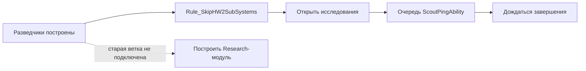
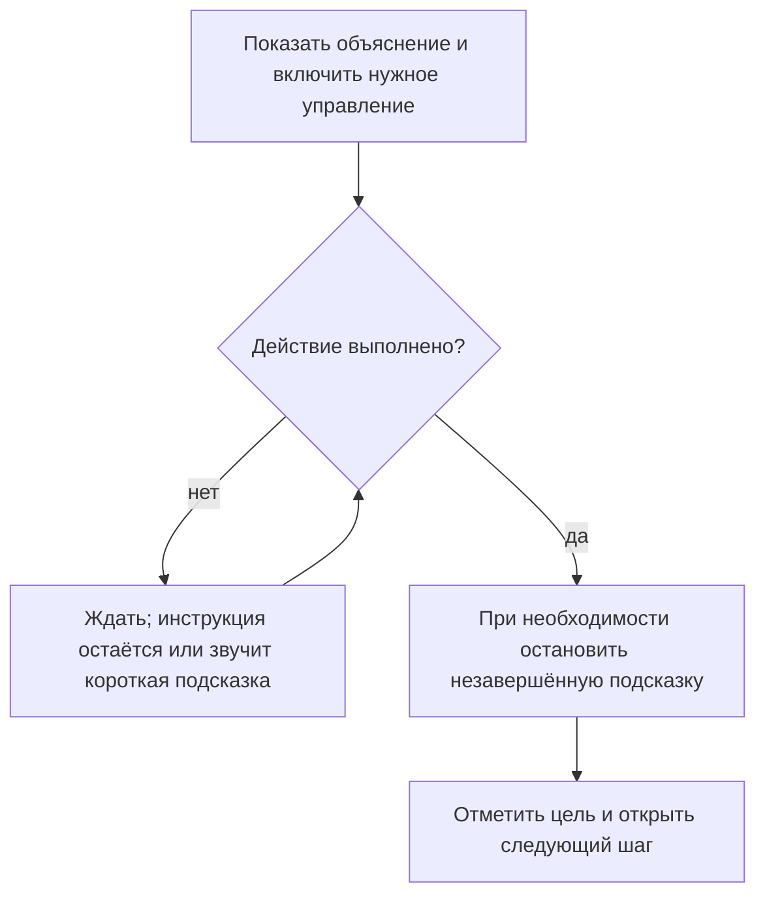

# Родное обучение HWRM: как оно устроено и что берём для Vast Reaches

Основу обучения управлению с мышью и клавиатурой можно взять из родного HWRM. **Для нашего T1 подходят почти весь первый урок, постройка и безопасная атака из второго, группы и маршрут из третьего.** Сюжет первого подключения Тирры, её разговоры с Каран и первый гиперпрыжок оставляем из VR.

Это разбор файлов установленного **Remastered**, а не исходного HW2 Classic. Игру при подготовке не запускал. Ниже показаны родные миниатюры и элементы подсказок, а не новые скриншоты прохождения.

Позже посмотреть сам курс можно в обычном HWRM: **главное меню → Tutorial / Обучение**. Наша кампания для этого не нужна.

## Чтение и прослушивание

- **[Читатель с русским текстом, раскрываемым EN и родной английской озвучкой](native-tutorial/index.html).**
- [Урок 1: камера, интерфейс и движение — полный текст и действия](native-tutorial/M01.md).
- [Урок 2: ресурсы, постройка, исследования и атака](native-tutorial/M02.md).
- [Урок 3: группы, бой, способности, захват и свободная практика](native-tutorial/M03.md).

В трёх уроках восстановлено **171 подключённое речевое вхождение**, для каждого найдена соответствующая родная английская запись. Русский и английский здесь взяты из HWRM буквально: это отдельный материал для сравнения с нашим новым переводом. Неиспользуемые и закомментированные упражнения отделены. В сырых строках встречаются хвосты `#+`; они сохранены для точности, их отображение родным интерфейсом здесь не проверялось.

## Что видит игрок

Это обычное игровое пространство с кораблями и штатным интерфейсом. Инструктор по очереди открывает нужные элементы, подсвечивает кнопки и корабли, ставит пинги и указатели. Пока упражнение не пройдено, часть команд недоступна. Затем скрипт проверяет действие и открывает следующий шаг.

| На экране | Как используется | Что можно взять |
|---|---|---|
| Панель задач и выбранные корабли | Показать/скрыть панель, подсветить нужную кнопку | Готовый HUD, названия элементов и подсветку |
| Субтитры и кнопка подтверждения | Последовательные объяснения, ожидание окончания/действия | Родной речевой механизм и оформление |
| Журнал сообщений | Открыть и закрыть SpeechRecall | Урок повторного чтения реплик, если он нужен |
| Список целей | Открыть, выбрать цель, прочитать описание | Готовые Objective_Add / описания / отметку выполнения |
| Корабль или область интереса | Камера фокусируется, появляется указатель или пинг | Приёмы постановки и привязку подсказки к объекту |
| Карта сенсоров | Открыть/закрыть; объяснить обозначения | Готовые проверки состояния Sensors Manager |
| Дополнительная иллюстрация | Цветные рамки объясняют отображение кораблей | Родной GenericScreen и его пример графики |

Родная картинка для объяснения обозначений кораблей:

В `ui/newui/generic.lua` поверх этой картинки создаются зелёная, красная и жёлтая рамки. Это не отдельный VR-интерфейс: элементы уже принадлежат HWRM.

## Урок 1 — интерфейс, камера и движение

Начальная сцена содержит хиигарский носитель. Разведчики появляются по сценарию позже. Основной маршрут:

1. Приветствие; показать панель задач, свернуть и снова открыть её.
2. Открыть и закрыть журнал сообщений.
3. Открыть список целей, выбрать цель, закрыть окно.
4. Выбрать одну эскадрилью разведчиков, затем выделить две рамкой.
5. Повернуть камеру, приблизить/отдалить, сместить её в сторону.
6. Вернуть фокус на выбранный корабль.
7. Открыть карту сенсоров, изучить обозначения своих/чужих/нейтральных объектов, закрыть её.
8. Приказать кораблю двигаться к астероидам; дождаться входа в область.
9. Открыть и закрыть диск движения.
10. Задать движение по вертикали: изменить высоту как минимум на **4000 игровых единиц**; после этого снять ограничение щелчка и закончить приказ.
11. Завершить урок и перейти к следующему родному уроку.

| Упражнение | Что действительно проверяет скрипт |
|---|---|
| Выделение | `SobGroup_Selected` для нужной эскадрильи/обеих групп |
| Вращение | `Camera_PlayerHasRotated` |
| Зум | Изменение `Camera_GetLastZoomAmount` |
| Панорамирование | `Camera_PlayerHasPanned`, затем уход разведчика с экрана |
| Возврат фокуса | Одновременно `Camera_IsFocused` и выделение нужной группы |
| Сенсоры | `Sensors_ManagerIsUp` |
| Первый приказ движения | `SobGroup_IsDoingAbility(..., AB_Move)` |
| Долетел до места | `Player_IsShipInVolume` / `SobGroup_IsInVolume` |
| Диск движения | `Universe_IsPiePlateActive` |
| Высота | `abs(Universe_GetCurrentMoveHeight()) >= 4000` |

**Для нас:** заменить VR-телепортацию, вращение мира руками и перемещение точки присутствия этой цепочкой камеры/выделения/движения. Число 4000 и зоны — параметры учебной карты HWRM, их нужно подстроить под нашу сцену. Длинное знакомство с журналом сообщений можно сократить.

## Урок 2 — ресурсы, постройка, исследование и первая атака

Начало — носитель; сборщик создаётся скриптом, выдаётся **2500 RU**. Учебные группы мишеней лишены движения и атаки, AI отключён.

1. Выбрать сборщик и отправить его добывать. Засчитывается **начало добычи**, а не получение определённой суммы RU.
2. Выбрать носитель и открыть строительство. Подсветить нужные элементы панели.
3. Заказать разведчики; переход к следующему объяснению допускается после постановки в очередь, затем отдельная проверка ждёт не менее трёх разведывательных эскадрилий.
4. Открыть исследования.
5. Поставить `ScoutPingAbility` в очередь, затем дождаться завершения исследования.
6. Построить бомбардировщик; объяснить приказ атаки.
7. Уничтожить учебный фрегат, затем остальные мишени.
8. Завершить урок.

### Отличие Remastered, которое легко пропустить

В файле сохранились старые сцены выбора и постройки исследовательского модуля. **В активном маршруте они обойдены:** носитель уже получает `FighterProduction` и `Research` при инициализации, а после разведчиков вызывается `Rule_SkipHW2SubSystems`.

**Для нас:** берём обучение окну строительства, реальные проверки очереди/готового корабля и безопасные мишени. Сбор ресурсов логичнее оставить в M1, где он уже является сюжетной задачей. `ScoutPingAbility`, хиигарские модули и родные 2500 RU не переносим автоматически: в VR-T1 нет такой исследовательской задачи, а наши корпуса кушанские.

## Урок 3 — группы, бой и специальные команды

Начальная сцена содержит по три эскадрильи перехватчиков и бомбардировщиков, носитель, абордажный фрегат и учебных противников.

1. Выбрать только перехватчики и присвоить им контрольную группу 1.
2. Объяснить выбор/фокус группы, присвоить бомбардировщикам группу 2.
3. Уничтожить указанный вражеский фрегат.
4. Выбрать носитель, открыть специальные команды, включить и выключить маскировку.
5. Захватить другой фрегат абордажным кораблём. Скрипт поддерживает здоровье цели, чтобы игрок не заменил захват её уничтожением.
6. Объяснить агрессивную, оборонительную и пассивную тактику.
7. Выделить объединённый флот и назначить ударное построение; проверить `SobGroup_InStrikeGroup`.
8. Объяснить маршрут с точками. **Отдельной проверки, что игрок действительно проложил маршрут, в этой завершающей цепочке нет:** она ждёт окончания объяснения.
9. Отметить обучение завершённым и предложить свободную боевую практику. Каждые 30 секунд создаётся очередная волна: попеременно разведчики и бомбардировщики, количество растёт; приказ атаки планируется через 25 секунд.

Старый отдельный эпизод трёхмерного перемещения `intelevent_3dmovement` в этой части не подключён. Он не входит в маршрут выше.

**Для нас:** контрольные группы, ударное построение и объяснение маршрутов хорошо заменяют VR-операции с группами. Маскировка носителя и абордажный фрегат к нашему T1 не относятся. Захват не равен сцеплению трёх инженерных корветов в VR-M4. Свободные растущие волны после урока тоже не нужны перед сюжетным переходом к M1.

## Как устроено ожидание действий

Это не просто ролик с паузами. Например, объяснение выделения может ещё идти, а игрок уже сделал нужное. Многие родные правила прекращают лишнюю подсказку и переходят дальше, но только после проверки самого действия.

Для технических подсказок это удобно. Сюжетные разговоры Тирры и Каран так обрывать нельзя: их нужно отделить от прерываемых инструкций и дать закончиться.

## Сопоставление с VR-T1

| В VR | Что подходит из родного HWRM | Решение для нашего T1 |
|---|---|---|
| Первое подключение Тирры, наставления Каран | Родной сюжет этого не содержит | Сохраняем VR-диалоги |
| Телепортация, поворот/масштаб мира руками | Урок 1: вращение, зум, панорамирование, фокус | Заменяем на управление камерой HWRM |
| Сенсоры | Урок 1: Sensors Manager, указатели, обозначения | Берём готовую логику и оформление |
| Выделение ударной группы | Урок 1: одиночное выделение и рамка | Меняем объекты и текст под наши корабли |
| Перелёт через две учебные зоны | Урок 1: приказ движения и проверка области | Сохраняем нужные VR-зоны, используем родные проверки |
| Первая учебная атака | Урок 2: неподвижные мишени без ответного огня | Берём механизм, ставим наши цели |
| Постройка перехватчика | Урок 2: NewBuildMenu, очередь и число кораблей | Адаптируем на `kus_interceptor`, нужный отряд и исходные RU |
| Тактическая пауза | Соответствующий отдельный урок в найденной активной цепочке не обнаружен | Нужен наш короткий шаг, если сохраняем упражнение |
| Перенос кораблей между VR-группами | Урок 3: контрольные группы и ударные построения | Заменяем на принятую в HWRM организацию флота |
| Списание корабля | В родном обучении retire/scuttle, напротив, запрещены | Делаем отдельную подсказку либо убираем упражнение после сверки диалогов |
| Маршрут в обход платформы | Урок 3: текст/подсветка Waypoints | Проверку обхода и конечных целей сохраняем из VR |
| Разговоры об ощущении кораблей частью себя и потерях | Родного аналога нет | Сохраняем VR-диалоги после первого боя |
| Первый самостоятельный гиперпрыжок | Родные уроки используют `FE_NextTutorial` | Нужен переход нашей кампании, а не переход к следующему стандартному уроку |

## Предлагаемая сборка нашего обучения

**Пролог VR → подключение Тирры → компактный блок камеры HWRM → выделение/сенсоры → перелёт через зоны → безопасная атака → сюжетный разговор о потерях → постройка перехватчика → группы и маршрут → итоговые цели → разговор Каран и гиперпрыжок в M1.**

Это даёт готовую механику PC-управления и сохраняет историю. Пока это план для согласования: текущий установленный мод этим документом не изменялся.

При переносе конкретно меняем:

- Имя группы `Carrier`, хиигарские типы и объекты мишеней на наши SOB-группы и кушанские корпуса.
- Проверки количества: «один отряд» и «один физический аппарат» нельзя считать одинаковыми.
- Зоны, расстояния камеры и порог высоты — под выбранную карту и размеры кораблей.
- Тексты с упоминанием носителя/исследовательского модуля — по нашему сюжету и интерфейсу.
- `FE_NextTutorial` и родные кнопки «следующий урок» — на завершение главы нашей кампании.
- Условия завершения — оставляем настоящими; таймер не заменяет выделение, постройку или достижение зоны.

## Звук: уточнение к прежнему плану

В `EnglishSpeech.big` найдены и извлечены **233 WAV** трёх родных учебных папок. Все проверены как **PCM, mono, 16 bit, 44100 Hz**. Это около 15 минут исходного материала, включая неиспользуемые/дополнительные записи; не все они обязательно проигрываются в активном маршруте.

Родные скрипты задают `Sound_SpeechSubtitlePath("speech:missions/TUT_01/")`, а `HW2_SubTitleEvent` создаёт вызов `Subtitle_Add` и ждёт `Subtitle_IsDone`. Имя WAV соответствует номеру строки, например `50030.wav` ↔ `$50030`.

**Прежнее утверждение об обязательном FDA для всей нашей речевой озвучки было слишком сильным.** Для учебной речи есть подтверждённый родной WAV-путь. Теперь следующий практический шаг — проверить на одной нашей реплике совпадение пути, номера UCS, WAV и actor; после этого переносить очередь целиком. Наличие готового WAV ещё не означает, что наши голоса уже подключены в движке.

## Источники и проверка

- Три исходных скрипта: `local/hwrm-base/leveldata/campaign/tutorial/m01/m01.lua`, `m02/m02.lua`, `m03/m03.lua`.
- Определение курса: `local/hwrm-base/leveldata/campaign/tutorial.campaign`.
- RU: `local/hwrm-base/locale/russian/leveldata/campaign/tutorial`; EN: `local/english/leveldata/campaign/tutorial`.
- UI: `ui/newui/generic.lua`, `ui/newui/tutorial/ati_shipexample.tga`; helper: `scripts/scar/scar_util.lua`.
- Проверяемый JSON с функциями, событиями, строками и связями: `local/native-tutorial/audit.json`; краткий отчёт: `verification.json`.
- Генератор подробных разборов: `tools/write_native_tutorial.py`. Он только определяет Lua-таблицы и функции в изолированном Lua-runtime; `OnInit` и игровые правила не вызываются. Комментарии исключены из анализа связей. Динамическое исполнение условий и реальный UI требуют отдельного игрового прохода.
