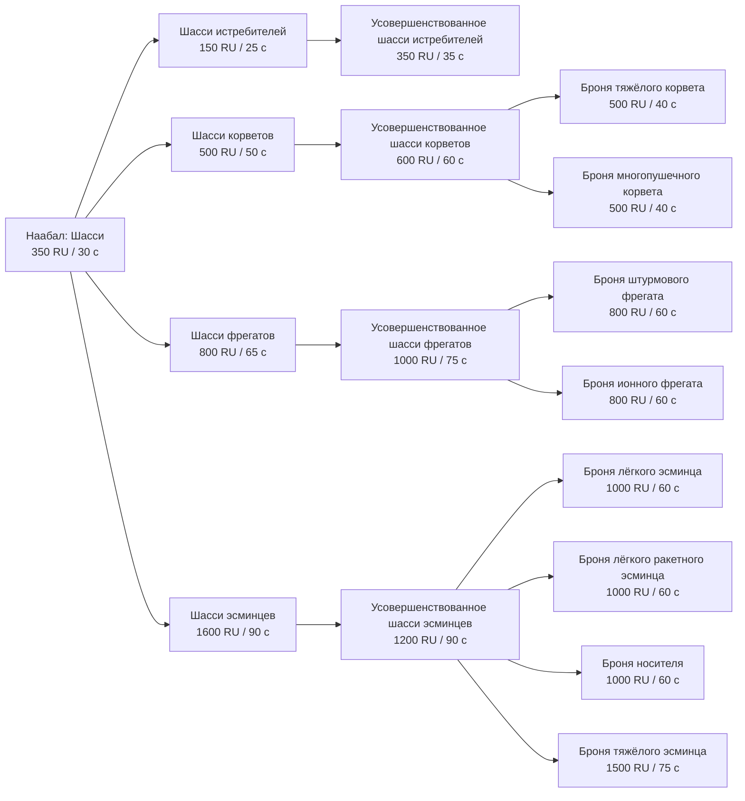
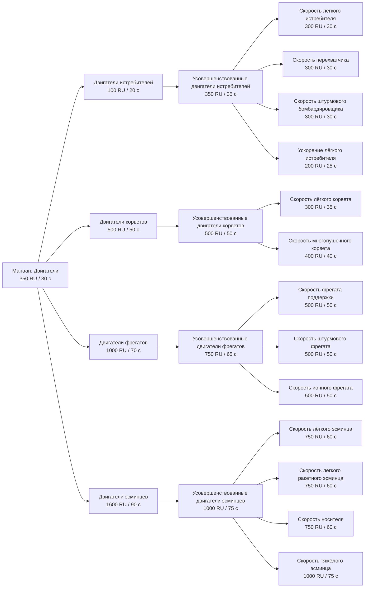
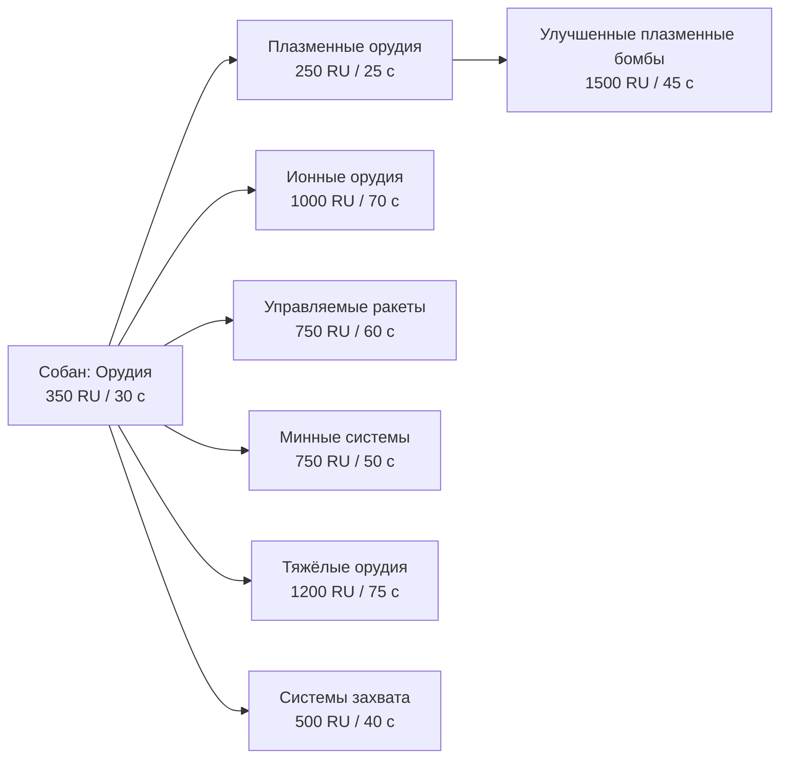
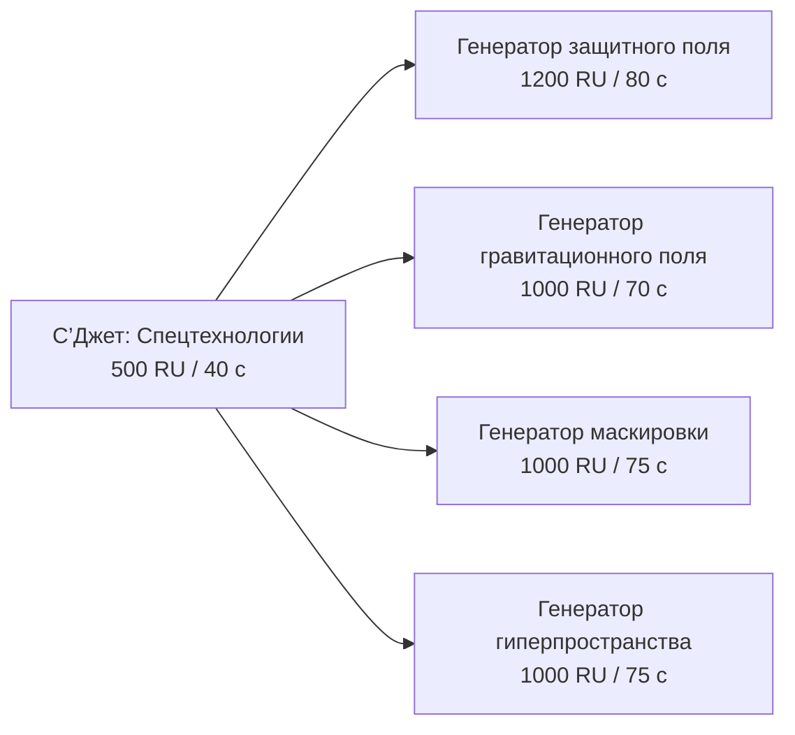
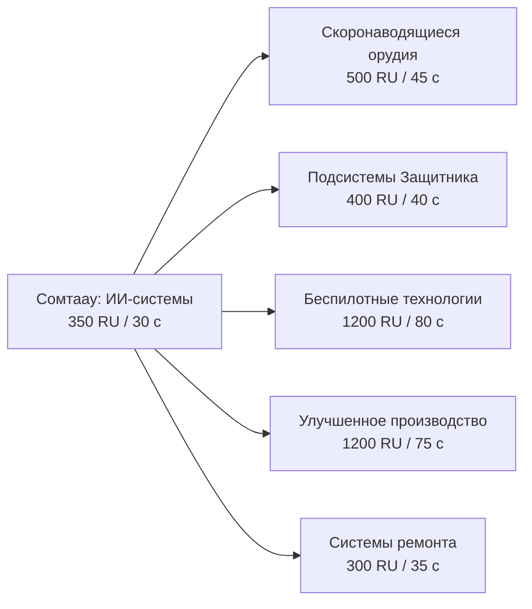
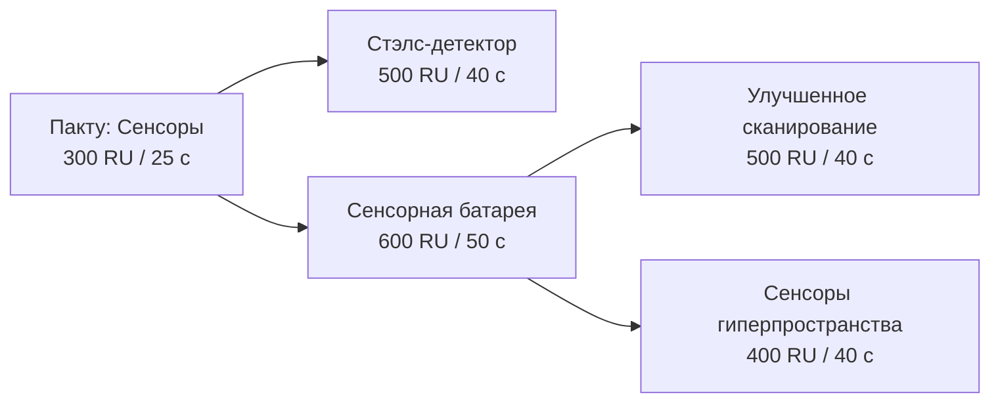

# Новокушане: исследовательское дерево v1

21 октября 2026. Основа — подробное дерево Дмитрия; цены, времена и величины бонусов — первая настройка для пробы. Схема реализуется только у Новокушан. Научная сборка Новотаиидан и её классовое дерево — следующий отдельный этап; станция по-прежнему только у них.

## Зафиксированные уточнения

- Минному корвету нужны двигатели/шасси корветов и **Минные системы**, не скоронаводящиеся орудия.
- Общие усовершенствованные шасси/двигатели сами дают бонус классу и открывают продолжение. Предложенные ступени: **115% базовых HP /110% скорости**; индивидуальные броня/двигатель — целевые **130% HP /125% скорости**. Это абсолютные целевые уровни, не обещание подтверждённого в движке порядка сочетания модификаторов.
- Последнее уточнение Дмитрия: индивидуальные двигатели **многопушечного** корвета. Предыдущее английское heavy Corvette drive сохранено как исходный текст, его русский смысл исправлен по уточнению.
- **Плазменные орудия / Plasma Weapons —250RU/25с**: общее условие бомбардировщика и штурмового фрегата. **Улучшенные плазменные бомбы / Improved Plasma Bombs —1500RU/45с**, после плазменных орудий: отдельный специальный боеприпас против подсистем для обоих кораблей, по механике UseSpecialWeaponsInNormalAttack из Classic. Обычные пушки штурмового фрегата не усиливает. Цены/время улучшения совпадают с референсом Hgn/Vgr Classic; характеристики двух кушанских установок остаются собственной пробной настройкой.
- Heavy Guns — добровольное усиление урона пушечных лёгкого/тяжёлого эсминцев на10%. Оно не становится новым обязательным условием тяжёлого эсминца.
- Новая игровая единица: **фрегат защитного поля**, существующий подготовленный корпус VR nku_barricadefrigate, механика поля штатного Hgn. Первая настройка1100 RU/55 с/16000HP, общий лимит NFP_Special2 вместе с дронным фрегатом. Это не автоматическое отождествление с CUT_Ship_Kus_SupportFrigate.
- Носитель, по прежнему канону UI, остаётся «Носитель»; «авианосец» — понятный алиас обсуждения. С’Джет сохраняет ранее согласованное написание. «Воягры» — сленг Дмитрия; рабочая словарная форма Vaygr — «вэйгры».

## Научная сборка и очередь

Шесть разных научных кораблей, по одному каждого профиля. Все шесть доступны без исследований; первый профиль можно выбрать свободно. Наабал использует основной корпус кольца, остальные секции работают самостоятельно и пристыковываются при наличии основы. Последовательные ограничения штатного скрипта сняты, физические стыковка/эффекты сохранены. Реальное поведение сборки и подсчёт скрытых исследовательских подсистем ещё требуют теста HWRM.

Одна общая научная очередь. Профиль проверяется RequiredSubSystems, связи между технологиями — RequiredResearch. Полное кольцо стоит **2200RU**; цена каждого профиля ниже. Каждая секция занимает1 из общего пула генераторов18, отдельный профиль ограничен1 — всего не более6 научных секций. Новые UI-вкладки/иконки не добавлены.

| Модуль | Направление | RU | Постройка, базовые с | Техническая секция |
|---|---|---:|---:|---|
| Наабал / Naabal | Шасси | 350 | 30 | `kus_researchship` |
| Манаан / Manaan | Двигатели | 350 | 30 | `kus_researchship_1` |
| Собан / Soban | Орудия | 350 | 30 | `kus_researchship_2` |
| С’Джет / S’jet | Спецтехнологии | 500 | 40 | `kus_researchship_3` |
| Сомтаау / Somtaaw | ИИ-системы | 350 | 30 | `kus_researchship_4` |
| Пакту / Paktu | Сенсоры | 300 | 25 | `kus_researchship_5` |

При потере профильной секции новые работы её ветки недоступны; полученные технологии и постройка уже открытых проектов не требуют сохранять лабораторию. Пауза/поведение уже выполняющегося задания определяется штатным ResearchManager и пока не проверено. Скрипт не отменяет очередь и не убивает другие секции вручную.

## Цены и базовое время исследований

Время — исходное поле Time. Ориентир ускорения Classic: t=T/√(n+1), где n — активные секции. На одной секции 70.7% T, при полном кольце37.8% T. Нулевая длительность внутренних эффектов не означает ещё одну бесплатную очередь: это сопровождающие применения уже оплаченного исследования по штатному образцу InstaAdvancedFrigateTech.

### Наабал — Шасси

| RU / EN | RU | Базовые с | Предыдущее открытие | Эффект |
|---|---:|---:|---|---|
| Шасси истребителей Fighter Chassis | 150 | 25 | Только профильный модуль | Открытие связанных проектов |
| Усовершенствованное шасси истребителей Advanced Fighter Chassis | 350 | 35 | Шасси истребителей | Общий уровень прочности: 115% базовых HP; также открывает продолжение ветки. |
| Шасси корветов Corvette Chassis | 500 | 50 | Только профильный модуль | Открытие связанных проектов |
| Усовершенствованное шасси корветов Advanced Corvette Chassis | 600 | 60 | Шасси корветов | Общий уровень прочности: 115% базовых HP; также открывает продолжение ветки. |
| Шасси фрегатов Frigate Chassis | 800 | 65 | Только профильный модуль | Открытие связанных проектов |
| Усовершенствованное шасси фрегатов Advanced Frigate Chassis | 1000 | 75 | Шасси фрегатов | Общий уровень прочности: 115% базовых HP; также открывает продолжение ветки. |
| Шасси эсминцев Destroyer Chassis | 1600 | 90 | Только профильный модуль | Открытие связанных проектов |
| Усовершенствованное шасси эсминцев Advanced Destroyer Chassis | 1200 | 90 | Шасси эсминцев | Общий уровень прочности: 115% базовых HP; также открывает продолжение ветки. |
| Броня тяжёлого корвета Heavy Corvette Armor | 500 | 40 | Усовершенствованное шасси корветов | Индивидуальный уровень: целевые 130% базовых HP, тип брони не меняется. |
| Броня многопушечного корвета Multigun Corvette Armor | 500 | 40 | Усовершенствованное шасси корветов | Индивидуальный уровень: целевые 130% базовых HP, тип брони не меняется. |
| Броня штурмового фрегата Assault Frigate Armor | 800 | 60 | Усовершенствованное шасси фрегатов | Индивидуальный уровень: целевые 130% базовых HP, тип брони не меняется. |
| Броня ионного фрегата Ion Cannon Frigate Armor | 800 | 60 | Усовершенствованное шасси фрегатов | Индивидуальный уровень: целевые 130% базовых HP, тип брони не меняется. |
| Броня лёгкого эсминца Light Destroyer Armor | 1000 | 60 | Усовершенствованное шасси эсминцев | Индивидуальный уровень: целевые 130% базовых HP, тип брони не меняется. |
| Броня лёгкого ракетного эсминца Light Missile Destroyer Armor | 1000 | 60 | Усовершенствованное шасси эсминцев | Индивидуальный уровень: целевые 130% базовых HP, тип брони не меняется. |
| Броня носителя Carrier Armor | 1000 | 60 | Усовершенствованное шасси эсминцев | Индивидуальный уровень: целевые 130% базовых HP, тип брони не меняется. |
| Броня тяжёлого эсминца Heavy Destroyer Armor | 1500 | 75 | Усовершенствованное шасси эсминцев | Индивидуальный уровень: целевые 130% базовых HP, тип брони не меняется. |

### Манаан — Двигатели

| RU / EN | RU | Базовые с | Предыдущее открытие | Эффект |
|---|---:|---:|---|---|
| Двигатели истребителей Fighter Drive | 100 | 20 | Только профильный модуль | Открытие связанных проектов |
| Усовершенствованные двигатели истребителей Advanced Fighter Drive | 350 | 35 | Двигатели истребителей | Общий уровень скорости: 110% исходной; также открывает продолжение ветки. |
| Двигатели корветов Corvette Drive | 500 | 50 | Только профильный модуль | Открытие связанных проектов |
| Усовершенствованные двигатели корветов Advanced Corvette Drive | 500 | 50 | Двигатели корветов | Общий уровень скорости: 110% исходной; также открывает продолжение ветки. |
| Двигатели фрегатов Frigate Drive | 1000 | 70 | Только профильный модуль | Открытие связанных проектов |
| Усовершенствованные двигатели фрегатов Advanced Frigate Drive | 750 | 65 | Двигатели фрегатов | Общий уровень скорости: 110% исходной; также открывает продолжение ветки. |
| Двигатели эсминцев Destroyer Drive | 1600 | 90 | Только профильный модуль | Открытие связанных проектов |
| Усовершенствованные двигатели эсминцев Advanced Destroyer Drive | 1000 | 75 | Двигатели эсминцев | Общий уровень скорости: 110% исходной; также открывает продолжение ветки. |
| Скорость лёгкого истребителя Light Fighter Drive | 300 | 30 | Усовершенствованные двигатели истребителей | Индивидуальный уровень: целевые 125% исходной скорости. |
| Скорость перехватчика Interceptor Drive | 300 | 30 | Усовершенствованные двигатели истребителей | Индивидуальный уровень: целевые 125% исходной скорости. |
| Скорость штурмового бомбардировщика Attack Bomber Drive | 300 | 30 | Усовершенствованные двигатели истребителей | Индивидуальный уровень: целевые 125% исходной скорости. |
| Скорость лёгкого корвета Light Corvette Drive | 300 | 35 | Усовершенствованные двигатели корветов | Индивидуальный уровень: целевые 125% исходной скорости. |
| Скорость многопушечного корвета Multigun Corvette Drive | 400 | 40 | Усовершенствованные двигатели корветов | Индивидуальный уровень: целевые 125% исходной скорости. |
| Скорость фрегата поддержки Support Frigate Drive | 500 | 50 | Усовершенствованные двигатели фрегатов | Индивидуальный уровень: целевые 125% исходной скорости. |
| Скорость штурмового фрегата Assault Frigate Drive | 500 | 50 | Усовершенствованные двигатели фрегатов | Индивидуальный уровень: целевые 125% исходной скорости. |
| Скорость ионного фрегата Ion Cannon Frigate Drive | 500 | 50 | Усовершенствованные двигатели фрегатов | Индивидуальный уровень: целевые 125% исходной скорости. |
| Скорость лёгкого эсминца Light Destroyer Drive | 750 | 60 | Усовершенствованные двигатели эсминцев | Индивидуальный уровень: целевые 125% исходной скорости. |
| Скорость лёгкого ракетного эсминца Light Missile Destroyer Drive | 750 | 60 | Усовершенствованные двигатели эсминцев | Индивидуальный уровень: целевые 125% исходной скорости. |
| Скорость носителя Carrier Drive | 750 | 60 | Усовершенствованные двигатели эсминцев | Индивидуальный уровень: целевые 125% исходной скорости. |
| Скорость тяжёлого эсминца Heavy Destroyer Drive | 1000 | 75 | Усовершенствованные двигатели эсминцев | Индивидуальный уровень: целевые 125% исходной скорости. |
| Ускорение лёгкого истребителя Light Fighter Acceleration | 200 | 25 | Усовершенствованные двигатели истребителей | Время разгона ×0.8; максимальная скорость не меняется. |

### Собан — Орудия

| RU / EN | RU | Базовые с | Предыдущее открытие | Эффект |
|---|---:|---:|---|---|
| Плазменные орудия Plasma Weapons | 250 | 25 | Только профильный модуль | Открытие связанных проектов |
| Ионные орудия Ion Cannons | 1000 | 70 | Только профильный модуль | Открытие связанных проектов |
| Управляемые ракеты Guided Missiles | 750 | 60 | Только профильный модуль | Открытие связанных проектов |
| Минные системы Minelaying Technology | 750 | 50 | Только профильный модуль | Открытие связанных проектов |
| Тяжёлые орудия Heavy Guns | 1200 | 75 | Только профильный модуль | Добровольное усиление пушечного вооружения лёгкого/тяжёлого эсминца на10%; не дополнительное условие тяжёлого эсминца. |
| Системы захвата Salvage Systems | 500 | 40 | Только профильный модуль | Открытие связанных проектов |
| Улучшенные плазменные бомбы Improved Plasma Bombs | 1500 | 45 | Плазменные орудия | Открывает улучшенный плазменный боеприпас против подсистем для бомбардировщика и плазменных установок штурмового фрегата. Обычные пушки фрегата не усиливает. |

### С’Джет — Спецтехнологии

| RU / EN | RU | Базовые с | Предыдущее открытие | Эффект |
|---|---:|---:|---|---|
| Генератор защитного поля Defense Field Generator | 1200 | 80 | Только профильный модуль | Открытие связанных проектов |
| Генератор гравитационного поля Gravity Generator | 1000 | 70 | Только профильный модуль | Открытие связанных проектов |
| Генератор маскировки Cloak Generator | 1000 | 75 | Только профильный модуль | Открытие связанных проектов |
| Генератор гиперпространства Hyperspace Generator | 1000 | 75 | Только профильный модуль | Открытие связанных проектов |

### Сомтаау — ИИ-системы

| RU / EN | RU | Базовые с | Предыдущее открытие | Эффект |
|---|---:|---:|---|---|
| Скоронаводящиеся орудия Fast-Tracking Turrets | 500 | 45 | Только профильный модуль | Открытие связанных проектов |
| Подсистемы Защитника Defender Subsystems | 400 | 40 | Только профильный модуль | Открытие связанных проектов |
| Беспилотные технологии Drone Technology | 1200 | 80 | Только профильный модуль | Открытие связанных проектов |
| Улучшенное производство Improved Manufacturing | 1200 | 75 | Только профильный модуль | Скорость производства Материнского корабля и носителей ×1.3; очередь остаётся последовательной. |
| Системы ремонта Repair Systems | 300 | 35 | Только профильный модуль | Открытие связанных проектов |

### Пакту — Сенсоры

| RU / EN | RU | Базовые с | Предыдущее открытие | Эффект |
|---|---:|---:|---|---|
| Стэлс-детектор Proximity Detector | 500 | 40 | Только профильный модуль | Открытие связанных проектов |
| Сенсорная батарея Sensor Array | 600 | 50 | Только профильный модуль | Открытие связанных проектов |
| Улучшенное сканирование Enhanced Scanning | 500 | 40 | Сенсорная батарея | Пинг и обнаружение маскировки сенсорной батареей. |
| Сенсоры гиперпространства Hyperspace Sensors | 400 | 40 | Сенсорная батарея | Штатная подсистема HyperspaceSensor на сенсорной батарее; работает после исследования. |

## Открытия кораблей и полная цена доступа

Стоимость включает все необходимые научные секции и исследования с нуля, без самого корабля. Общие узлы оплачиваются один раз. Уже имеющиеся секции/технологии уменьшают цену следующего проекта. Выданный в исходном флоте корабль не доказывает, что его проект уже разрешён к постройке.

| Корабль | Обязательные технологии | Исследования, RU | Секции, RU | Доступ всего, RU | Базовая научная работа, с |
|---|---|---:|---:|---:|---:|
| Лёгкий истребитель | Двигатели истребителей | 100 | 350 | 450 | 20 |
| Перехватчик | Двигатели истребителей + Шасси истребителей | 250 | 700 | 950 | 45 |
| Штурмовой бомбардировщик | Двигатели истребителей + Шасси истребителей + Плазменные орудия | 500 | 1050 | 1550 | 70 |
| Стэлс-истребитель | Двигатели истребителей + Шасси истребителей + Генератор маскировки | 1250 | 1200 | 2450 | 120 |
| Лёгкий корвет | Двигатели корветов | 500 | 350 | 850 | 50 |
| Тяжёлый корвет | Двигатели корветов + Шасси корветов | 1000 | 700 | 1700 | 100 |
| Многопушечный корвет | Двигатели корветов + Шасси корветов + Скоронаводящиеся орудия | 1500 | 1050 | 2550 | 145 |
| Минный корвет | Двигатели корветов + Шасси корветов + Минные системы | 1750 | 1050 | 2800 | 150 |
| Фрегат поддержки | Двигатели фрегатов | 1000 | 350 | 1350 | 70 |
| Штурмовой фрегат | Двигатели фрегатов + Шасси фрегатов + Плазменные орудия | 2050 | 1050 | 3100 | 160 |
| Ионный фрегат | Двигатели фрегатов + Шасси фрегатов + Ионные орудия | 2800 | 1050 | 3850 | 205 |
| Дронный фрегат | Двигатели фрегатов + Шасси фрегатов + Беспилотные технологии | 3000 | 1050 | 4050 | 215 |
| Фрегат защитного поля | Двигатели фрегатов + Шасси фрегатов + Генератор защитного поля | 3000 | 1200 | 4200 | 215 |
| Защитник | Шасси истребителей + Подсистемы Защитника | 550 | 700 | 1250 | 65 |
| Ремонтный корвет | Шасси корветов + Системы ремонта | 800 | 700 | 1500 | 85 |
| Абордажный корвет | Шасси корветов + Системы захвата | 1000 | 700 | 1700 | 90 |
| Носитель | Двигатели эсминцев | 1600 | 350 | 1950 | 90 |
| Лёгкий эсминец | Двигатели эсминцев + Шасси эсминцев | 3200 | 700 | 3900 | 180 |
| Лёгкий ракетный эсминец | Двигатели эсминцев + Шасси эсминцев + Управляемые ракеты | 3950 | 1050 | 5000 | 240 |
| Тяжёлый эсминец | Усовершенствованные двигатели эсминцев + Усовершенствованное шасси эсминцев | 5400 | 700 | 6100 | 345 |
| Сборщик ресурсов | Без исследований | 0 | 0 | 0 | 0 |
| Ресурсный контроллер | Без исследований | 0 | 0 | 0 | 0 |
| Разведывательный зонд | Без исследований | 0 | 0 | 0 | 0 |
| Датчик приближения | Стэлс-детектор | 500 | 300 | 800 | 40 |
| Сенсорная батарея | Сенсорная батарея | 600 | 300 | 900 | 50 |
| Генератор гравитационного поля | Генератор гравитационного поля | 1000 | 500 | 1500 | 70 |
| Генератор маскировки | Генератор маскировки | 1000 | 500 | 1500 | 75 |

Материнский корабль исходный, не новый строительный заказ. Сборщик, ресурсный контроллер и обычный зонд доступны сразу. Ремонтный/абордажный корветы теперь за технологиями по указанию Дмитрия. Носитель не производит эсминцы, другие носители и ресурсный контроллер; исследования этот охват не расширяют.

Базовые90000HP тяжёлого эсминца сохранены. Условия его проекта включают обе общие усовершенствованные ступени: при ожидаемом общем бонусе это103500HP и110% исходной скорости; отдельная броня целится в117000HP. Нативный порядок модификаторов ещё должен быть проверен.

## Сенсоры и гиперпространство

- Сенсорная батарея сохраняет большой пассивный обзор. Enhanced Scanning включает её SensorPing и CloakDetection4; бесплатного обнаружения маскировки до открытия больше нет.
- Hyperspace Sensors использует штатный тип подсистемы HyperspaceSensor на креплении NKRHyperspaceSensor батареи. Три узла Position/Direction/Rest добавлены в исходный HOD по штатному образцу. Первоначальная ошибочная привязка Root вызвала падение загрузки; после исправления Дмитрий подтвердил успешный запуск. Реальные сигнатуры после исследования ещё не проверены. Подробности — [FLEET_PREVIEW.md](FLEET_PREVIEW.md).
- Hyperspace Generator открывает гиперпрыжки Материнского корабля и носителей через штатное улучшение способности. Не добавляет станцию Новокушанам.
- Условие «исследовательская станция = генератор гиперпространства» сохраняется для будущего дерева Новотаиидан. Сейчас их полигон остаётся без исследований; привязать станцию к недоступному им новокушанскому открытию нельзя.

## Проба и совместимость

- В Extra Missions добавлена отдельная **«Новокушане — исследовательская проба»**: Материнский корабль, сборщик, контроллер, зонд и20000RU; без выданных технологий и лабораторий. По исходной схеме первый лёгкий истребитель также требует Fighter Drive.
- Старый полигон Новокушан остаётся показом флота с выданными технологиями; там есть все шесть секций и баррикадный фрегат. Он не проверяет развитие с нуля.
- Скирмиш использует те же зависимости. ИИ пока не обучен новому дереву; не считать его поведение проверенным.
- Три главы HWVR сохраняют сценарные бесплатные открытия: разрешённым проектам выдаются необходимые технологии, научная очередь в главах заблокирована. Реплики/объявления технологий не переписывались. Это исследовательская проба фракции, не решение о платной науке кампании.

## Локализация RU/EN

В обеих версиях420 совпадающих ID:166 строк прежней кампании и254 новых строк флота/науки. Новые корабли, лимиты, лаборатории, названия/описания исследований и сцены имеют отдельные переводы. В BIG находятся locale:Russian и locale:English, общий locale использует английский fallback. Запускатель по умолчанию русский; `start_campaign.ps1 -Language English` выбирает английский. Выбор языка в движке и специальный боеприпас новой версии ещё требуют игрового теста.

## Статус проверки

Граф, отсутствие циклов, реальные LUA-таблицы, условия проектов, цены/время, лимиты, бесплатные сценарные открытия, исправления минного/многопушечного корветов и подготовленный VR-корпус проверяются отдельным верификатором. Это данные и API-моки; не нативная проверка HWRM. Перед балансной оценкой проверить свободный выбор секций, сборку, одну очередь/ускорение, автоматические эффекты, фактические HP/скорости, исследовательское меню и выпуск кораблей.

Источники: пользовательская схема21 октября, [референс Classic](HW2_CLASSIC_RESEARCH.md), [общие решения науки](epics/NOVOKUSHAN_RESEARCH_MODULES.md). Данные/исходные EN-алиасы: [research-design.json](../local/novokushan/research-design.json). Воспроизведение: `rebuild_fleet_preview.ps1`.
