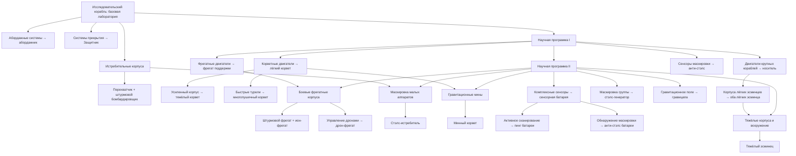

# Новокушане: состав и проект исследований v4

**Обновление21 октября:** инженерная научная фаза подготовлена и установлена. Актуальное конкретное дерево — [NOVOKUSHAN_RESEARCH_TREE.md](../NOVOKUSHAN_RESEARCH_TREE.md),57 платных работ, шесть модулей/одна очередь; цены — первая настройка для пробы. Добавлен VR-фрегат защитного поля nku_barricadefrigate. Исходные90000HP/HeavyArmour тяжёлого эсминца сохранены, исследования добавляют бонусы отдельно. Исторические предложения дерева и цен ниже заменены новым документом там, где расходятся. Первая научная версия упала при загрузке сенсорной батареи; [исправление установлено](../FLEET_PREVIEW.md). Проверки данных/моделей/моков/архива пройдены. Плазменные орудия теперь открывают бомбардировщик и штурмовой фрегат; улучшенные бомбы отдельно открывают обоим боеприпас против подсистем. RU/EN разделены; загрузку после исправления батареи Дмитрий подтвердил, новое обновление ещё не запускали.

Уточнение Дмитрия, 20 октября: **тяжёлый эсминец — 90000 HP, ArmourFamily HeavyArmour, как у линейных крейсеров HW2**. Цена 2800 и лимит 5 сохраняются. Разговорные сокращения списка развёрнуты в интерфейсные названия; алиасы сохранены в глоссарии.
20 октября 2026 года. **Приняты 28 проектов, лимиты, первая настройка истребителей/корветов/фрегатов; носитель 4000 RU, лёгкие эсминцы 1350/1500 RU, тяжёлый 2800 RU. Наука — кушанское кольцо с ускорением по HW2; носитель строит последовательно, в классическом охвате, без сверхтяжей и пока без контроллера. Сенсорная батарея имеет большой обзор, пинг и анти-стэлс открываются исследованиями. Дерево, оставшиеся цены и подробные характеристики ещё проектируются. Это спецификация, не реализация мода и не результат игрового теста.**

Общий справочник исходных рас: [NOVOKUSHAN.md](NOVOKUSHAN.md). Этот документ описывает именно новую расу, поэтому её названия могут отличаться от названий штатных Kushan.

Принято разделение науки двух рас: [Новокушанам — инженерные направления с киитами, Новотаииданам — классовые](NOVOKUSHAN_RESEARCH_MODULES.md). [Новотаиидане](NEOTAIIDAN_DESIGN.md) копируют общую балансную основу и получают дополнительную вызываемую исследовательскую станцию с производством до фрегатов; научная сборка у них сохраняется отдельно. Support Units ещё обсуждаются; действующие капы автоматически не заменяются.

## Принятые решения

- Истребители и три боевых корвета работают отрядами. **Минный корвет — одиночный**, как у хиигарян и вэйгров HW2.
- Основа юниткапа — хиигаряне **HW2 Classic**, с принятыми авторскими изменениями: крупные 15, лёгкие эсминцы 10, тяжёлые 5, генераторы 18, инженеры 20. Это уже не буквальная копия Classic Normal/SP.
- Лёгкий истребитель основан на кушанском разведчике, с устройством отряда по принципу Assault Craft Vaygr; перехватчик и бомбардировщик ориентируются на хиигарские аналоги Classic.
- Стэлс-истребитель пока использует кушанскую механику маскировки и боевые параметры перехватчика; дальнейшая специализация обсуждается отдельно.
- **Бывший тяжёлый крейсер называется тяжёлым эсминцем**, остаётся по боевому весу близок к эсминцу HW2. Штатный прототип `kus_heavycruiser` и его исходное EN Heavy Cruiser не переименовываются.
- Прежняя категория «Платформы» переработана: **Генераторы** содержат исследовательский корабль, стэлс-генератор, гравицапу и добавленную **сенсорную батарею**. Каждый тип ≤6, вместе ≤18. Защитники имеют отдельный пул: 4 аппарата в группе, ≤4 групп.
- Абордажный корвети и ремонтники вместе ≤20. Сборщик ресурсовов ≤20, переработчиков ≤4. Носителей ≤4.
- Носитель стоит **4000 RU**. Он последовательно строит исследованные проекты **в пределах классических возможностей носителя**: без сверхтяжей, включая эсминцы и другие носители; контроллер пока также только на Материнском. Прежняя трактовка «строит всё исследованное, включая эсминцы» снята. Сумма корпуса/двух модулей HW2 была только старым ориентиром цены.
- Лёгкий эсминец **1350 RU**, лёгкий ракетный **1500 RU**, как у кушан HW1 Classic; тяжёлый эсминец **2800 RU**. Время производства и характеристики уточняются отдельно.
- Исследовательские корабли собираются в **кольцо до шести секций**. **Одна общая очередь; секции открывают свои ветки** и вместе ускоряют текущее исследование по формуле HW2. Новокушанам приняты инженерные направления: шасси — Наабал, двигатели — Манаан, орудия — Собан, спецтех и гиперпространство — С’Джет, ИИ — Сомтаау, сенсоры — Пакту.
- Сенсорная батарея сразу даёт большой пассивный обзор; **пинг и обнаружение маскировки — два исследовательских открытия**. Отдельный вспомогательный Датчик приближения сохраняется.
- Две линии носителя «военная + мирная» пока только предмет технической разведки; в принятую последовательную схему они не включены.
- Технические ID и исходные EN/RAW сохраняются. Новое распределение категорий ещё не меняет штатные определения и установленную игру.

## Состав: 28 проектов

EN ниже — исходное название прототипа для сопоставления, не утверждённая английская подпись нового корабля. Для боевых значений HW2 имеются в виду Classic, а не одноимённый корпус Remastered.

| Категория | Принятое название RU | Исходный тип / EN | База и назначение |
|---|---|---|---|
| Истребители | Лёгкий истребитель | Scout · `kus_scout` | Кушанский разведчик; многочисленный быстрый отряд, ориентир Assault Craft Vaygr. |
| Истребители | Перехватчик | Interceptor · `kus_interceptor` | Кушанский корпус, боевой ориентир Hgn Interceptor. |
| Истребители | Штурмовой бомбардировщик | Attack Bomber · `kus_attackbomber` | Ориентир Hgn Bomber. |
| Истребители | Стэлс-истребитель | Cloaked Fighter · `kus_cloakedfighter` | Пока механика Kushan + параметры перехватчика. |
| Корветы | Лёгкий корвет | Light Corvette · `kus_lightcorvette` | Против истребителей. |
| Корветы | Тяжёлый корвет | Heavy Corvette · `kus_heavycorvette` | Против корветов. |
| Корветы | Многопушечный корвет | Multi-Gun Corvette · `kus_multiguncorvette` | Специализированное усиленное ПВО против истребителей. |
| Корветы | Минный корвет | Minelayer Corvette · `kus_minelayercorvette` | Против фрегатов, одиночный аппарат. |
| Фрегаты | Фрегат поддержки | Support Frigate · `kus_supportfrigate` | Штатная кушанская поддержка/ремонт; не VR CUT SupportFrigate. |
| Фрегаты | Штурмовой фрегат | Assault Frigate · `kus_assaultfrigate` | Корветы и фрегаты; общевойсковой корабль. |
| Фрегаты | Ионный фрегат | Ion Cannon Frigate · `kus_ioncannonfrigate` | Специализированный огонь по крупным целям. |
| Фрегаты | Дронный фрегат | Drone Frigate · `kus_dronefrigate` | Зональная защита от малых кораблей с зависимостью от носителя дронов. |
| Эсминцы | Лёгкий эсминец | Destroyer · `kus_destroyer` | Кушанская компоновка; промежуточный класс между фрегатами и эсминцем HW2. |
| Эсминцы | Лёгкий ракетный эсминец | Missile Destroyer · `kus_missiledestroyer` | Специализация против ударных аппаратов. |
| Эсминцы | Тяжёлый эсминец | Heavy Cruiser · `kus_heavycruiser` | Верхний боевой корпус расы, по весу эсминец HW2. |
| Носители | Кушанский носитель | Carrier · `kus_carrier` | 4000 RU; последовательная стройка в классическом охвате, без сверхтяжей и пока без контроллера. |
| Материнский корабль | Материнский корабль | Mothership · `kus_mothership` | Исходная кушанская основа. |
| Защитники | Защитник | Defender · `kus_defender` | Мобильное прикрытие, 4 аппарата в группе, максимум 4 группы. |
| Генераторы | Исследовательский корабль | Research Ship · `kus_researchship` | Кольцо до шести секций; ускорение общей очереди по HW2. |
| Генераторы | Генератор маскировки | Cloak Generator · `kus_cloakgenerator` | Маскировка группы, тип ≤6. |
| Генераторы | Генератор гравитационного поля | Gravwell Generator · `kus_gravwellgenerator` | Контроль ударных аппаратов, тип ≤6; параметры поля ещё настраиваются. |
| Генераторы | Сенсорная батарея | Sensors Array · `kus_sensorarray` | Тип ≤6; большой обзор сразу, пинг и анти-стэлс после исследований. |
| Инженерные корабли | Абордажный корвет | Salvage Corvette · `kus_salvagecorvette` | Кушанский захват/буксировка; отдельный управляемый аппарат. |
| Инженерные корабли | Ремонтный корвет | Repair Corvette · `kus_repaircorvette` | Ремонт; отдельный управляемый аппарат. |
| Вспомогательные | Сборщик ресурсов | Resource Collector · `kus_resourcecollector` | Добыча; не выдавать ремонт автоматически лишь потому, что он есть у аналога HW2. |
| Вспомогательные | Ресурсный контроллер | Resource Controller · `kus_resourcecontroller` | Кушанский ресурсный контроллер, приём ресурсов. |
| Вспомогательные | Разведывательный зонд | Probe · `kus_probe` | Разведывательный зонд. |
| Вспомогательные | Датчик приближения | Proximity Sensor · `kus_proximitysensor` | Обнаружение маскировки; не ECM-глушение. |

Верфь не добавлена. Сенсорная батарея использует кушанский SensorArray. Варианты ResearchShip_1…5 — секции принятого кольца, не пять дополнительных проектов. Все шесть секций учитываются в подлимите науки и общем пуле генераторов.

## Что используем из статьи

В [Taiidani pitch](https://www.moddb.com/members/amddred/blogs/pitch-homeworld-taiidani-mod) полезны размер отряда как параметр баланса, собственная ниша лёгкого истребителя, раздельные роли корветов, инженерные аппараты вне боевого корветного лимита, мобильные защитные средства и научные корабли как альтернатива модулям. Ещё один подходящий принцип — сравнивать старые крупные корабли с HW2 по боевому весу. Для Новокушан это отправная точка; новые проекты и переименования из статьи целиком не переносим. Дерево ниже — предложение для принятого состава с отдельной сверкой Classic.

## Проверенная база HW2 Classic

Локальные файлы Classic содержат Lua 4 bytecode. [Аудитор](../../tools/audit_hw2classic_balance.py) читает формат и восстанавливает только прямые таблицы, арифметику и записи вызовов. Он не запускает Lua VM, функции игры, OnInit или приложения. Неизвестные операции и управляющие переходы отвергаются. Сохранены пути и SHA256 источников: [hw2classic-baseline.json](../../local/novokushan/hw2classic-baseline.json).

| Штатный тип Classic | Корпусов в SquadronSize | Цена заказа, RU | buildTime | maxhealth одного корпуса |
|---|---:|---:|---:|---:|
| Hgn Scout | 3 | 350 | 20 | 30 |
| Hgn Interceptor | 5 | 500 | 35 | 30 |
| Hgn Bomber | 5 | 550 | 40 | 30 |
| Vgr Assault Craft | 7 | 500 | 35 | 30 |
| Hgn Gunship | 3 | 625 | 45 | 400 |
| Hgn Pulsar Gunship | 3 | 625 | 45 | 400 |
| Hgn Minelayer | **1** | 800 | 45 | 400 |
| Hgn Flak Frigate | 1 | 700 | 50 | 16000 |
| Hgn Ion Cannon Frigate | 1 | 700 | 45 | 16000 |
| Hgn Destroyer | 1 | 2000 | 165 | 85000 |
| Hgn Battlecruiser | 1 | 4000 | 280 | 240000 |
| Hgn Carrier | 1 | 2800 | 65 | 80000 |
| Hgn Resource Collector | 1 | 400 | 30 | 2000 |
| Hgn Mobile Refinery | 1 | 800 | 45 | 18000 |

Это исходные численные поля, без пересчёта сложности, апгрейдов и боевой эффективности. Отряд из нескольких аппаратов нельзя настраивать простым умножением всей его итоговой мощности на число корпусов.

### Юниткап: база и принятые изменения

| Категория / подлимит | Hgn Classic Normal | Новокушане |
|---|---:|---|
| Истребители | 14 отрядов | Все четыре типа делят 14. |
| Боевые корветы | 12 отрядов | Общие 12 юнитов. Лёгкий/тяжёлый/многопушечный — отряды, минный — одиночный; минных юнитов ≤5. |
| Фрегаты | 21 корпус | Общие 21. Сохранены предложенные подлимиты поддержки ≤4 и дрон-фрегатов ≤2. |
| Крупные корабли, общий | 13 | **15** на все эсминцы и носители вместе. |
| Лёгкие эсминцы | Destroyer ≤5 | **10 вместе** для обычных и ракетных лёгких эсминцев. |
| Тяжёлые эсминцы | Нет такого проекта | **5**; исходный кушанский Heavy Cruiser, по весу эсминец HW2. |
| Carrier | 4 | ≤4 носителей. |
| Генераторы | Нет такого отдельного пула | **18 вместе**, каждый из четырёх типов ≤6. |
| Защитники | В новой роли нет прямого аналога | **4 группы по 4 аппарата**, всего ≤16 аппаратов. Отдельный от генераторов/истребителей пул. |
| Вспомогательные | Utility ≤50 | Ресурсные и сенсорные подлимиты ниже; общий Utility 50 не должен дополнительно связывать их с инженерами/генераторами. |
| ResourceCollector / ResourceController | 20 / 4 | Сборщик ресурсов ≤20, переработчик ≤4. |
| Probe / ProximitySensor | 10 / 10 | Разведывательный зонд ≤10, анти-стэлс ≤10. |
| Инженеры | Нет отдельного штатного пула | **20 вместе** для абордажников и ремонтников; отдельный пул, не боевые корветы. |

**Singleplayer Classic отличается:** Battlecruiser ≤2, Normal ≤3. Это различие нельзя выдавать за одно универсальное число. Кап «Материнский корабль =1» — наше правило стартового состава, а не буквальное значение исходного UC_Family Mothership (в файлах оно 6).

Утверждён общий потолок 15 при подлимитах 10 лёгких, 5 тяжёлых и 4 носителя: все частные максимумы одновременно недоступны. Например, 4 носителя +5 тяжёлых оставляют место для 6 лёгких. Прежние варианты 5+3 и общего эсминцевого пула 5 сняты.

Прежний общий Platform 20 не накладывается поверх новых генераторных 18 и четырёх групп Защитников. Отдельные пулы — требование к последующей реализации, а не только названия вкладок.

## Отряды и первые ценовые ориентиры

Истребители, корветы и фрегаты согласованы в первом предложенном варианте с уточнёнными ролями и одиночным минным корветом. Цены носителя и всех эсминцев утверждены отдельно. Цены Защитников, инженеров, вспомогательных и генераторов пока остаются ориентиром для дальнейшей настройки.

| Тип Новокушан | Корпусов в юните | RU за юнит | Условие баланса / статус |
|---|---:|---:|---|
| Лёгкий истребитель | 5 | 450 | По уточнению Дмитрия — пять аппаратов; быстрее основного перехватчика, слабее в прямом бою. |
| Перехватчик | 5 | 500 | Ориентир Hgn Interceptor Classic. |
| Штурмовой бомбардировщик | 5 | 550 | Ориентир Hgn Bomber Classic. |
| Стэлс-истребитель | 5 | 700 | Те же базовые боевые показатели перехватчика, доплата и поздний доступ за маскировку. |
| Лёгкий корвет | 4 | 625 | Скорость и перехват; меньшая стойкость отдельного аппарата. |
| Тяжёлый корвет | 3 | 650 | Огонь против корветов. |
| Многопушечный корвет | 3 | 650 | Плотная ПВО, слабее против брони. |
| Минный корвет | **1** | 800 | Мины против фрегатов, как одиночный минный юнит HW2. |
| Фрегат поддержки / штурм-фрегат / ион-фрегат | 1 | 650 / 700 / 700 | Разные роли; цены за корпус. |
| Дронный фрегат | 1 | 1100 | Дроны — зависимая часть оружия носителя; не бесплатные самостоятельные отряды. |
| Лёгкий / лёгкий ракетный эсминец | 1 | **1350 / 1500** | Приняты цены Kushan HW1 Classic; исходные buildCost проверены в архиве установленной Classic. |
| Тяжёлый эсминец | 1 | **2800** | Цена принята. Уровень сильного эсминца; ориентир порядка 85–90 тысяч HP пока предложен, подробные статы не утверждены. |
| Кушанский носитель | 1 | **4000** | Принятая настройка, дальнейший тонкий баланс позже. |
| Защитник | **4** | 450 | Мобильный эскорт, отдельный лимит четырёх групп. Число аппаратов принято; цена пока предложена. |
| Абордажный корвет / ремонтник | 1 / 1 | 250 / 250 | Отдельные аппараты, не боевые корветные эскадрильи. |
| Сборщик ресурсов / переработчик / пробка / анти-стэлс | 1 | 400 / 800 / 150 / 250 | Экономический масштаб соответствующих Hgn Classic. |

Минный корвет теперь исключение из многокорпусного правила: прежний вариант отряда из трёх снят. Стэлс-истребитель сохраняет исходную кушанскую механику, базовые боевые параметры перехватчика и согласованный первый ценовой ориентир 700 RU.

### Основания цен носителя и эсминцев

В Classic `hgn_carrier.buildCost=2800`, у **Carrier**-модулей `hgn_c_production_fighter.costToBuild=500` и `hgn_c_production_frigate.costToBuild=1000`. Источники сохранены в статическом аудите (9 подсистем). Прежний ориентир **4300 RU** заменён прямым решением Дмитрия на **4000 RU**; это уже не точное равенство исходной сумме. Отдельно оплачивать эти два производства не нужно. Время постройки ещё предстоит выбрать.

Цены HW1 проверены непосредственно в локальном `Homeworld1Classic/Data/homeworld.big`: `r1/standarddestroyer.shp` → `buildCost 1350`, `r1/missiledestroyer.shp` → `buildCost 1500`. Это HW1 Classic, а не цены одноимённых корпусов HWRM. [Статический разбор](../../tools/audit_novokushan_mechanics.py) сохранил два исходных SHP и [свидетельства с путями/хешами](../../local/novokushan/mechanics-evidence.json). Игра не запускалась.

## Проект исследований

Приняты **кушанское кольцо до шести исследовательских кораблей**, инженерные направления с киитами и ускорение общей научной очереди по HW2. Прежняя цельная схема ниже — ранний проект конкретных работ, который надо переразложить по принятым секциям. Рабочее правило потерь: отсутствие всей научной инфраструктуры останавливает новые работы, полученные открытия сохраняются; поведение текущего задания ещё надо определить при реализации.

| Направление | Киит RU / EN |
|---|---|
| Модуль шасси | Наабал / Naabal |
| Модуль двигателей | Манаан / Manaan |
| Модуль орудий | Собан / Soban |
| Модуль спецтехнологий, включая гиперпространство | С’Джет / S’jet |
| Модуль ИИ | Сомтаау / Somtaaw |
| Модуль сенсоров | Пакту / Paktu |

Это принятое авторское распределение направлений. Английские имена киитов сверены с официальным описанием Revelations, ссылки и подробные ветки — в [общем документе науки](NOVOKUSHAN_RESEARCH_MODULES.md). Классовое разделение науки отдано отдельной расе Новотаиидан.

### Ускорение научного кольца

В локальном `HW2 Classic/scripts/tuning.lua` и штатном HWRM подтверждён `ResearchShipExponent = 0.5`. Формула **t = T / (n + 1)^0.5**, где T — исходное Time исследования, n — число действующих научных модулей, описана автором после собственных опытов в Classic: [Ten, «Технологии и модернизации Хиигарян»](https://www.homeworld3.ru/index.php?name=Pages&op=page&pid=95), [аналогичная проверка вэйгров](https://www.homeworld3.ru/index.php?name=Pages&op=page&pid=96). Локальные данные подтверждают показатель степени; полный закон с +1 здесь опирается на опубликованный эксперимент, не на наш запуск движка.

Для Новокушан принимаем одну действующую секцию за один модуль. Ноль секций означает отсутствие исследований, хотя формально выражение при n=0 определено. Если время удобнее задавать относительно первой секции, то **t(n) = t(1) × √(2 / (n + 1))**.

| Секций кольца | Время от исходного T | Скорость относительно одной секции |
|---|---:|---:|
| 1 | 70,7% | ×1,00 |
| 2 | 57,7% | ×1,22 |
| 3 | 50,0% | ×1,41 |
| 4 | 44,7% | ×1,58 |
| 5 | 40,8% | ×1,73 |
| 6 | 37,8% | ×1,87 |

В штатной основе Research Ship уже несёт скрытый `HW1_ResearchModule` с `isResearch=1`; сборку ведёт `kus_researchship.lua`. При реализации надо проверить учёт пристыкованных секций, исключить двойной счёт и проверить изменение скорости при потере секции. Число секций отвечает за скорость; предложенные программы I/II — за глубину дерева, их нельзя молча заменить требованием построить определённое число секций.

В [предложении базовой постройки для двух рас](NOVOKUSHAN_RESEARCH_MODULES.md#предложение-базовая-постройка-без-исследований) без исследований доступны лёгкий истребитель, ресурсер, переработчик, пробка, ремонтник и все шесть специализаций исследовательских секций. Это обсуждаемый строительный пакет, не согласованный стартовый флот миссии. Базовые лёгкое шасси, двигатель и кинетическое оружие предлагается считать уже известными, а перехватчик/бомбардировщик открывать дальнейшими работами. Ранняя роль лёгкого истребителя должна оставаться слабее полноценного Assault Craft.

Ионный фрегат и штурм-фрегат открываются одним боевым фрегатным исследованием. Лёгкий эсминец и его ракетный вариант — одним корпусным исследованием. Специализация выбирается строительством, а не двумя почти одинаковыми технологическими налогами. Генератор маскировки не является обязательным условием стэлс-истребителя: это две разные технологии маскировки.

Для сенсорной батареи приняты большой пассивный обзор и исследуемые пинг/анти-стэлс. Их расположение после «Комплексных сенсоров» на схеме — предложение; стоимость, время, дальность, длительность/перезарядка пинга и радиус обнаружения пока не назначены. Вспомогательный Датчик приближения сохраняет нишу дешёвого отдельного детектора. Штатные `prmSensorRange=12000`, `secSensorRange=17000` и уже включённый `SensorPing` — исходные данные HWRM, не готовая новая настройка: пинг потребуется закрыть исследованием.

Несколько входящих стрелок на схеме означают выполнение **всех** условий: например, боевым фрегатам нужны и фрегатные двигатели, и программа II; тяжёлым корпусам — лёгкие эсминцы и программа II.

### Как оценивать цену и время веток

Проверенные исходные инвестиции Hgn Classic: Fighter Facility **500/45**, Corvette Facility **800/60**, Frigate Facility **1000/65**, Capital Facility **1800/75**, Research Module **1500/75**, Advanced Research **2250/150** (RU/buildTime). DestroyerTech **1500/90**, GraviticAttractionMines **750/40**. Это ориентиры всей дороги к кораблю, не автоматически цена каждого узла нового дерева.

Для первого расчёта предлагается Research Ship **700 RU/45**, программа I **800 RU/30**: вместе они воспроизводят ресурсную инвестицию **1500 RU** базовой хиигарской науки. **45+30 — сумма исходных полей, не фактические 75 секунд пути**: программа уже ускоряется научной секцией. Программа II — отправная точка **2250/150**. Это предложенное разделение бюджета, не найденные параметры Kushan; у штатного HWRM Research Ship в текущих локальных файлах 600/50. После выбора кольца времена всей дороги надо пересчитать с общим законом ускорения; цена дополнительных секций тоже ещё не утверждена.

Корветные, фрегатные и крупные двигатели можно предварительно оценивать по соответствующим производственным модулям. Открытие лёгких эсминцев — по DestroyerTech. У дополнительных подветок пока не назначены окончательные цены: их надо складывать с исследовательским кораблём и научными программами, иначе ступень станет значительно дороже исходного пути HW2. Особенно это касается раннего перехватчика.

По носителю принято решение о готовом корпусе **4000 RU**, без повторной покупки двух производств из прежней ценовой формулы. Правило — **одна активная постройка корабля на носитель**, доступные проекты определяются исследованием **и** классическим охватом строителя. Сверхтяжи — все эсминцы и другие носители — только на Материнском. Контроллер пока также оставлен Материнскому, по уточнению Дмитрия. Остальные вспомогательные типы сверяем с классическим набором; исследование само не снимает ограничения строителя. Прежняя трактовка «всё исследованное, включая эсминцы» снята.

### Разведка: отдельные военная и мирная линии

В HWRM уже существует `setConcurrentBuildLimit(NewShipType,0,2)`; именно он стоит у штатных кушанских носителя и Материнского корабля. [Справочник API](https://github.com/HWRM/KarosGraveyard/wiki/Function%3B-setConcurrentBuildLimit) описывает число параллельных очередей ([доступное зеркало](https://github-wiki-see.page/m/HWRM/KarosGraveyard/wiki/Function%3B-setConcurrentBuildLimit)). Это подтверждает настройку общей параллельности; в самой сигнатуре нет списка классов, закрепляющего одну линию за военными, другую за мирными.

У хиигарян/вэйгров корабельные производства — условия доступа к семействам, а отдельные корабельная и подсистемная очереди обслуживают разные типы объектов: `Ship=0`, `SubSystem=1`. Мирный ресурсер остаётся кораблём; простое перенесение его в список SubSystem ещё не доказывает, что движок построит и выпустит обычный корабль. В интерфейсе найдены `shipQueueTitle`/`subsystemQueueTitle`, но отдельной штатной настройки «очередь военных / очередь мирных» в изученных данных не найдено.

**Вывод разведки:** два одновременных корабельных заказа поддерживаются настройкой; две линии с обязательным разделением по назначению пока не подтверждены. Возможные пути — отдельный контроллер заказов или второй производственный объект, но это отдельный прототип с проверкой оплаты, отмены, юниткапа, выпуска, ИИ и сохранений. Такое разделение не объявляется невозможным и не включается автоматически. Принятая база остаётся последовательной; при её реализации штатные кушанские две одновременные постройки потребуется явно изменить.

Штатный `kus_carrier.CanBuildShips` содержит Fighter/Corvette/Frigate/Resource/NonCombat, без SuperCap. Добавлять ему SuperCap не требуется и не планируется. При этом HWRM-контроллер относится к Resource_Kus и DockFamily SuperCap: для принятого исключения контроллера понадобится явный фильтр производства, а не вывод по одному имени семейства. Данные и номера строк сохранены в `local/novokushan/mechanics-evidence.json`; физический выпуск контроллера не проверялся.

### Улучшения характеристик

- В первом варианте — улучшения **по отдельным проектам**, как у хиигарян, с общей технологической базой. Открытие класса само по себе не повышает характеристики всех уже построенных кораблей.
- У истребителей начать со скорости: Classic Interceptor/Bomber имеют целевые множители **1.25 / 1.5**. Отдельную броню истребителей и общий множитель урона сначала не добавлять.
- Для корветов/фрегатов исходный ориентир HP **1.3 / 1.6**, скорости **1.2 / 1.35**. Это конечные уровни относительно базы; перемножение 1.3×1.6 было бы другой системой.
- Для тяжёлого эсминца брать масштаб улучшений эсминца HW2, согласно принятому боевому весу; не автоматически дорогие BC-улучшения.
- Стэлс, дроны, мины, сенсоры и абордаж — отдельные способности/открытия. Общая прибавка DPS не должна заменять проверку взаимодействия этих механик.

## Применение к кампании HWVR

Это полное дерево расы, а не приказ добавить платные исследования в исходные миссии. Для кампании сохраняются сценарные объявления, реальные моменты открытия и ограничения строительства. Готовая технология может быть выдана сценарием без повторной оплаты.

Ранние главы и T1 нельзя блокировать новым исследовательским кораблём: при адаптации соответствующая научная готовность/открытия должны быть уже выданы либо отдельно встроены в учебный сценарий. Это ещё требует миссионного решения, не утверждение о готовой выдаче.

Сюжетные Engineer Craft, Barricade Frigate и Ballistic Destroyer VR нельзя автоматически переименовать в один из новых проектов. Разделение инженера на абордажник/ремонтник затрагивает M4; отсутствующий в новом списке баррикадный фрегат — отдельный вопрос кампанийной адаптации. Штатный фрегат поддержки не получает защитное поле лишь из-за сходства старого VR-ID.

## Что осталось согласовать

1. **Исследования:** утвердить само дерево, программы I/II, цены и время; кольцо и закон ускорения уже выбраны. Определить правила текущего задания при потере науки.
2. **Производство:** время постройки и точный классический список вспомогательных кораблей носителя; цена 4000, последовательность, отсутствие сверхтяжей и текущее исключение контроллера уже выбраны. Разделение военной/мирной линий — отдельная необязательная разведка, не принятое изменение.
3. **Сенсорная батарея:** точные дальности, параметры пинга, цены/время двух открытий. Большой пассивный обзор и исследуемые пинг/анти-стэлс уже приняты.
4. **Настройка:** окончательные HP/DPS/скорости, поля, дистанции, ремонт/захват, цены оставшихся типов и время производства. У истребителей, корветов и фрегатов первая концепция уже принята; это не повод заново согласовывать их названия или размеры отрядов.
5. Отдельным этапом — кампанийные соответствия уникальным VR-кораблям и последовательность открытия технологий. Состав расы не переписывает автоматически сценарий HWVR.
6. **Наука двух рас и SU:** специализации уже выбраны — инженерные с киитами у Новокушан, классовые у Новотаиидан. Переразложить конкретные работы по секциям; решить, вводить ли Support Units поверх текущих капов или позднее вместо части из них. Очередь у каждой расы одна общая. [Общие правила](NOVOKUSHAN_RESEARCH_MODULES.md) сохранены отдельно; численные SU и новый запас пока не назначены.

Игра/лаунчер не запускались. Установленный пакет и игровые определения не менялись. Статический разбор исходных данных не является проверкой движка или доказательством сбалансированности предложения.

Уточнение интерфейса от 20 октября: тяжёлый эсминец использует эсминный тактический значок Parallelogram. Строительные вкладки штатные: Platform — Защитники, абордажный и ремонтный корветы; NonCombat — два генератора и сенсорная батарея. Капы по назначению остаются прежними. Построение по умолчанию — Batch_delta (можно задавать для каждого типа); новые UI-вкладки и иконки не добавлять.

Актуальное уточнение капов: Защитники входят в отдельную категорию **Платформы ≤4отряда**, не Fighter. Инженерные корветы сохраняются в строительной вкладке Platform, но учитываются по Engineers20. Подлимиты фрегатов поддержки/специальных фрегатов расположены сразу после Frigate21; подлимиты трёх генераторов — после общего Generators18. Числа подлимитов прежние.

Актуальная настройка истребителей по новой просьбе Дмитрия: лёгкие5/450RU/20HP/урон0.6; основные Перехватчики5/550RU/40HP/урон1.2. Числа HP/урона — первая проба, оценка с оговорками в FIGHTER_BALANCE.md. Лёгкий корвет600RU, четыре аппарата ромбом1+2+1. Защитники — Стена2x2. ТО платформ и инженерных корветов Hexagon, генераторов/батареи Diamond. Тяжёлый эсминец технически SmallCapitalShip и AvoidanceCapital как HW2Destroyer, штатный кап Destroyer5; лёгкие эсминцы имеют дополнительный пул10, общие Capital15.
