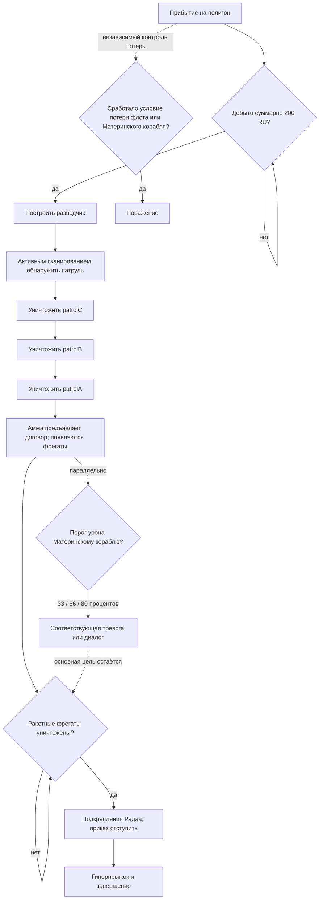

# M1. Испытательный полигон Хиигары — разбор миссии

21 октября: M1: девятнадцать реплик подключены через штатные Subtitle_Add/Subtitle_IsDone, отдельные PCM и портреты. Обновление установлено, но новый нативный просмотр ещё не пройден. Речь ролика вынесена из WebM; [реализация и ограничения](../CAMPAIGN_SPEECH.md).

Совместимость21 октября: в установленной исследовательской пробе Новокушан общие зависимости кораблей восстановлены, но в подготовленной копии M1 нужные разрешённым проектам технологии выдаются сценарно и бесплатно. Платная очередь в главе закрыта; диалоги/технологические объявления не переписаны. Регрессионная API-проверка ресурсов, разведки, патрулей, прорыва и побега пройдена; это не новый запуск HWRM. Подробности: [научная фаза](../NOVOKUSHAN_RESEARCH_TREE.md).

Живой рабочий документ, 18 октября 2026 года. Здесь три слоя: **что есть в оригинале**, **что подготовлено для HWRM**, **что ещё согласовать**. Подробности будем дополнять в этом же файле. Английский и новый русский стоят рядом; старый русский спрятан под репликой для сравнения. Технические имена сейчас не переименовываем.

Источник: полная Quest 1.1.0-16520, `level1` / `Assets/Hercules/Scenes/M1 - Hiigara Proving Grounds/M1_Hiigara Proving Grounds.unity`. Используемые английские строки этой миссии совпадают со Steam-демкой. Числа ниже взяты из Quest; отличие уже установленной мини-демки отмечено отдельно.

## Материалы и готовность

| Часть | Извлечено / подготовлено | Что остаётся |
|---|---|---|
| Загрузка | [Исходная картинка](<C:/Users/Dmitry/Documents/ChatGPT/Homeworld Vast Reaches/campaign-export/assets/loading/Mission_M1.png>), DDS рядом с `.level` | Проверить отображение движком |
| Говорящие головы | Исходные PNG, TGA и speech actors подключены | Проверить в M1; небольшое растяжение замечено в T1 |
| Звуки и диалоги | EN, новый RU, старый RU; PCM/Speech и 19 реплик подключены | Проверить очередь M1 в движке |
| Камеры и действия | Timeline-клипы и узлы графа, ID и связи | Постановка HWRM/NIS, замена VR-управления |
| Карта | [Подготовленная .level](<C:/Users/Dmitry/Documents/ChatGPT/Homeworld Vast Reaches/campaign-export/data/leveldata/campaign/VastReachesFull/M01_ProvingGrounds/M01_ProvingGrounds.level>), области и маршруты | Выбрать и адаптировать орбитальную сцену Хиигары HWRM |
| Наш флот и стройка | Составы, RU, whitelist, исходные открытия | Эскадрильи, зависимости HWRM и правила переноса флота |
| Враг / нейтралы | Стартовые размещения и отдельные отложенные шаблоны | Условия появления, повторы волн, поведение |

## Карта: переиспользуем HWRM по смыслу

Для этой главы выбираем готовое окружение Хиигары: первый кандидат — **HW2 Remastered, M02_Hiigara**, дополнительно можно сравнить орбиту Хиигары из финала HW1. Берём планету, фон и подходящие декорации; вражеский сценарий исходной миссии HWRM не копируем. Нужные VR-зоны обнаружения, маршруты и дистанции восстанавливаем под наши события. Готовая `.level` сейчас служит измерительной базой, а не обязательством перенести каждый астероид. Конкретное окружение ещё не заменено и требует визуальной сверки вместе.

## Наш стартовый флот, ресурсы и ограничения

Начальные параметры оригинала: **100 RU**, лимит **30 отрядов**, Carryover = **False**. False здесь означает заданный старт этой главы в источнике, а не запрет HWRM переносить флот вообще.

| Группа | Состав исходника | Отрядов / физических корпусов |
|---|---|---|
| `Group_M1_Default_1` (default_groups) | 3 отр. / 15 корп. × Перехватчик | 3 / 15 |
| `Group_M1_Default_2` (default_groups) | 1 отр. / 5 корп. × Перехватчик; 3 отр. / 15 корп. × Ударный бомбардировщик | 4 / 20 |
| `Group__RCx1` (default_groups) | 1 отр. / 1 корп. × Сборщик ресурсов | 1 / 1 |
| `Mothership` (scene auto) | 1 отр. / 1 корп. × Материнский корабль | 1 / 1 |

Итого baseline: **9 / 37**. Столбцы — отряды / корпуса, это разные числа.

| Разрешено строить в исходнике | RU | Время боя, с |
|---|---:|---:|
| Разведчик (`Build_Kus_Scout`) | 200 | 12 |
| Перехватчик (`Build_Kus_Interceptor`) | 500 | 20 |
| Ударный бомбардировщик (`Build_Kus_AttackBomber`) | 750 | 20 |
| Сборщик ресурсов (`Build_Kus_ResourceCollector`) | 600 | 15 |

Контроллер: **Whitelist (1)**. Перечисленные цены/время принадлежат VR, это ещё не выбранный баланс HWRM. Отдельной платной очереди исследований в этой главе не найдено. Разрешение строительства, учебная блокировка интерфейса и оплачиваемое исследование — разные вещи.

В M1 задача добычи **200 RU суммарно** не открывает новое исследование: четыре типа уже разрешены контроллером. Затем нужны постройка разведчика и обнаружение патруля. В установленной мини-демке старт пока **9 физических корпусов вместо 37**; в полном экспорте развёрнут исходный SquadronCount. Нативное число тел/эскадрилий ещё проверим движком.

## Говорящие головы и звук этой главы

| Говорящий | Исходный портрет | Ключей реплик / звуков |
|---|---|---|
| Гиитан Радаа | [PNG](<C:/Users/Dmitry/Documents/ChatGPT/Homeworld Vast Reaches/campaign-export/assets/portraits/Character_Giitan_Radaa.png>) | 5 / 5 |
| Амма Радаа | [PNG](<C:/Users/Dmitry/Documents/ChatGPT/Homeworld Vast Reaches/campaign-export/assets/portraits/Character_Amma_Radaa.png>) | 6 / 6 |
| Каран С’Джет | [PNG](<C:/Users/Dmitry/Documents/ChatGPT/Homeworld Vast Reaches/campaign-export/assets/portraits/Character_Karan_OutofTank.png>) | 9 / 9 |
| Разведка флота | [PNG](<C:/Users/Dmitry/Documents/ChatGPT/Homeworld Vast Reaches/campaign-export/assets/portraits/Character_FleetIntelligence.png>) | 17 / 17 |
| Тирра Собан | [PNG](<C:/Users/Dmitry/Documents/ChatGPT/Homeworld Vast Reaches/campaign-export/assets/portraits/Character_Tyrra.png>) | 8 / 8 |

Для каждого ключа ниже есть ссылка на WAV. Имена и суффиксы звуковых файлов не определяют говорящего: использована фактическая цепочка Character → DialogueLine → WwiseEvent → MediaRef. Это оригинальная английская озвучка; новый русский — текст субтитров.

## Схема событий: что последовательно, а что параллельно

Сплошные стрелки — основная цепочка, ромбы — условия. Пунктир — отдельный обработчик, который работает параллельно цепочке. Тревога от урона может прозвучать во время любой текущей задачи; она не означает, что следующая напечатанная реплика уже обязана начаться.

## Вражеские / дружеские появления

Ниже подключённые SpawnEntity, а не все шаблоны, лежащие на карте. Состав показан за одно срабатывание; PatrolManager может выбирать вариант и повторяться. Название редакторской группы — ориентир, реальные условия основного маршрута показаны в схеме и сценах диалога.

| Узел / группа редактора | Создаваемая цель | Состав и сторона источника |
|---|---|---|
| `88` / cutscene | `Pat_InfiltrationFrigPatrol1` → `` | Патруль, один вариант: Computer1: 1 отр. / 1 корп. × Фрегат проникновения Радаа; `level1:432` |
| `112` / HSG spawns | `Spawn_HyperspaceGate` → `` | Computer1: 1 отр. / 1 корп. × Гиперврата Радаа; `level1:446` |
| `158` / spawn scaries | `Frigate1` → `` | Computer1: 1 отр. / 1 корп. × Фрегат проникновения Радаа; `level1:469` |
| `158` / spawn scaries | `Frigate2` → `` | Computer1: 1 отр. / 1 корп. × Фрегат проникновения Радаа; `level1:490` |
| `158` / spawn scaries | `Frigate4` → `` | Computer1: 1 отр. / 1 корп. × Фрегат проникновения Радаа; `level1:473` |
| `158` / spawn scaries | `Frigate3` → `` | Computer1: 1 отр. / 1 корп. × Фрегат проникновения Радаа; `level1:467` |
| `158` / spawn scaries | `Group_EndShips` → `` | Computer1: 1 отр. / 1 корп. × Линейный крейсер Радаа; 2 отр. / 2 корп. × Штурмовой фрегат Радаа; 2 отр. / 2 корп. × Эсминец Радаа; 2 отр. / 10 корп. × Бомбардировщик Радаа; `level1:412` |
| `268` / HSG spawns | `Pat_Patrol1D` → `` | Патруль, один вариант: Computer1: 1 отр. / 1 корп. × Штурмовой фрегат Радаа; 2 отр. / 10 корп. × Бомбардировщик Радаа; `level1:420` |
| `292` / Build Scout, added bc of beta (HERC-4467) | `Group1C` → `` | Computer1: 1 отр. / 5 корп. × Штурмовик Радаа; `level1:468` |
| `302` / spawn patrol A (3) | `Pat_Patrol1A` → `` | Патруль, один вариант: Computer1: 3 отр. / 15 корп. × Штурмовик Радаа; `level1:537` |
| `318` / cutscene | `Pat_InfiltrationFrigPatrol2` → `` | Патруль, один вариант: Computer1: 1 отр. / 1 корп. × Фрегат проникновения Радаа; `level1:409` |
| `334` / spawn backup every 60 seconds | `Pat_Patrol1E` → `` | Патруль, один вариант: Computer1: 1 отр. / 1 корп. × Штурмовой фрегат Радаа; `level1:501` |
| `553` / cutscene | `Pat_InfiltrationFrigPatrol3` → `` | Патруль, один вариант: Computer1: 1 отр. / 1 корп. × Фрегат проникновения Радаа; `level1:461` |
| `581` / Build Scout | `Spawn_Shipyards` → `` | нейтральная/None: 1 отр. / 1 корп. × Верфь Радаа; `level1:442` |
| `605` / spawn patrol B (2) | `Pat_Patrol1B` → `` | Патруль, один вариант: Computer1: 2 отр. / 10 корп. × Штурмовик Радаа; `level1:405` |

Источник TeamId: **1 — игрок, 1024 — Радаа, 0 — нейтральный**, 2048 — дополнительная компьютерная сторона. Для тренировочных целей действуют свои ограничения активности/уязвимости. Количество автоматически размещённых исходных групп: 1.

## Камеры и действия

[Родное обучение HWRM и сопоставление с VR](../HWRM_NATIVE_TUTORIAL.md): подготовлены отдельные разборы трёх стандартных уроков, исходные реплики и голос. Отсюда берём проверенные упражнения с мышью/клавиатурой, сохраняя сюжетные разговоры VR.

В игровом графе VR нет готового NIS для HWRM. Управление восприятием/камерой часто задано режимом сенсоров и уроками контроллеров; вступление использует отдельную Unity Timeline. Ниже сохранены управляющие действия для адаптации, а не заявлено готовое движение камеры HWRM.

| Тип узла | ID | Дальнейшая адаптация |
|---|---|---|
| SetSensorsManagerDisplayMode | `56`, `122`, `168`, `182`, `244`, `304`, `407`, `427`, `437`, `467`, `535`, `557`, `583`, `617` | Режим сенсоров/фокус; подобрать штатную камеру HWRM. |
| BeginLesson | `369`, `изолированный`, `627`, `651` | Заменить VR-урок обучением камере, приказам и строительству HWRM. |
| WaitForLessonCompleted | `126`, `228`, `497` | Реальное условие завершения упражнения, не просто задержка. |
| HyperspaceWarp | `116` | Штатный/сценарный гиперпрыжок и переход. |
| ModifyHealth | `58`, `238`, `274`, `332`, `363` | Сюжетный урон; сохранить порог и причину. |
| SetMoveTarget | `375`, `660`, `662` | Приказ движения к нужной зоне. |
| SetAttackTarget | `377` | Приказ атаки нужной стороны. |

## Сцены и переводы

Общий пролог вынесен в [разбор T1](T01_Training.md). Здесь начинаем с прибытия на полигон.

### 1. Прибытие на полигон и сбор ресурсов

Основная цепочка начинается от `OnSimReady` (169). Флот приходит раньше Радаа. После диалога выдаётся задача добычи ресурсов.

**Тирра Собан** — `M01_020_003_TS`

**EN:** Hyperspace jump... successful.

**RU, новый:** Гиперпрыжок... выполнен успешно.

Старый русский перевод для сравнения

Гиперпространственный прыжок... успешен.

[Исходный звук](<C:/Users/Dmitry/Documents/ChatGPT/Homeworld Vast Reaches/campaign-export/assets/audio/wav/M01_020_003_TS.wav>)

*Quest PlayDialogue: 561.*

**Каран С’Джет** — `M01_020_005_KS`

**EN:** I knew you could do it.

**RU, новый:** Я знала, что ты справишься.

Старый русский перевод для сравнения

Я знал, что ты сможешь это сделать.

[Исходный звук](<C:/Users/Dmitry/Documents/ChatGPT/Homeworld Vast Reaches/campaign-export/assets/audio/wav/M01_020_005_KS.wav>)

*Quest PlayDialogue: 551.*

**Разведка флота** — `M01_020_010_FI`

**EN:** We are early for our rendezvous with the Radaa.

**RU, новый:** Мы прибыли к месту встречи раньше Радаа.

Старый русский перевод для сравнения

На встречу с Радой мы пришли рано.

[Исходный звук](<C:/Users/Dmitry/Documents/ChatGPT/Homeworld Vast Reaches/campaign-export/assets/audio/wav/M01_020_010_FI.wav>)

*Quest PlayDialogue: 413.*

**Тирра Собан** — `M01_020_020_TS`

**EN:** Let's not put the time to waste.  Scanning for Resources in our vicinity.

**RU, новый:** Не будем терять время. Сканирую окрестности в поисках ресурсов.

Старый русский перевод для сравнения

Давайте не будем тратить время попусту. Ищем ресурсы поблизости.

[Исходный звук](<C:/Users/Dmitry/Documents/ChatGPT/Homeworld Vast Reaches/campaign-export/assets/audio/wav/M01_020_020_TS.wav>)

*Quest PlayDialogue: 152.*

**Разведка флота** — `M01_020_030_FI`

**EN:** Acknowledged.  Command, this sector is rife with asteroids and rich dust clouds.

**RU, новый:** Принято. Командование, в этом секторе множество астероидов и богатых ресурсами пылевых облаков.

Старый русский перевод для сравнения

Признано. Командир, этот сектор изобилует астероидами и богатыми пылевыми облаками.

[Исходный звук](<C:/Users/Dmitry/Documents/ChatGPT/Homeworld Vast Reaches/campaign-export/assets/audio/wav/M01_020_030_FI.wav>)

*Quest PlayDialogue: 26.*

**Разведка флота** — `M01_020_035_FI`

**EN:** One of your Strike Groups contains Resource Collectors which can be used for harvesting. Initiate at will.

**RU, новый:** В одной из ваших ударных групп есть сборщики ресурсов. Можете отдавать приказ на добычу.

Старый русский перевод для сравнения

Нет строки в исходной таблице.

[Исходный звук](<C:/Users/Dmitry/Documents/ChatGPT/Homeworld Vast Reaches/campaign-export/assets/audio/wav/M01_020_035_FI.wav>)

*Quest PlayDialogue: 130.*

**Тирра Собан** — `M01_020_040_TS`

**EN:** Any objections, Commander Karan S'jet?

**RU, новый:** Есть возражения, командующая Каран С’Джет?

Старый русский перевод для сравнения

Есть возражения, командир Каран С'джет?

[Исходный звук](<C:/Users/Dmitry/Documents/ChatGPT/Homeworld Vast Reaches/campaign-export/assets/audio/wav/M01_020_040_TS.wav>)

*Quest PlayDialogue: 308.*

**Каран С’Джет** — `M01_020_050_KS`

**EN:** Former Commander.  Your ship, your orders, Commander Tyrra Soban.

**RU, новый:** Я уже не командую. Ваш корабль — ваши приказы, командующая Тирра Собан.

Старый русский перевод для сравнения

Бывший командир. Ваш корабль, ваши приказы, командир Тирра Собан.

[Исходный звук](<C:/Users/Dmitry/Documents/ChatGPT/Homeworld Vast Reaches/campaign-export/assets/audio/wav/M01_020_050_KS.wav>)

*Quest PlayDialogue: 421.*

**Задача** — `M01_Objective_00`

**EN:** Harvest RU from asteroids to a total of 200.

**RU, новый:** Добывайте ресурсы на астероидах, пока их запас не достигнет 200 ед.

Старый русский перевод для сравнения

Соберите RU с астероидов в общей сложности до 200.

### 2. Построить разведчик

Завершение ресурсной цели (`OnObjectiveCompleted`, 321) снимает её, выдаёт следующую и запускает короткое повторение тактической паузы/постройки.

**Разведка флота** — `M01_025_010_FI`

**EN:** Necessary Resources secured.  Continuing to gather Resources is important for Mothership systems health, and keeps our construction bays capable of building more ships.

**RU, новый:** Необходимые ресурсы собраны. Продолжайте добычу: ресурсы нужны для поддержания систем Материнского корабля и работы его кораблестроительных отсеков.

Старый русский перевод для сравнения

Нет строки в исходной таблице.

[Исходный звук](<C:/Users/Dmitry/Documents/ChatGPT/Homeworld Vast Reaches/campaign-export/assets/audio/wav/M01_025_010_FI.wav>)

*Quest PlayDialogue: 300.*

**Разведка флота** — `M01_025_020_FI`

**EN:** We now have the Resources to build a Scout unit so we can pinpoint the location of the Radaa.

**RU, новый:** Теперь у нас достаточно ресурсов, чтобы построить разведчик и точно определить местоположение Радаа.

Старый русский перевод для сравнения

Теперь у нас есть ресурсы для создания отряда разведчиков, чтобы мы могли точно определить местонахождение Радаа.

[Исходный звук](<C:/Users/Dmitry/Documents/ChatGPT/Homeworld Vast Reaches/campaign-export/assets/audio/wav/M01_025_020_FI.wav>)

*Quest PlayDialogue: 563.*

**Задача** — `M01_Objective_00a`

**EN:** Use your RU to Build a Scout.

**RU, новый:** Постройте разведчик на собранные ресурсы.

Старый русский перевод для сравнения

Используйте свой RU, чтобы построить разведчика.

### 3. Гиитан и поиск первого патруля

Завершение постройки разведчика (339) запускает появление верфей и разговор с Гиитаном. Первый патруль уже размещается сценарием; игрок должен обнаружить его активным сканированием разведчика.

**Гиитан Радаа** — `M01_030_010_GR`

**EN:** Greetings, Hiigaran Command, this is Radaa Admiral Giitan. Our Commander Amma relays her wishes for our long and fruitful partnership with the Hiigaran people.

**RU, новый:** Приветствую хиигарское командование. Говорит адмирал Гиитан Радаа. Наша Коммандер Амма передаёт свои пожелания долгого и плодотворного сотрудничества с народом Хиигары.

Старый русский перевод для сравнения

Приветствую вас, хиигарское командование, это адмирал Рада Гиитан. Наш командующий Амма желает нам долгого и плодотворного сотрудничества с народом Хиигаран.

[Исходный звук](<C:/Users/Dmitry/Documents/ChatGPT/Homeworld Vast Reaches/campaign-export/assets/audio/wav/M01_030_010_GR.wav>)

*Quest PlayDialogue: 547.*

**Гиитан Радаа** — `M01_030_015_GR`

**EN:** And now that pleasantries are out of the way, let us begin. I live for a good battle.

**RU, новый:** С любезностями покончено — приступим. Ничто не сравнится с хорошим боем.

Старый русский перевод для сравнения

Нет строки в исходной таблице.

[Исходный звук](<C:/Users/Dmitry/Documents/ChatGPT/Homeworld Vast Reaches/campaign-export/assets/audio/wav/M01_030_015_GR.wav>)

*Quest PlayDialogue: 176.*

**Тирра Собан** — `M01_030_020_TS`

**EN:** As do I.

**RU, новый:** Здесь мы с вами согласны.

Старый русский перевод для сравнения

Как и я.

[Исходный звук](<C:/Users/Dmitry/Documents/ChatGPT/Homeworld Vast Reaches/campaign-export/assets/audio/wav/M01_030_020_TS.wav>)

*Quest PlayDialogue: 429.*

**Разведка флота** — `M01_030_030_FI`

**EN:** Radaa craft signatures detected in this sector.

**RU, новый:** В секторе обнаружены сигнатуры кораблей Радаа.

Старый русский перевод для сравнения

В этом секторе обнаружены следы кораблей Радаа.

[Исходный звук](<C:/Users/Dmitry/Documents/ChatGPT/Homeworld Vast Reaches/campaign-export/assets/audio/wav/M01_030_030_FI.wav>)

*Quest PlayDialogue: 28.*

**Гиитан Радаа** — `M01_030_040_GR`

**EN:** I thought it best for our skirmish to involve live fire.  I've found it's the only way to truly learn.  Are we agreed?  Good.

**RU, новый:** Я решил, что для наших учений лучше использовать боевые снаряды. По моему опыту, только так и можно чему-то научиться. Вы согласны? Вот и прекрасно.

Старый русский перевод для сравнения

Я подумал, что для нашей стычки лучше всего вести боевую стрельбу. Я обнаружил, что это единственный способ по-настоящему учиться. Мы согласны? Хороший.

[Исходный звук](<C:/Users/Dmitry/Documents/ChatGPT/Homeworld Vast Reaches/campaign-export/assets/audio/wav/M01_030_040_GR.wav>)

*Quest PlayDialogue: 653.*

**Разведка флота** — `M01_030_050_FI`

**EN:** To gain precise coordinates on the Radaa craft, have your Scout perform reconnaissance with a Sensor Sweep.

**RU, новый:** Чтобы получить точные координаты кораблей Радаа, прикажите разведчику провести активное сканирование сенсорами.

Старый русский перевод для сравнения

Чтобы получить точные координаты корабля Радаа, попросите своего разведчика провести разведку с помощью сенсорного сканирования.

[Исходный звук](<C:/Users/Dmitry/Documents/ChatGPT/Homeworld Vast Reaches/campaign-export/assets/audio/wav/M01_030_050_FI.wav>)

*Quest PlayDialogue: 66.*

**Задача** — `M01_Objective_00b`

**EN:** Locate the Radaa patrol using Scout Sensor Sweep Ability.

**RU, новый:** Найдите патруль Радаа с помощью активного сканирования разведчика.

Старый русский перевод для сравнения

Найдите патруль Радаа, используя способность «Разведчик-сенсор».

### 4. Первый учебный бой

После выполнения задачи обнаружения (110) выдаётся задача уничтожить первый патруль. Внутреннее имя этого патруля — `patrolC`; буквы тегов не отражают порядок встречи.

**Разведка флота** — `M01_035_010_FI`

**EN:** The first Radaa skirmish group has been detected.

**RU, новый:** Первая учебная группа Радаа обнаружена.

Старый русский перевод для сравнения

Обнаружена первая боевая группа Радаа.

[Исходный звук](<C:/Users/Dmitry/Documents/ChatGPT/Homeworld Vast Reaches/campaign-export/assets/audio/wav/M01_035_010_FI.wav>)

*Quest PlayDialogue: 477.*

**Каран С’Джет** — `M01_035_020_KS`

**EN:** This is it, Fleet Command.  Take them on with one of your combat Strike Groups.

**RU, новый:** Пора, Командование флота. Вступайте в бой одной из ваших ударных групп.

Старый русский перевод для сравнения

Вот оно, командование флота. Сразитесь с ними с помощью одной из своих боевых ударных групп.

[Исходный звук](<C:/Users/Dmitry/Documents/ChatGPT/Homeworld Vast Reaches/campaign-export/assets/audio/wav/M01_035_020_KS.wav>)

*Quest PlayDialogue: 240.*

**Задача** — `M01_Objective_01`

**EN:** Destroy the first Radaa patrol.

**RU, новый:** Уничтожьте первый патруль Радаа.

Старый русский перевод для сравнения

Уничтожьте первый патруль Радаа.

### 5. Второй патруль

Уничтожение `patrolC` (419) создаёт `patrolB`, меняет цель и запускает этот диалог.

**Разведка флота** — `M01_040_010_FI`

**EN:** Second Radaa patrol signature detected.

**RU, новый:** Обнаружена сигнатура второго патруля Радаа.

Старый русский перевод для сравнения

Обнаружена вторая подпись патруля Радаа.

[Исходный звук](<C:/Users/Dmitry/Documents/ChatGPT/Homeworld Vast Reaches/campaign-export/assets/audio/wav/M01_040_010_FI.wav>)

*Quest PlayDialogue: 433.*

**Каран С’Джет** — `M01_040_020_KS`

**EN:** Do you see their position in the Sensors Manager?

**RU, новый:** Видишь их положение на карте сенсоров?

Старый русский перевод для сравнения

Вы видите их положение в Менеджере датчиков?

[Исходный звук](<C:/Users/Dmitry/Documents/ChatGPT/Homeworld Vast Reaches/campaign-export/assets/audio/wav/M01_040_020_KS.wav>)

*Quest PlayDialogue: 521.*

**Тирра Собан** — `M01_040_030_TS`

**EN:** I see it all.

**RU, новый:** Я вижу всё.

Старый русский перевод для сравнения

Я все это вижу.

[Исходный звук](<C:/Users/Dmitry/Documents/ChatGPT/Homeworld Vast Reaches/campaign-export/assets/audio/wav/M01_040_030_TS.wav>)

*Quest PlayDialogue: 543.*

**Задача** — `M01_Objective_01b`

**EN:** Destroy the second Radaa patrol.

**RU, новый:** Уничтожьте второй патруль Радаа.

Старый русский перевод для сравнения

Уничтожьте второй патруль Радаа.

### 6. Третий патруль

Уничтожение `patrolB` (139) создаёт `patrolA` и следующую цель. Это последний этап совместных учений.

**Разведка флота** — `M01_050_010_FI`

**EN:** Final Radaa skirmish initiated.

**RU, новый:** Начат последний учебный бой с Радаа.

Старый русский перевод для сравнения

Началась последняя стычка в Раде.

[Исходный звук](<C:/Users/Dmitry/Documents/ChatGPT/Homeworld Vast Reaches/campaign-export/assets/audio/wav/M01_050_010_FI.wav>)

*Quest PlayDialogue: 597.*

**Каран С’Джет** — `M01_050_020_KS`

**EN:** Intelligence reports say the Radaa utilize very high level technology, but I haven't seen anything remarkable yet.

**RU, новый:** По данным разведки, Радаа владеют весьма передовыми технологиями. Но пока я не увидела ничего особенного.

Старый русский перевод для сравнения

В отчетах разведки говорится, что Рада использует технологии очень высокого уровня, но я пока не видел ничего примечательного.

[Исходный звук](<C:/Users/Dmitry/Documents/ChatGPT/Homeworld Vast Reaches/campaign-export/assets/audio/wav/M01_050_020_KS.wav>)

*Quest PlayDialogue: 188.*

**Задача** — `M01_Objective_01c`

**EN:** Destroy the third Radaa patrol.

**RU, новый:** Уничтожьте третий патруль Радаа.

Старый русский перевод для сравнения

Уничтожьте третий патруль Радаа.

### 7. Амма предъявляет договор TR-3

Уничтожение `patrolA` (415) снимает учебную цель. Амма предъявляет претензии, рядом с Материнским кораблём появляются враждебные фрегаты. Разговор идёт в указанном порядке, включая два разных ключа с номером 085. Затем выставляются обе боевые задачи.

**Амма Радаа** — `M01_060_010_AR`

**EN:** Hiigaran command, I am Amma, Commander of the Radaa Fleet. I am declaring Taiidani agreement TR-3 in effect.

**RU, новый:** Хиигарское командование, я Амма, командующая флотом Радаа. Объявляю о вступлении в силу таииданского договора TR-3.

Старый русский перевод для сравнения

Хиигарский командующий, я Амма, командующий флотом Радаа. Я объявляю Тайданское соглашение ТР-3 вступившим в силу.

[Исходный звук](<C:/Users/Dmitry/Documents/ChatGPT/Homeworld Vast Reaches/campaign-export/assets/audio/wav/M01_060_010_AR.wav>)

*Quest PlayDialogue: 489.*

**Тирра Собан** — `M01_060_020_TS`

**EN:** What? What agreement?

**RU, новый:** Что? Какого ещё договора?

Старый русский перевод для сравнения

Что? Какое соглашение?

[Исходный звук](<C:/Users/Dmitry/Documents/ChatGPT/Homeworld Vast Reaches/campaign-export/assets/audio/wav/M01_060_020_TS.wav>)

*Quest PlayDialogue: 346.*

**Амма Радаа** — `M01_060_030_AR`

**EN:** In return for a considerable investment from us, the Taiidani Emperor agreed to share all technology related to a Hyperspace Core.

**RU, новый:** В обмен на наши значительные вложения таииданский император согласился передать нам все технологии, связанные с гиперпространственным ядром.

Старый русский перевод для сравнения

В обмен на значительные инвестиции с нашей стороны Тайиданский император согласился поделиться всеми технологиями, связанными с гиперпространственным ядром.

[Исходный звук](<C:/Users/Dmitry/Documents/ChatGPT/Homeworld Vast Reaches/campaign-export/assets/audio/wav/M01_060_030_AR.wav>)

*Quest PlayDialogue: 529.*

**Каран С’Джет** — `M01_060_040_KS`

**EN:** We made no such agreement!

**RU, новый:** Мы не заключали такого договора!

Старый русский перевод для сравнения

Мы не заключали такого соглашения!

[Исходный звук](<C:/Users/Dmitry/Documents/ChatGPT/Homeworld Vast Reaches/campaign-export/assets/audio/wav/M01_060_040_KS.wav>)

*Quest PlayDialogue: 208.*

**Амма Радаа** — `M01_060_050_AR`

**EN:** When the Taiidan Empire fell, you inherited the planet Hiigara and all legal agreements pertaining to it.

**RU, новый:** После падения Таииданской империи вы унаследовали планету Хиигара вместе со всеми связанными с ней договорными обязательствами.

Старый русский перевод для сравнения

Когда Империя Тайдан пала, вы унаследовали планету Хиигара и все юридические соглашения, относящиеся к ней.

[Исходный звук](<C:/Users/Dmitry/Documents/ChatGPT/Homeworld Vast Reaches/campaign-export/assets/audio/wav/M01_060_050_AR.wav>)

*Quest PlayDialogue: 146.*

**Амма Радаа** — `M01_060_055_AR`

**EN:** You are bound by that agreement to relinquish your Hyperspace Core or face default. Thank you for your cooperation.

**RU, новый:** По условиям договора вы обязаны передать нам гиперпространственное ядро. Иначе это будет признано неисполнением обязательств. Благодарю за содействие.

Старый русский перевод для сравнения

Нет строки в исходной таблице.

[Исходный звук](<C:/Users/Dmitry/Documents/ChatGPT/Homeworld Vast Reaches/campaign-export/assets/audio/wav/M01_060_055_AR.wav>)

*Quest PlayDialogue: 409.*

**Разведка флота** — `M01_060_060_FI`

**EN:** Radaa Frigates have jumped in near the Mothership.

**RU, новый:** Фрегаты Радаа вышли из гиперпространства рядом с Материнским кораблём.

Старый русский перевод для сравнения

Фрегаты Радаа высадились возле Материнского корабля.

[Исходный звук](<C:/Users/Dmitry/Documents/ChatGPT/Homeworld Vast Reaches/campaign-export/assets/audio/wav/M01_060_060_FI.wav>)

*Quest PlayDialogue: 294.*

**Каран С’Джет** — `M01_060_070_KS`

**EN:** Scanning Radaa Frigates...They are a Beta class threat, the could do us great harm. They are not joking.

**RU, новый:** Сканирую фрегаты Радаа... Угроза класса «бета». Они способны причинить нам серьёзный ущерб. Это не блеф.

Старый русский перевод для сравнения

Сканирование фрегатов Радаа... Они представляют угрозу класса Бета и могут причинить нам большой вред. Они не шутят.

[Исходный звук](<C:/Users/Dmitry/Documents/ChatGPT/Homeworld Vast Reaches/campaign-export/assets/audio/wav/M01_060_070_KS.wav>)

*Quest PlayDialogue: 242.*

**Амма Радаа** — `M01_060_080_AR`

**EN:** Your governing body has not complied in the given time period and is in default.

**RU, новый:** Ваше правительство не выполнило требования в отведённый срок и тем самым нарушило договор.

Старый русский перевод для сравнения

Ваш руководящий орган не выполнил обязательства в течение заданного периода времени и находится в состоянии дефолта.

[Исходный звук](<C:/Users/Dmitry/Documents/ChatGPT/Homeworld Vast Reaches/campaign-export/assets/audio/wav/M01_060_080_AR.wav>)

*Quest PlayDialogue: 306.*

**Амма Радаа** — `M01_060_085_AR`

**EN:** Though we anticipated this result we wish to assure you we are only taking what is legally ours.

**RU, новый:** Мы предвидели такой исход, но заверяем вас: мы намерены забрать лишь то, что принадлежит нам по закону.

Старый русский перевод для сравнения

Нет строки в исходной таблице.

[Исходный звук](<C:/Users/Dmitry/Documents/ChatGPT/Homeworld Vast Reaches/campaign-export/assets/audio/wav/M01_060_085_AR.wav>)

*Quest PlayDialogue: 633.*

**Гиитан Радаа** — `M01_060_085_GR`

**EN:** Time to cooperate and stand down.

**RU, новый:** Пора проявить благоразумие. Прекратите сопротивление.

Старый русский перевод для сравнения

Время сотрудничать и отступать.

[Исходный звук](<C:/Users/Dmitry/Documents/ChatGPT/Homeworld Vast Reaches/campaign-export/assets/audio/wav/M01_060_085_GR.wav>)

*Quest PlayDialogue: 539.*

**Тирра Собан** — `M01_060_090_TS`

**EN:** I've got your cooperation right here.  Fleet to battle positions!

**RU, новый:** Вот вам наше содействие. Флот, к бою!

Старый русский перевод для сравнения

У меня есть ваше сотрудничество прямо здесь. Флот на боевые позиции!

[Исходный звук](<C:/Users/Dmitry/Documents/ChatGPT/Homeworld Vast Reaches/campaign-export/assets/audio/wav/M01_060_090_TS.wav>)

*Quest PlayDialogue: 224.*

**Задача** — `M01_Objective_02b`

**EN:** Destroy the Radaa Missile Frigates.

**RU, новый:** Уничтожьте ракетные фрегаты Радаа.

Старый русский перевод для сравнения

Уничтожьте ракетные фрегаты Радаа.

**Задача** — `M01_Objective_02`

**EN:** Defend the Mothership from the Radaa.

**RU, новый:** Защитите Материнский корабль от Радаа.

Старый русский перевод для сравнения

Защитите корабль-носитель от Рады.

### 8. Успех: прорыв и отступление

Выполнение задачи уничтожения ракетных фрегатов (74) снимает обе цели. Скрипт создаёт дополнительные вражеские корабли, даёт разговор об отступлении, запускает общий гиперпрыжок и завершает миссию. Победа здесь — уйти с повреждённым Материнским кораблём.

**Разведка флота** — `M01_070_010_FI`

**EN:** Radaa Frigates neutralized but the Mothership has sustained significant damage.  Additional Radaa units incoming.

**RU, новый:** Фрегаты Радаа нейтрализованы, но Материнский корабль получил серьёзные повреждения. Приближаются новые силы Радаа.

Старый русский перевод для сравнения

Фрегаты Радаа нейтрализованы, но корабль-носитель получил значительные повреждения. Прибывают дополнительные подразделения Радаа.

[Исходный звук](<C:/Users/Dmitry/Documents/ChatGPT/Homeworld Vast Reaches/campaign-export/assets/audio/wav/M01_070_010_FI.wav>)

*Quest PlayDialogue: 507.*

**Каран С’Джет** — `M01_070_020_KS`

**EN:** Tyrra, there's too many. I know the Mothership won't take much more of this. You have to jump us out of here.

**RU, новый:** Тирра, их слишком много. Материнский корабль долго не продержится — я это знаю. Уводи нас отсюда прыжком.

Старый русский перевод для сравнения

Тирра, их слишком много. Я знаю, что Материнский корабль не выдержит большего. Ты должен вытащить нас отсюда.

[Исходный звук](<C:/Users/Dmitry/Documents/ChatGPT/Homeworld Vast Reaches/campaign-export/assets/audio/wav/M01_070_020_KS.wav>)

*Quest PlayDialogue: 393.*

**Тирра Собан** — `M01_070_030_TS`

**EN:** That is my decision Karan S'jet... but you are not wrong. We need an isolated location to regroup. Jumping the Mothership and fleet now.

**RU, новый:** Решать мне, Каран С’Джет... Но ты права. Нам нужно уединённое место для перегруппировки. Увожу Материнский корабль и флот в гиперпространство.

Старый русский перевод для сравнения

Это мое решение, Каран С'жет... но ты не ошибаешься. Нам нужно изолированное место, чтобы перегруппироваться. Прыгаем с корабля-носителя и флота прямо сейчас.

[Исходный звук](<C:/Users/Dmitry/Documents/ChatGPT/Homeworld Vast Reaches/campaign-export/assets/audio/wav/M01_070_030_TS.wav>)

*Quest PlayDialogue: 601.*

### Условные реплики: повреждение Материнского корабля

Это отдельные обработчики `33DMG`, `66DMG`, `80DMG`. Они зависят от состояния корабля и не обязаны прозвучать между соседними абзацами основной цепочки. Урон в финале также подталкивается сценарием по таймерам.

**Разведка флота** — `M01_130_010_FI`

**EN:** Mothership damage nearing critical levels.

**RU, новый:** Повреждения Материнского корабля приближаются к критическому уровню.

Старый русский перевод для сравнения

Повреждения корабля-носителя приближаются к критическому уровню.

[Исходный звук](<C:/Users/Dmitry/Documents/ChatGPT/Homeworld Vast Reaches/campaign-export/assets/audio/wav/M01_130_010_FI.wav>)

*Quest PlayDialogue: 613.*

**Каран С’Джет** — `M01_130_020_KS`

**EN:** They'll take the Mothership if we can't end this fast.

**RU, новый:** Если мы не покончим с этим немедленно, они захватят Материнский корабль.

Старый русский перевод для сравнения

Они захватят Материнский Корабль, если мы не сможем покончить с этим так быстро.

[Исходный звук](<C:/Users/Dmitry/Documents/ChatGPT/Homeworld Vast Reaches/campaign-export/assets/audio/wav/M01_130_020_KS.wav>)

*Quest PlayDialogue: 284.*

**Разведка флота** — `M01_120_010_FI`

**EN:** Damage to the Mothership from the hull breach is substantial, our situation is urgent.

**RU, новый:** Пробоина в обшивке привела к тяжёлым повреждениям Материнского корабля. Требуются срочные меры.

Старый русский перевод для сравнения

Повреждения материнского корабля из-за пробоины в корпусе значительны, наша ситуация неотложная.

[Исходный звук](<C:/Users/Dmitry/Documents/ChatGPT/Homeworld Vast Reaches/campaign-export/assets/audio/wav/M01_120_010_FI.wav>)

*Quest PlayDialogue: 425.*

**Разведка флота** — `M01_110_010_FI`

**EN:** The Radaa Missile Frigates are capable of breaching the hull of the Mothership.

**RU, новый:** Ракетные фрегаты Радаа способны пробить обшивку Материнского корабля.

Старый русский перевод для сравнения

Ракетные фрегаты Радаа способны пробить корпус корабля-матери.

[Исходный звук](<C:/Users/Dmitry/Documents/ChatGPT/Homeworld Vast Reaches/campaign-export/assets/audio/wav/M01_110_010_FI.wav>)

*Quest PlayDialogue: 178.*

### Условные реплики: поражение

Разные ветки потерь. `M01_080_010_GR` относится к раннему исчерпанию сил; `M01_090_010_FI` — к потерям в финальном бою; `M01_100_010_FI` — к слишком тяжёлому повреждению Материнского корабля. Эти реплики не являются продолжением успешного финала.

**Гиитан Радаа** — `M01_080_010_GR`

**EN:** The Skirmish is won.  Our victory, your loss.  You will need to do better.

**RU, новый:** Бой окончен. Мы победили, вы проиграли. В следующий раз постарайтесь лучше.

Старый русский перевод для сравнения

Схватка выиграна. Наша победа, твоя потеря. Вам нужно будет добиться большего.

[Исходный звук](<C:/Users/Dmitry/Documents/ChatGPT/Homeworld Vast Reaches/campaign-export/assets/audio/wav/M01_080_010_GR.wav>)

*Quest PlayDialogue: 344.*

**Разведка флота** — `M01_090_010_FI`

**EN:** Catastrophic losses reported.  Hiigaran fleet has been eliminated.

**RU, новый:** Катастрофические потери. Хиигарский флот уничтожен.

Старый русский перевод для сравнения

Сообщается о катастрофических потерях. Хиигаранский флот уничтожен.

[Исходный звук](<C:/Users/Dmitry/Documents/ChatGPT/Homeworld Vast Reaches/campaign-export/assets/audio/wav/M01_090_010_FI.wav>)

*Quest PlayDialogue: 276.*

**Разведка флота** — `M01_100_010_FI`

**EN:** Mothership has sustained massive damages. I repeat: Mothership incapacitated, Radaa forces will capture it.

**RU, новый:** Материнский корабль получил тяжелейшие повреждения. Повторяю: корабль выведен из строя. Радаа захватят его.

Старый русский перевод для сравнения

Корабль-носитель понес огромные повреждения. Повторяю: корабль-носитель выведен из строя, силы Рада захватят его.

[Исходный звук](<C:/Users/Dmitry/Documents/ChatGPT/Homeworld Vast Reaches/campaign-export/assets/audio/wav/M01_100_010_FI.wav>)

*Quest PlayDialogue: 381.*

## Следующие решения и журнал

- [x] Новый RU и EN вынесены в отдельный файл миссии; старый RU оставлен для сверки.
- [x] Гиитан и Тварь приведены к принятой терминологии в новом переводе.
- [x] Составы и появления отделены от стартового флота; добавлена схема условий.
- [ ] Дмитрий сверяет реплики и глоссарий; фиксируем правки здесь.
- [ ] Утвердить окружение Хиигары из HWRM и нужные области сценария.
- [ ] Проверить эскадрильи, RU, стройку, камеры и все реальные условия движком.
- [ ] Подключить WAV-речь/портреты и проверить темп диалога.
- [ ] Зафиксировать правила перехода и переноса флота. В оригинале T1/M1 имеют заданные старты; переносить всё автоматически поверх них нельзя.

Полные источники и оставшиеся обработчики: [QUEST_PROGRESSION.md](../QUEST_PROGRESSION.md), [CAMPAIGN_EXPORT_SCRIPTS.md](../CAMPAIGN_EXPORT_SCRIPTS.md), `campaign-export/manifests/placements.json`. Проверка игры в этом заходе не выполнялась.
