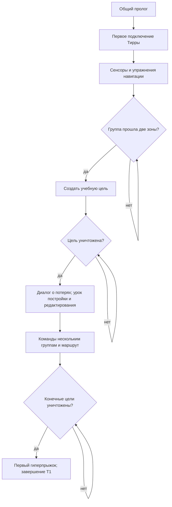

# M0. Обучение / Tutorial — разбор миссии

<!-- translation-sync:start -->
Актуальный перевод: сверка 21 октября 2026. [Что уже исправлено](../TRANSLATION_REVIEW.md). Блоки «Старый русский» и архив RAW сохраняют исходный перевод для сравнения.
<!-- translation-sync:end -->

Правки после просмотра 21 октября: название M0, согласованные формулировки пролога и «Коммандер Амма», фон Хиигары `ez16` из финала HW1RM, музыка `N01_R1Opening` из первого облёта HW1RM, новый облёт нашего Материнского корабля на время первого разговора. Вместо трёх одиночных перехватчиков подготовлены три полных отряда лёгких истребителей; каждый должен использовать buildBatch5 совмещённого мода. Физический состав в новой сцене ещё нужно проверить в игре. Установка отложена до окончания текущего просмотра; внутренний ID T01_Training сохранён.

21 октября: Дмитрий подтвердил в игре пролог, диалоги и портреты версии edc5b391…. Четыре реплики первого подключения Тирры/Каран используют штатные Subtitle_Add/Subtitle_IsDone и отдельные PCM. Портреты слегка растянуты; косметическую правку откладываем. Далее пользователь читает обучение и даёт замечания по изменениям. Полное прохождение T1 ещё не подтверждено; [реализация и ограничения](../CAMPAIGN_SPEECH.md).

Совместимость21 октября: в установленной исследовательской пробе Новокушан общие зависимости кораблей восстановлены, но в подготовленной копии T1 нужные разрешённым проектам технологии выдаются сценарно и бесплатно. Платная очередь в главе закрыта; диалоги/технологические объявления не переписаны. Регрессионная API-проверка движения, первого боя, дополнительной постройки и завершения пройдена; это не новый запуск HWRM. Подробности: [научная фаза](../NOVOKUSHAN_RESEARCH_TREE.md).

Живой рабочий документ, 18 октября 2026 года. Здесь три слоя: **что есть в оригинале**, **что подготовлено для HWRM**, **что ещё согласовать**. Подробности будем дополнять в этом же файле. Английский и новый русский стоят рядом; старый русский спрятан под репликой для сравнения. Технические имена сейчас не переименовываем.

Источник: полная Quest 1.1.0-16520, `level23` / `Assets/Hercules/Scenes/Tutorials/T1_CoreControls.unity`. Используемые английские строки этой миссии совпадают со Steam-демкой. Числа ниже взяты из Quest; отличие уже установленной мини-демки отмечено отдельно.

## Материалы и готовность

21 октября: [пролог](../reference/PROLOGUE_SOURCES.md) установлен перед T1; повтор восьми вступительных строк убран. После исправления упаковки RU/EN восстановлены меню, после переноса речи из WebM пользователь подтвердил пролог, диалоги и портреты. Пропуск ролика отдельно не подтверждён; [статус и ограничения](../CAMPAIGN_SPEECH.md). В предыдущем нативном T1 журнал показал неудачные Player_GrantResearchOption для NKR_FighterChassis/NKR_FighterDrive и отсутствующие UCS9902002/9902003; это отдельные замечания проверки миссии.

| Часть | Извлечено / подготовлено | Что остаётся |
|---|---|---|
| Загрузка | [Исходная картинка](<C:/Users/Dmitry/Documents/ChatGPT/Homeworld Vast Reaches/campaign-export/assets/loading/Mission_T1.png>), DDS рядом с `.level` | Проверить отображение движком |
| Говорящие головы | Исходные PNG, TGA и speech actors; показ в начале T1 подтверждён | Позже исправить небольшое растяжение |
| Звуки и диалоги | EN, новый RU, старый RU; PCM/Speech и диалоги начала T1 подтверждены в игре | Проверить всю очередь при полном прохождении |
| Камеры и действия | Исходные Timeline/граф; для мини-кампании подготовлен облёт во время первого разговора | Проверить ракурсы в HWRM, затем адаптировать остальные уроки |
| Карта | Геометрия исходных зон сохранена; в новой мини-сборке подготовлен фон `ez16` | Проверить вид Хиигары в HWRM после установки |
| Наш флот и стройка | Составы, RU, whitelist, исходные открытия | Эскадрильи, зависимости HWRM и правила переноса флота |
| Враг / нейтралы | Стартовые размещения и отдельные отложенные шаблоны | Условия появления, повторы волн, поведение |

## Карта: переиспользуем HWRM по смыслу

По просьбе Дмитрия выбран фон Хиигары из **HW1 Remastered, Mission16**: `loadBackground("ez16")`. В подготовленной мини-сборке применены и его настройки без тумана/блика с чёрной тенью; геометрия наших учебных зон и расстояния сохранены. Оригинальные вражеские флоты и сценарий финала HW1 не подключаются. `ez16` уже есть в загружаемом HWBackgrounds.big. Полный исследовательский экспорт остаётся исходной измерительной базой; новое окружение мини-кампании ещё предстоит сверить в игре.

В исходных записях сцены VR T1 не найдено отдельной привязки музыки; отдельный пролог содержит собственные музыкальные дорожки, которые сохранены. Для первого разговора после пролога подготовлен **N01_R1Opening** из `HW1Campaign.big/nis/n01r1.script`, с исходными конечными WAV/Lua из MusicHW1Campaign.big. Он включается первым игровым тиком, после видео. Уровень общей пользовательской громкости не меняется. Восемь последовательных камер образуют облёт нашего Материнского корабля; после `Subtitle_IsDone` последней реплики камера возвращается к учебному виду и больше не перехватывается. Это новая постановка по образцу HW1, без копирования его стройлесов/реплик и NIS-событий.

## Наш стартовый флот, ресурсы и ограничения

Начальные параметры оригинала: **5000 RU**, лимит **30 отрядов**, Carryover = **False**. False здесь означает заданный старт этой главы в источнике, а не запрет HWRM переносить флот вообще.

| Группа | Состав исходника | Отрядов / физических корпусов |
|---|---|---|
| `Mothership` (scene auto) | 1 отр. / 1 корп. × Материнский корабль | 1 / 1 |

Итого baseline: **1 / 1**. Столбцы — отряды / корпуса, это разные числа.

| Разрешено строить в исходнике | RU | Время боя, с |
|---|---:|---:|
| Перехватчик (`Build_Kus_Interceptor`) | 500 | 20 |

Контроллер: **Whitelist (1)**. Перечисленные цены/время принадлежат VR, это ещё не выбранный баланс HWRM. Отдельной платной очереди исследований в этой главе не найдено. Разрешение строительства, учебная блокировка интерфейса и оплачиваемое исследование — разные вещи.

В исходном T1 строится только перехватчик. Сценарий выдаёт ещё **1000 RU** во время урока тактической паузы. Два появления учебных StrikeGroupA/B дают по три отряда перехватчиков — по **15 физических корпусов**. Это не стартовый флот. Подтверждённая установленная edc5b391… использует сокращённое упражнение и заранее размещённые одиночные Kushan; полный экспорт T1 начинает с одного Материнского корабля, как исходник. Новая подготовленная M0 по просьбе пользователя заменяет три стартовые записи на полные отряды `kus_scout`: запрос размера0 использует buildBatch5 совмещённого мода. Ожидаются три отряда по пять лёгких истребителей; физические корпуса надо пересчитать в игре. Урок дополнительной постройки и бесплатные разрешения переключены на тот же тип.

## Говорящие головы и звук этой главы

| Говорящий | Исходный портрет | Ключей реплик / звуков |
|---|---|---|
| Рассказчик | В источнике портрета нет | 8 / 8 |
| Разведка флота | [PNG](<C:/Users/Dmitry/Documents/ChatGPT/Homeworld Vast Reaches/campaign-export/assets/portraits/Character_FleetIntelligence.png>) | 18 / 18 |
| Тирра Собан | [PNG](<C:/Users/Dmitry/Documents/ChatGPT/Homeworld Vast Reaches/campaign-export/assets/portraits/Character_Tyrra.png>) | 9 / 9 |
| Каран С’Джет | [PNG](<C:/Users/Dmitry/Documents/ChatGPT/Homeworld Vast Reaches/campaign-export/assets/portraits/Character_Karan_OutofTank.png>) | 11 / 11 |

Для каждого ключа ниже есть ссылка на WAV. Имена и суффиксы звуковых файлов не определяют говорящего: использована фактическая цепочка Character → DialogueLine → WwiseEvent → MediaRef. Это оригинальная английская озвучка; новый русский — текст субтитров.

## Схема событий: что последовательно, а что параллельно

Сплошные стрелки — основная цепочка, ромбы — условия. Пунктир — отдельный обработчик, который работает параллельно цепочке. Тревога от урона может прозвучать во время любой текущей задачи; она не означает, что следующая напечатанная реплика уже обязана начаться.

## Вражеские / дружеские появления

Ниже подключённые SpawnEntity, а не все шаблоны, лежащие на карте. Состав показан за одно срабатывание; PatrolManager может выбирать вариант и повторяться. Название редакторской группы — ориентир, реальные условия основного маршрута показаны в схеме и сценах диалога.

| Узел / группа редактора | Создаваемая цель | Состав и сторона источника |
|---|---|---|
| `147` / waypoint move attack | `PatrolFinal` → `` | Computer1: 3 отр. / 15 корп. × Бомбардировщик Радаа; `level23:318` |
| `163` / Select Ships | `PlaterSGA` → `` | игрок: 3 отр. / 15 корп. × Перехватчик; `level23:330` |
| `187` / Command Palette Select | `PlayerSGB` → `` | игрок: 3 отр. / 15 корп. × Перехватчик; `level23:284` |
| `453` / Attack | `EnemySpawn1` → `` | Computer1: 1 отр. / 5 корп. × Бомбардировщик Радаа; `level23:271` |
| `718` / waypoint move attack | `PatrolGunPlatform` → `` | Computer1: 1 отр. / 1 корп. × Орудийная платформа; `level23:260` |

Источник TeamId: **1 — игрок, 1024 — Радаа, 0 — нейтральный**, 2048 — дополнительная компьютерная сторона. Для тренировочных целей действуют свои ограничения активности/уязвимости. Количество автоматически размещённых исходных групп: 1.

## Камеры и действия

[Родное обучение HWRM и сопоставление с VR](../HWRM_NATIVE_TUTORIAL.md): подготовлены отдельные разборы трёх стандартных уроков, исходные реплики и голос. Отсюда берём проверенные упражнения с мышью/клавиатурой, сохраняя сюжетные разговоры VR.

В игровом графе VR нет готового NIS для HWRM. Управление восприятием/камерой часто задано режимом сенсоров и уроками контроллеров; вступление использует отдельную Unity Timeline. Ниже сохранены управляющие действия для адаптации, а не заявлено готовое движение камеры HWRM.

| Тип узла | ID | Дальнейшая адаптация |
|---|---|---|
| SetSensorsManagerDisplayMode | `63`, `809` | Режим сенсоров/фокус; подобрать штатную камеру HWRM. |
| BeginLesson | `49`, `85`, `155`, `197`, `282`, `356`, `401`, `413`, `477`, `527`, `543`, `565`, `609`, `615`, `651`, `691`, `724`, `744`, `754`, `766`, `818` | Заменить VR-урок обучением камере, приказам и строительству HWRM. |
| WaitForLessonCompleted | `59`, `71`, `115`, `165`, `201`, `209`, `211`, `245`, `348`, `431`, `473`, `577`, `631`, `637`, `661`, `687`, `705`, `730`, `756`, `780`, `788` | Реальное условие завершения упражнения, не просто задержка. |
| HyperspaceWarp | `183` | Штатный/сценарный гиперпрыжок и переход. |
| LockControls | `117`, `133`, `207`, `469` | Ограничение управления во время постановки. |
| UnlockControls | `87`, `603`, `697` | Вернуть управление. |

## Сцены и переводы

### Пролог — перед обучением

Общий сюжетный пролог теперь показан здесь один раз; в M1 он повторно не печатается.

*Timeline: 1.28 с, длительность клипа 4.56 с.*

**Рассказчик** — `M01_010_010_A_HA`

**EN:** After a long exile, we Hiigarans at last welcomed peace in our home.

**RU, новый:** После долгих лет изгнания мы, хиигаряне, наконец обрели мир на родной планете.

Старый русский перевод для сравнения

После долгого изгнания мы, хиигарцы, наконец-то обрели мир в нашем доме.

[Исходный звук](<C:/Users/Dmitry/Documents/ChatGPT/Homeworld Vast Reaches/campaign-export/assets/audio/wav/M01_010_010_A_HA.wav>)

*Timeline: 7.60 с, длительность клипа 21.41 с.*

**Рассказчик** — `M01_010_020_A_HA`

**EN:** Our great Mothership, with Karan S'jet fused as its Commander, Navigator and living core, allowed our people to carve a fiery path from exile to home and freedom. Now the Mothership rests in orbit around Hiigara, a tribute to those times and the great generation that sacrificed everything to find and claim our Homeworld.

**RU, новый:** Наш великий Материнский корабль, с которым Каран С’Джет слилась воедино, став его командиром, навигатором и живым ядром, позволил нашему народу проложить огненный путь из изгнания к дому и свободе. Теперь он покоится на орбите Хиигары — памятник той эпохе и великому поколению, пожертвовавшему всем, чтобы найти и вернуть наш родной мир.

Старый русский перевод для сравнения

Наш великий корабль-матка, в котором Каран С'джет стал его командиром, навигатором и живым ядром, позволил нашему народу проложить огненный путь от изгнания к дому и свободе. Сейчас Корабль-носитель находится на орбите Хиигары, это дань тем временам и великому поколению, которое пожертвовало всем, чтобы найти и завоевать наш Родной мир.

[Исходный звук](<C:/Users/Dmitry/Documents/ChatGPT/Homeworld Vast Reaches/campaign-export/assets/audio/wav/M01_010_020_A_HA.wav>)

*Timeline: 30.07 с, длительность клипа 22.03 с.*

**Рассказчик** — `M01_010_030_A_HA`

**EN:** Though the Taiidani empire had fallen, the new Hiigarans were caught off guard by the short but deadly BeastWar. The Daiamid, the ruling council of the Hiigaran people, were painfully aware that they were alone in the Galaxy. So when the Radaa - interstellar traders with their own mysterious technology - approached with offers of an alliance and exchange, the Daiamid was very receptive.

**RU, новый:** Таииданская империя пала, но хиигарян, едва вернувшихся домой, застала врасплох короткая и смертоносная война с Тварью. Дайамид, правящий совет Хиигары, болезненно осознавал, насколько хиигаряне одиноки в Галактике. Поэтому предложение Радаа — межзвёздных торговцев, владевших собственными загадочными технологиями, — заключить союз и наладить обмен встретило самый тёплый приём.

<!-- approved-line:M01_010_030_A_HA -->
*Внесена правка пользователя · 21 октября 2026*

Старый русский перевод для сравнения

Хотя империя Тайидани пала, новые хиигарцы были застигнуты врасплох короткой, но смертоносной Звериной Войной. Дайамиды, правящий совет народа Хиигаран, с болью осознавали, что они одни в Галактике. Поэтому, когда Радаа — межзвездные торговцы со своими таинственными технологиями — обратились с предложениями союза и обмена, Дайамиды были очень восприимчивы.

[Исходный звук](<C:/Users/Dmitry/Documents/ChatGPT/Homeworld Vast Reaches/campaign-export/assets/audio/wav/M01_010_030_A_HA.wav>)

*Timeline: 53.08 с, длительность клипа 23.52 с.*

**Рассказчик** — `M01_010_040_A_HA`

**EN:** The Radaa believed that the longer we were at peace, the more vulnerable we became. Their leader, Commander Amma, warned that former Taiidani bandit kingdoms were re-arming and a new Empire was a real possibility.  In exchange for permission to build and mine in the Hiigaran star system, Commander Amma offered to shepherd the Hiigaran Fleet through a new era of modernization and growth.

**RU, новый:** Радаа считали, что долгий мир делает нас всё уязвимее. Их предводительница, Коммандер Амма, предупреждала: осколки Таииданской империи, превратившиеся во владения военных вождей, снова вооружаются, и возникновение новой империи вполне возможно. В обмен на разрешение строить и добывать ресурсы в системе Хиигары Коммандер Амма предложила помочь нашему флоту вступить в новую эпоху развития и перевооружения.

<!-- approved-line:M01_010_040_A_HA -->
*Внесена правка пользователя · 21 октября 2026*

Старый русский перевод для сравнения

Рада считала, что чем дольше мы живем в мире, тем более уязвимыми мы становимся. Их лидер, командующий Амма, предупредил, что бывшие бандитские королевства Тайидани перевооружаются и существует реальная возможность создания новой Империи. В обмен на разрешение на строительство и добычу полезных ископаемых в звездной системе Хиигаран командующий Амма предложил вести флот Хиигаран в новую эпоху модернизации и роста.

[Исходный звук](<C:/Users/Dmitry/Documents/ChatGPT/Homeworld Vast Reaches/campaign-export/assets/audio/wav/M01_010_040_A_HA.wav>)

*Timeline: 79.07 с, длительность клипа 13.18 с.*

**Рассказчик** — `M01_010_050_A_HA`

**EN:** So we began to forge a new military force with our new allies.  We also pulled the original Mothership out of retirement and built her back up.  The Radaa were very interested in the Ship that had defeated the Taiidani Empire.

**RU, новый:** Вместе с новыми союзниками мы начали создавать новую военную силу. Мы также вернули в строй и восстановили первый Материнский корабль. Радаа проявляли особый интерес к кораблю, сокрушившему Таииданскую империю.

Старый русский перевод для сравнения

Итак, мы начали создавать новую военную силу вместе с нашими новыми союзниками. Мы также вывели из эксплуатации оригинальный Mothership и восстановили его. Рада очень интересовалась Кораблём, победившим Империю Тайидани.

[Исходный звук](<C:/Users/Dmitry/Documents/ChatGPT/Homeworld Vast Reaches/campaign-export/assets/audio/wav/M01_010_050_A_HA.wav>)

*Timeline: 93.98 с, длительность клипа 14.88 с.*

**Рассказчик** — `M01_010_060_A_HA`

**EN:** Karan S'jet retired years ago, but she was still the only being that had learned to control the Mothership by direct link to its Progenitor core. She agreed to return to the Mothership project but this time only as an instructor. She had earned her peace.

**RU, новый:** Каран С’Джет давно отошла от дел, но по-прежнему оставалась единственной, кто научился управлять Материнским кораблём через прямую связь с его ядром Предтеч. Она согласилась вернуться к работе над кораблём, но на этот раз лишь в качестве наставницы. Право на покой она заслужила.

Старый русский перевод для сравнения

Каран С'джет ушла на пенсию много лет назад, но она все еще была единственным существом, которое научилось управлять Кораблём-матерью посредством прямой связи с ядром его Прародителя. Она согласилась вернуться в проект Mothership, но на этот раз только в качестве инструктора. Она заслужила покой.

[Исходный звук](<C:/Users/Dmitry/Documents/ChatGPT/Homeworld Vast Reaches/campaign-export/assets/audio/wav/M01_010_060_A_HA.wav>)

*Timeline: 110.72 с, длительность клипа 10.79 с.*

**Рассказчик** — `M01_010_070_A_HA`

**EN:** The role of Fleet Command fell to Tyrra Soban. A peerless military veteran, she had fought countless battles in the splintering remains of the Taiidani empire, and had broken up dozens of Raider groups.

**RU, новый:** Роль Командующего Флотом переняла Тирра Собан. Закалённый в боях ветеран, она прошла через множество битв в разваливающейся Таииданской Империи и разгромила десятки банд рейдеров.

<!-- approved-line:M01_010_070_A_HA -->
*Внесена правка пользователя · 21 октября 2026*

Старый русский перевод для сравнения

Роль командования флотом выпала на долю Тирры Собан. Бесподобный военный ветеран, она участвовала в бесчисленных битвах на развалинах империи Тайидани и разбила десятки групп рейдеров.

[Исходный звук](<C:/Users/Dmitry/Documents/ChatGPT/Homeworld Vast Reaches/campaign-export/assets/audio/wav/M01_010_070_A_HA.wav>)

*Timeline: 122.95 с, длительность клипа 18.82 с.*

**Рассказчик** — `M01_010_080_A_HA`

**EN:** To take command of the Mothership and the Fleet, she underwent the same process that Karan S'jet had decades before. She was a trained warrior and that would make it clear to anyone that the Mothership was now a warship, pure and direct.Tyrra Soban was only the second of our people to become unbound.

**RU, новый:** Чтобы принять командование Материнским кораблём и флотом, Тирра прошла ту же процедуру, что и Каран С’Джет за несколько десятилетий до неё. Она была опытным бойцом, и всем было понятно, что Материнский Корабль теперь — боевое судно без всяких оговорок. Тирра Собан стала второй Освобождённой среди нашего народа.

<!-- approved-line:M01_010_080_A_HA -->
*Внесена правка пользователя · 21 октября 2026*

Старый русский перевод для сравнения

Чтобы принять на себя командование Кораблем-носителем и Флотом, она прошла тот же процесс, что и Каран С'джет несколько десятилетий назад. Она была обученным воином, и это дало бы понять любому, что «Корабль-носитель» теперь стал военным кораблем, чистым и прямым. Тирра Собан была лишь второй из наших людей, которая освободилась от уз.

[Исходный звук](<C:/Users/Dmitry/Documents/ChatGPT/Homeworld Vast Reaches/campaign-export/assets/audio/wav/M01_010_080_A_HA.wav>)

### 1. Первое подключение Тирры

После готовности симуляции (`OnSimReady`, узел 764) проходит пять секунд. Тирра впервые ощущает себя частью Материнского корабля. Каран присутствует как наставник.

**Тирра Собан** — `T01_010_010_TS`

**EN:** Command... on-line...

**RU, новый:** Командование... на связи...

Старый русский перевод для сравнения

Команда... онлайн...

[Исходный звук](<C:/Users/Dmitry/Documents/ChatGPT/Homeworld Vast Reaches/campaign-export/assets/audio/wav/T01_010_010_TS.wav>)

*Quest PlayDialogue: 259.*

**Каран С’Джет** — `T01_010_020_KS`

**EN:** It's ok, Fleet Command... Being fused with the Mothership takes getting used to.  Remember your training...flow with the ship, don't grasp at the data.  

**RU, новый:** Всё хорошо, Командование флота... К слиянию с Материнским кораблём нужно привыкнуть. Вспомни обучение... Доверься кораблю, не цепляйся за каждый поток данных.

Старый русский перевод для сравнения

Все в порядке, командование флотом... К слиянию с Материнским кораблем нужно привыкнуть. Помните о своих тренировках... двигайтесь вместе с кораблем, не цепляйтесь за данные.

[Исходный звук](<C:/Users/Dmitry/Documents/ChatGPT/Homeworld Vast Reaches/campaign-export/assets/audio/wav/T01_010_020_KS.wav>)

*Quest PlayDialogue: 567.*

**Тирра Собан** — `T01_010_030_TS`

**EN:** You're coming in clear, Karan.  But I can hear everything at the same time...it's amazing!

**RU, новый:** Тебя хорошо слышно, Каран. Но я слышу всё сразу... Невероятно!

Старый русский перевод для сравнения

Ты понимаешь, Каран. Но я слышу все одновременно... это потрясающе!

[Исходный звук](<C:/Users/Dmitry/Documents/ChatGPT/Homeworld Vast Reaches/campaign-export/assets/audio/wav/T01_010_030_TS.wav>)

*Quest PlayDialogue: 405.*

**Каран С’Джет** — `T01_010_040_KS`

**EN:** Fleet Intelligence will take you through some exercises now Commander.  But I'm here and you can call on me as well.  

**RU, новый:** Сейчас Разведка флота проведёт с тобой несколько упражнений, командующая. Но я рядом — можешь обращаться и ко мне.

Старый русский перевод для сравнения

Разведка флота проведет вас через несколько учений, командир. Но я здесь, и ты тоже можешь позвонить мне.

[Исходный звук](<C:/Users/Dmitry/Documents/ChatGPT/Homeworld Vast Reaches/campaign-export/assets/audio/wav/T01_010_040_KS.wav>)

*Quest PlayDialogue: 409.*

### 2. Сенсоры и восприятие

Событие `IntroFinished` запускает объяснение сенсоров. Продолжение ждёт завершения урока открытия Sensors Manager. Появляется общая цель обучения.

**Разведка флота** — `T01_020_010_FI`

**EN:** Fleet Intelligence Officer on-line. My task is to collate information, analyze sensor data and provide objectives.  

**RU, новый:** Офицер Разведки флота на связи. Моя задача — собирать информацию, анализировать данные сенсоров и ставить задачи.

Старый русский перевод для сравнения

Офицер разведки флота на связи. Моя задача — сопоставить информацию, проанализировать данные датчиков и поставить цели.

[Исходный звук](<C:/Users/Dmitry/Documents/ChatGPT/Homeworld Vast Reaches/campaign-export/assets/audio/wav/T01_020_010_FI.wav>)

*Quest PlayDialogue: 515.*

**Разведка флота** — `T01_020_020_FI`

**EN:** First I will guide you through systems tests.  Open the Sensors Manager now.

**RU, новый:** Для начала я проведу проверку систем. Откройте карту сенсоров.

Старый русский перевод для сравнения

Сначала я проведу вас через системные тесты. Откройте диспетчер датчиков сейчас.

[Исходный звук](<C:/Users/Dmitry/Documents/ChatGPT/Homeworld Vast Reaches/campaign-export/assets/audio/wav/T01_020_020_FI.wav>)

*Quest PlayDialogue: 798.*

**Разведка флота** — `T01_020_030_FI`

**EN:** The Sensors Manager shows you a map of your local environment, including the heart of command operations, the Mothership.

**RU, новый:** Карта сенсоров показывает окружающее пространство, включая центр управления операциями — Материнский корабль.

Старый русский перевод для сравнения

Менеджер датчиков показывает вам карту вашего местного окружения, включая центр командования — материнский корабль.

[Исходный звук](<C:/Users/Dmitry/Documents/ChatGPT/Homeworld Vast Reaches/campaign-export/assets/audio/wav/T01_020_030_FI.wav>)

*Quest PlayDialogue: 231.*

**Разведка флота** — `T01_020_040_FI`

**EN:** Current mission objectives are also displayed prominently in your sensors manager.

**RU, новый:** Текущие задачи миссии также отмечены на карте сенсоров.

Старый русский перевод для сравнения

Текущие цели миссии также отображаются на видном месте в вашем диспетчере датчиков.

[Исходный звук](<C:/Users/Dmitry/Documents/ChatGPT/Homeworld Vast Reaches/campaign-export/assets/audio/wav/T01_020_040_FI.wav>)

*Quest PlayDialogue: 728.*

**Тирра Собан** — `T01_020_050_TS`

**EN:** Understood...attempting to refocus.

**RU, новый:** Понятно... Пытаюсь сосредоточиться.

Старый русский перевод для сравнения

Понятно... пытаюсь перефокусироваться.

[Исходный звук](<C:/Users/Dmitry/Documents/ChatGPT/Homeworld Vast Reaches/campaign-export/assets/audio/wav/T01_020_050_TS.wav>)

*Quest PlayDialogue: 657.*

**Каран С’Джет** — `T01_020_060_KS`

**EN:** Commander, let go.  Right now, self is your enemy.  

**RU, новый:** Командующая, расслабься. Сейчас тебе мешает собственное «я».

Старый русский перевод для сравнения

Командир, отпусти. Прямо сейчас «я» — ваш враг.

[Исходный звук](<C:/Users/Dmitry/Documents/ChatGPT/Homeworld Vast Reaches/campaign-export/assets/audio/wav/T01_020_060_KS.wav>)

*Quest PlayDialogue: 397.*

**Задача** — `MT01_Objective_02`

**EN:** Complete each exercise of the training regimen.

**RU, новый:** Выполните все упражнения учебной программы.

Старый русский перевод для сравнения

Выполняйте каждое упражнение тренировочного режима.

### 3. Навигация в VR

После `SensorsFinished` идут перемещение точки обзора, вращение и масштаб, полёт стиком, пошаговый поворот, телепортация и её отмена. Это управление камерой/присутствием игрока, а не новая способность корабля. Последняя ветка вызывает `MovementFinished`.

**Разведка флота** — `T01_030_010_FI`

**EN:** Our next test is of your navigation systems, to help you gain tactical awareness around the Mothership.  First we will try moving around your environment. 

**RU, новый:** Теперь проверим навигацию, чтобы вы освоились в пространстве вокруг Материнского корабля. Начнём с перемещения точки обзора.

Старый русский перевод для сравнения

Наше следующее испытание — ваши навигационные системы, которые помогут вам получить тактическую осведомленность о Материнском корабле. Сначала мы попробуем передвигаться по вашему окружению.

[Исходный звук](<C:/Users/Dmitry/Documents/ChatGPT/Homeworld Vast Reaches/campaign-export/assets/audio/wav/T01_030_010_FI.wav>)

*Quest PlayDialogue: 137.*

**Разведка флота** — `T01_030_017_FI`

**EN:** You can move your view of the world using several methods.

**RU, новый:** Перемещать точку обзора можно несколькими способами.

Старый русский перевод для сравнения

Изменить свой взгляд на мир можно несколькими способами.

[Исходный звук](<C:/Users/Dmitry/Documents/ChatGPT/Homeworld Vast Reaches/campaign-export/assets/audio/wav/T01_030_017_FI.wav>)

*Quest PlayDialogue: 306.*

**Разведка флота** — `T01_030_013_FI`

**EN:** You can also zoom your view in and out.

**RU, новый:** Вы также можете приближать и отдалять изображение.

Старый русский перевод для сравнения

Вы также можете увеличивать и уменьшать масштаб изображения.

[Исходный звук](<C:/Users/Dmitry/Documents/ChatGPT/Homeworld Vast Reaches/campaign-export/assets/audio/wav/T01_030_013_FI.wav>)

*Quest PlayDialogue: 135, 145.*

**Разведка флота** — `T01_030_020_FI`

**EN:** You can teleport your viewpoint and instantly move it anywhere within range.

**RU, новый:** Вы можете телепортировать точку обзора, мгновенно перемещаясь в любое доступное место.

Старый русский перевод для сравнения

Вы можете телепортировать свою точку обзора и мгновенно переместить ее в любое место в пределах досягаемости.

[Исходный звук](<C:/Users/Dmitry/Documents/ChatGPT/Homeworld Vast Reaches/campaign-export/assets/audio/wav/T01_030_020_FI.wav>)

*Quest PlayDialogue: 585.*

**Тирра Собан** — `T01_030_040_TS`

**EN:** This is stunning! I have spent years staring into tactical screens but never like this.

**RU, новый:** Потрясающе! Столько лет я смотрела на тактические экраны, но такого ещё не видела.

Старый русский перевод для сравнения

Это потрясающе! Я провел годы, глядя на тактические экраны, но никогда не делал этого.

[Исходный звук](<C:/Users/Dmitry/Documents/ChatGPT/Homeworld Vast Reaches/campaign-export/assets/audio/wav/T01_030_040_TS.wav>)

*Quest PlayDialogue: 161.*

**Каран С’Джет** — `T01_030_050_KS`

**EN:** Remember when you merge with the sensor data you can see everything, everywhere.  You can make so many decisions, so quickly.  But you are not infinite, never forget that.

**RU, новый:** Помни: слившись с потоками данных сенсоров, ты можешь видеть всё и везде. Принимать множество решений почти мгновенно. Но твои возможности не безграничны. Никогда об этом не забывай.

Старый русский перевод для сравнения

Помните, что когда вы объединяете данные датчиков, вы можете видеть все и везде. Вы можете принять так много решений и так быстро. Но ты не бесконечен, никогда не забывай об этом.

[Исходный звук](<C:/Users/Dmitry/Documents/ChatGPT/Homeworld Vast Reaches/campaign-export/assets/audio/wav/T01_030_050_KS.wav>)

*Quest PlayDialogue: 278.*

### 4. Выделение, движение и первая атака

После `MovementFinished` появляются учебные корабли. Игрок выбирает ударную группу и проводит её через две зоны (`Detect_SG_Move1`, `Detect_SG_Move2`). После второй зоны создаётся учебный противник и предлагается атака.

**Разведка флота** — `T01_040_010_FI`

**EN:** We will now focus on your fleet of ships and how to command them.  Start by surveying the ships you have available. They are placed into functional formations called Strike Groups.  

**RU, новый:** Теперь перейдём к вашему флоту и управлению им. Для начала осмотрите доступные корабли. Они объединены в боевые формирования — ударные группы.

Старый русский перевод для сравнения

Теперь мы сосредоточимся на вашем флоте кораблей и на том, как ими управлять. Начните с осмотра имеющихся у вас кораблей. Они объединены в функциональные формирования, называемые ударными группами.

[Исходный звук](<C:/Users/Dmitry/Documents/ChatGPT/Homeworld Vast Reaches/campaign-export/assets/audio/wav/T01_040_010_FI.wav>)

*Quest PlayDialogue: 561.*

**Разведка флота** — `T01_040_020_FI`

**EN:** You can give Strike Groups movement orders.

**RU, новый:** Вы можете отдавать ударным группам приказы о перемещении.

Старый русский перевод для сравнения

Вы можете отдавать приказы о движении ударных групп.

[Исходный звук](<C:/Users/Dmitry/Documents/ChatGPT/Homeworld Vast Reaches/campaign-export/assets/audio/wav/T01_040_020_FI.wav>)

*Quest PlayDialogue: 55.*

**Разведка флота** — `T01_040_035_FI`

**EN:** You can also give Strike Groups attack orders.

**RU, новый:** Вы можете приказывать ударным группам атаковать.

Старый русский перевод для сравнения

Вы также можете отдавать приказы ударным группам об атаке.

[Исходный звук](<C:/Users/Dmitry/Documents/ChatGPT/Homeworld Vast Reaches/campaign-export/assets/audio/wav/T01_040_035_FI.wav>)

*Quest PlayDialogue: 93.*

### 5. После уничтожения учебного противника

`OnWaveDestroyed` для первой учебной группы запускает этот обмен репликами. Противник в этом упражнении не отвечает огнём.

**Разведка флота** — `T01_040_050_FI`

**EN:** You are now facing simulated enemies, which will not fight back. Of course real enemies will.

**RU, новый:** Сейчас перед вами учебные противники. Они не станут стрелять в ответ. Настоящий враг, разумеется, будет.

Старый русский перевод для сравнения

Теперь вы столкнулись с симулированными врагами, которые не будут сопротивляться. Конечно, настоящие враги будут.

[Исходный звук](<C:/Users/Dmitry/Documents/ChatGPT/Homeworld Vast Reaches/campaign-export/assets/audio/wav/T01_040_050_FI.wav>)

*Quest PlayDialogue: 792.*

**Каран С’Джет** — `T01_040_060_KS`

**EN:** That's it, Commander. You're getting it. 

**RU, новый:** Вот так, командующая. Ты осваиваешься.

Старый русский перевод для сравнения

Вот и все, командир. Вы получаете это.

[Исходный звук](<C:/Users/Dmitry/Documents/ChatGPT/Homeworld Vast Reaches/campaign-export/assets/audio/wav/T01_040_060_KS.wav>)

*Quest PlayDialogue: 385.*

**Тирра Собан** — `T01_040_070_TS`

**EN:** It's so direct, so immediate.

**RU, новый:** Всё так непосредственно. Между мыслью и действием ничего нет.

Старый русский перевод для сравнения

Это так прямо, так непосредственно.

[Исходный звук](<C:/Users/Dmitry/Documents/ChatGPT/Homeworld Vast Reaches/campaign-export/assets/audio/wav/T01_040_070_TS.wav>)

*Quest PlayDialogue: 535.*

**Каран С’Джет** — `T01_040_080_KS`

**EN:** You are experiencing all the things only I have known. You and I now make a very exclusive pair.

**RU, новый:** Ты ощущаешь то, что прежде знала только я. Теперь нас таких двое.

Старый русский перевод для сравнения

Вы испытываете все то, что знал только я. Мы с тобой теперь составляем очень эксклюзивную пару.

[Исходный звук](<C:/Users/Dmitry/Documents/ChatGPT/Homeworld Vast Reaches/campaign-export/assets/audio/wav/T01_040_080_KS.wav>)

*Quest PlayDialogue: 525.*

### 6. Постройка, перегруппировка и списание

Далее объясняются выбор через палитру команд и тактическая пауза. Игрок строит перехватчик, переносит корабли между группами, списывает корабль и выходит из режима редактирования.

**Разведка флота** — `T01_050_010_FI`

**EN:** Tactical Pause allows you to stop the action so that you can plan your next moves, including spending Resources to build new ships. 

**RU, новый:** Тактическая пауза останавливает происходящее и позволяет спланировать дальнейшие действия, в том числе потратить ресурсы на постройку новых кораблей.

Старый русский перевод для сравнения

Тактическая пауза позволяет вам остановить действие, чтобы вы могли спланировать свои следующие действия, в том числе потратить ресурсы на постройку новых кораблей.

[Исходный звук](<C:/Users/Dmitry/Documents/ChatGPT/Homeworld Vast Reaches/campaign-export/assets/audio/wav/T01_050_010_FI.wav>)

*Quest PlayDialogue: 91.*

**Разведка флота** — `T01_050_020_FI`

**EN:** You can also retire ships in your Strike Groups that you no longer need, and get some Resources returned to your reserves.

**RU, новый:** Вы также можете списывать ненужные корабли из ударных групп, возвращая часть затраченных ресурсов.

Старый русский перевод для сравнения

Вы также можете вывести из эксплуатации корабли в своих ударных группах, которые вам больше не нужны, и вернуть часть ресурсов в свои резервы.

[Исходный звук](<C:/Users/Dmitry/Documents/ChatGPT/Homeworld Vast Reaches/campaign-export/assets/audio/wav/T01_050_020_FI.wav>)

*Quest PlayDialogue: 415.*

**Каран С’Джет** — `T01_050_040_KS`

**EN:** The ships are all yours now. Be careful with them, like they are a part of you.

**RU, новый:** Теперь все эти корабли — твои. Береги их, словно они часть тебя.

Старый русский перевод для сравнения

Корабли теперь все ваши. Будьте осторожны с ними, как будто они часть вас.

[Исходный звук](<C:/Users/Dmitry/Documents/ChatGPT/Homeworld Vast Reaches/campaign-export/assets/audio/wav/T01_050_040_KS.wav>)

*Quest PlayDialogue: 221.*

**Тирра Собан** — `T01_050_050_TS`

**EN:** I have always felt that way.

**RU, новый:** Я всегда так к ним относилась.

Старый русский перевод для сравнения

Я всегда так чувствовал.

[Исходный звук](<C:/Users/Dmitry/Documents/ChatGPT/Homeworld Vast Reaches/campaign-export/assets/audio/wav/T01_050_050_TS.wav>)

*Quest PlayDialogue: 549.*

**Каран С’Джет** — `T01_050_060_KS`

**EN:** Not like this. You will hear every loss now.  Be prepared for that.

**RU, новый:** Теперь всё иначе. Ты будешь слышать каждую потерю. Будь к этому готова.

Старый русский перевод для сравнения

Не так. Теперь ты услышишь каждую потерю. Будьте к этому готовы.

[Исходный звук](<C:/Users/Dmitry/Documents/ChatGPT/Homeworld Vast Reaches/campaign-export/assets/audio/wav/T01_050_060_KS.wav>)

*Quest PlayDialogue: 659.*

### 7. Несколько групп и маршрут в обход платформы

После выхода из редактирования — команды нескольким группам, затем маршрут с контрольными точками. В зоне `Detect_SG_Post_Attack` появляются конечные цели и патрулирующая орудийная платформа. Нужно уничтожить цели, обойдя платформу.

**Разведка флота** — `T01_040_030_FI`

**EN:** You also have the ability to give commands to more than one Strike Group at a time.

**RU, новый:** Вы также можете отдавать приказы нескольким ударным группам одновременно.

Старый русский перевод для сравнения

У вас также есть возможность отдавать команды более чем одной ударной группе одновременно.

[Исходный звук](<C:/Users/Dmitry/Documents/ChatGPT/Homeworld Vast Reaches/campaign-export/assets/audio/wav/T01_040_030_FI.wav>)

*Quest PlayDialogue: 300.*

**Разведка флота** — `T01_060_010_FI`

**EN:** You can also set up more advanced movement patterns for your Strike Groups, using waypoints.

**RU, новый:** С помощью путевых точек вы можете задавать ударным группам более сложные маршруты.

Старый русский перевод для сравнения

Вы также можете настроить более сложные схемы движения для своих ударных групп, используя путевые точки.

[Исходный звук](<C:/Users/Dmitry/Documents/ChatGPT/Homeworld Vast Reaches/campaign-export/assets/audio/wav/T01_060_010_FI.wav>)

*Quest PlayDialogue: 673.*

**Разведка флота** — `T01_060_020_FI`

**EN:** Use waypoints to navigate to attack those enemy ships while avoiding the gun platform.

**RU, новый:** Задайте маршрут через путевые точки, чтобы атаковать вражеские корабли, обойдя орудийную платформу.

Старый русский перевод для сравнения

Используйте путевые точки для навигации и атаки вражеских кораблей, избегая при этом артиллерийской платформы.

[Исходный звук](<C:/Users/Dmitry/Documents/ChatGPT/Homeworld Vast Reaches/campaign-export/assets/audio/wav/T01_060_020_FI.wav>)

*Quest PlayDialogue: 770.*

**Задача** — `MT01_Objective_01`

**EN:** Destroy Target Ships while avoiding Gun Platform.

**RU, новый:** Уничтожьте корабли-мишени, избегая орудийной платформы.

Старый русский перевод для сравнения

Уничтожайте целевые корабли, избегая при этом артиллерийской платформы.

### 8. Завершение и первый самостоятельный прыжок

Завершение `MT01_Objective_01` увеличивает счётчик общей цели и снимает учебные задачи. Следуют нижние реплики, общий гиперпрыжок и через восемь секунд `EndMission`.

**Разведка флота** — `T01_060_030_FI`

**EN:** This concludes our test of core systems.

**RU, новый:** Проверка основных систем завершена.

Старый русский перевод для сравнения

На этом мы завершаем тестирование основных систем.

[Исходный звук](<C:/Users/Dmitry/Documents/ChatGPT/Homeworld Vast Reaches/campaign-export/assets/audio/wav/T01_060_030_FI.wav>)

*Quest PlayDialogue: 437.*

**Каран С’Джет** — `T01_070_010_KS`

**EN:** Well done, Commander. But now it's time to push your limits. I am sending you the coordinates for the Radaa meeting point. For this you are on your own. Hyperspace manipulation is for a singular mind.

**RU, новый:** Хорошо, командующая. А теперь пора испытать твои возможности. Передаю координаты места встречи с Радаа. Здесь тебе придётся действовать самой: управлять гиперпространством должен один разум.

Старый русский перевод для сравнения

Молодец, командир. Но теперь пришло время расширить свои границы. Я посылаю вам координаты места встречи Рады. Для этого вы предоставлены сами себе. Манипулирование гиперпространством — удел исключительного ума.

[Исходный звук](<C:/Users/Dmitry/Documents/ChatGPT/Homeworld Vast Reaches/campaign-export/assets/audio/wav/T01_070_010_KS.wav>)

*Quest PlayDialogue: 360.*

**Каран С’Джет** — `T01_070_020_KS`

**EN:** You can do this.

**RU, новый:** Ты справишься.

Старый русский перевод для сравнения

Вы можете сделать это.

[Исходный звук](<C:/Users/Dmitry/Documents/ChatGPT/Homeworld Vast Reaches/campaign-export/assets/audio/wav/T01_070_020_KS.wav>)

*Quest PlayDialogue: 663.*

**Тирра Собан** — `T01_070_030_TS`

**EN:** It feels just like the simulation but I will not lie, Hyperspatial math is not my strongest suit.  

**RU, новый:** Всё как на тренажёре. Но не стану врать: гиперпространственная математика никогда не была моей сильной стороной.

Старый русский перевод для сравнения

Это похоже на симуляцию, но я не буду лгать: гиперпространственная математика — не моя сильная сторона.

[Исходный звук](<C:/Users/Dmitry/Documents/ChatGPT/Homeworld Vast Reaches/campaign-export/assets/audio/wav/T01_070_030_TS.wav>)

*Quest PlayDialogue: 467.*

**Каран С’Джет** — `T01_070_040_KS`

**EN:** Just keep control of the equations as you feed them to the Hyperspace Core and then... open the door.

**RU, новый:** Просто удерживай уравнения под контролем, передавая их гиперпространственному ядру. А затем... открой дверь.

Старый русский перевод для сравнения

Просто продолжайте контролировать уравнения, передавая их в Гиперпространственное ядро, а затем... откройте дверь.

[Исходный звук](<C:/Users/Dmitry/Documents/ChatGPT/Homeworld Vast Reaches/campaign-export/assets/audio/wav/T01_070_040_KS.wav>)

*Quest PlayDialogue: 171.*

**Тирра Собан** — `T01_070_050_TS`

**EN:** Roger that... Hyperspace engage on my mark. 

**RU, новый:** Принято... Выход в гиперпространство по моей команде.

Старый русский перевод для сравнения

Роджер, это... Гиперпространство вступает в бой по моей цели.

[Исходный звук](<C:/Users/Dmitry/Documents/ChatGPT/Homeworld Vast Reaches/campaign-export/assets/audio/wav/T01_070_050_TS.wav>)

*Quest PlayDialogue: 439.*

**Тирра Собан** — `T01_070_060_TS`

**EN:** 3... 2... 1... mark.

**RU, новый:** 3... 2... 1... Пуск.

Старый русский перевод для сравнения

3... 2... 1... отметка.

[Исходный звук](<C:/Users/Dmitry/Documents/ChatGPT/Homeworld Vast Reaches/campaign-export/assets/audio/wav/T01_070_060_TS.wav>)

*Quest PlayDialogue: 545.*

## Следующие решения и журнал

- [x] Новый RU и EN вынесены в отдельный файл миссии; старый RU оставлен для сверки.
- [x] Гиитан и Тварь приведены к принятой терминологии в новом переводе.
- [x] Составы и появления отделены от стартового флота; добавлена схема условий.
- [ ] Дмитрий сверяет реплики и глоссарий; фиксируем правки здесь.
- [ ] Утвердить окружение Хиигары из HWRM и нужные области сценария.
- [ ] Проверить эскадрильи, RU, стройку, камеры и все реальные условия движком.
- [ ] Подключить WAV-речь/портреты и проверить темп диалога.
- [ ] Зафиксировать правила перехода и переноса флота. В оригинале T1/M1 имеют заданные старты; переносить всё автоматически поверх них нельзя.

Полные источники и оставшиеся обработчики: [QUEST_PROGRESSION.md](../QUEST_PROGRESSION.md), [CAMPAIGN_EXPORT_SCRIPTS.md](../CAMPAIGN_EXPORT_SCRIPTS.md), `campaign-export/manifests/placements.json`. Проверка игры в этом заходе не выполнялась.
