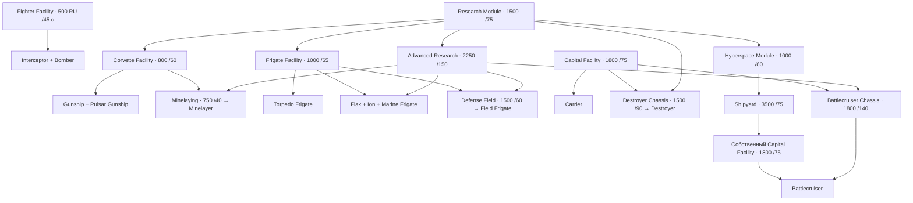
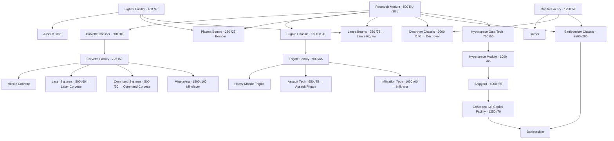

# Исследования HW2 Classic: хиигаряне и вэйгры

20 октября 2026. Справочник для проектирования науки Новокушан/Новотаиидан. Это описание исходной Classic, а не уже принятые цены или дерево новых рас. Исходники мода и установленная игра этим документом не меняются.

Схемы и числовые таблицы восстановлены из уже извлечённых файлов **Steam Homeworld 2 Classic**: `scripts/building and research/{hiigaran,vaygr}/{research,build}.lua` и `subsystem/*.subs`. Полные поля, скрытые строки и SHA256 сохраняются отдельно. Пояснения сопоставлены с авторскими разборами Тена: [хиигаряне](https://www.homeworld3.ru/index.php?name=Pages&op=page&pid=95), [вэйгры](https://www.homeworld3.ru/index.php?name=Pages&op=page&pid=96). У Тена базовая таблица рассчитана на1.1, отличия1.0 отмечены отдельно. Текст статьи не копируется; ниже наша схема по игровым данным.

## Как читать

- **Модуль** строится за RU и занимает место на корабле. **Исследование** занимает общую научную очередь. **Постройка корабля** оплачивается после получения доступа. Это три разные части цены пути.
- Производственный модуль нужен на конкретном строителе; научные условия проверяются по флоту. Наличие технологии не создаёт производственные мощности на каждом новом носителе.
- У обеих рас одна научная очередь. По экспериментам Тена ускорение описывается `t=T/√(n+1)`, где T — исходное поле Time, n — работающие научные модули. В локальном tuning подтверждён показатель0.5; это не наш новый тест движка. Одна секция:0.707T, две:0.577T, шесть:0.378T. При отсутствии науки новые исследования недоступны.
- Все времена ниже **базовые**. Сумма полей времени модулей и исследований не равна длительности развития в матче: есть параллельная постройка, научное ускорение и начальная инфраструктура.
- Ветки независимы: для фрегатов не требуется предварительно открыть корветы; для эсминцев — фрегаты. Цепочки уровней I→II существуют внутри улучшения, но общей лестницы классов нет.

## Основная разница

| Свойство | Хиигаряне / Hiigaran | Вэйгры / Vaygr |
|---|---|---|
| Базовая наука | Research Module:1500 RU /75 с | Research Module:500 RU /30 с |
| Продвинутая наука | Advanced Research Module:2250 /150, после базовой науки | Отдельного Advanced Research нет |
| Корветы и фрегаты | Основная плата за доступ — наука и производственный модуль | Наука → платное шасси класса → производственный модуль |
| Новые проекты | Многие появляются сразу с модулями; отдельные технологии для специальных проектов и сверхтяжёлых кораблей | Больше отдельных технологий проектов внутри класса |
| Улучшения | Обычно на конкретный тип: Gunship отдельно от Pulsar, Torpedo отдельно от Ion | На класс целиком: Corvette, Frigate, Capital и т.д. |
| Число уровней | Обычно два; II требует I и продвинутую науку. Скорость перехватчиков/бомбардировщиков II доступна с базовой наукой | Обычно два; оба с единственным типом Research Module |
| Цена за полный класс | Зависит от числа модернизируемых проектов | Крупный единый платёж, покрывающий весь класс |

## Хиигаряне: открытие боевых проектов

В схеме стрелки, сходящиеся к одному узлу, означают совместные условия. Условия R могут выполняться базовой либо продвинутой наукой там, где это разрешено исходным research.lua; таблица ниже сохраняет точный синтаксис.

У зенитного, ионного и десантного фрегатов есть внутренний допуск **InstaAdvancedFrigateTech:0 RU /0 с** при AdvancedResearch. В пользовательском дереве это появление кораблей после постройки продвинутой науки, без отдельного платного «шасси фрегатов».

Носитель открывает один Capital Ship Facility, без отдельного исследования и без обязательной базовой науки. Линейный крейсер строится только на верфи, имеющей собственное производство крупных кораблей; его исследование можно проводить раньше, используя CapShipProduction другого корабля флота. Эсминец не является предшествующей технологией линейного крейсера.

Платформы: **Platform Control650/70 → Gun Platform**; добавление базовой науки и исследования **Platform Ion Weapons600/100** открывает Ion Beam Platform. Доступные без производственных модулей проекты — разведчик, сборщик, ресурсный контроллер и обычный зонд. Кампания дополнительно ограничивает доступность сценарием.

## Вэйгры: открытие боевых проектов

Базовый Research Module нужен для всех перечисленных платных исследований, в том числе для оружейных проектов подветок. Он не требуется для базового штурмовика, пушечной платформы и носителя при наличии соответствующих производственных модулей.

Платформы: **Platform Control625/70 → Gun Platform**; с наукой и **Heavy Missiles1200/105 → Missile Platform**. Технология Hyperspace Gate750/50 открывает как постройку врат через платформенный модуль, так и возможность построить Hyperspace Module; сами врата не обязательны для модуля/вызова верфи. Корветная технология не требуется для фрегатной; Destroyer Chassis не требуется для Battlecruiser Chassis.

## Что именно улучшается

**Хиигаряне:** две отдельные линии скорости перехватчика и бомбардировщика; отдельные линии прочности/скорости Gunship, Pulsar, Torpedo, Flak, Ion, Destroyer, Battlecruiser, Carrier, Shipyard и Mothership. Для Gun Platform и Ion Platform — отдельная прочность; для сборщика/контроллера — также раздельная прочность. В обычной таблице нет отдельных броневых улучшений истребителей, линий корпуса/скорости Marine и Defense Field Frigate либо массового исследования урона всех орудий.

**Вэйгры:** скорость всего класса Fighter; прочность и скорость всех Corvette, Frigate и Capital; прочность Platform и Utility. Классовая Capital-модернизация задаётся для всего семейства, а не отдельного проекта эсминца или крейсера. Ускорение производства всё равно покупается отдельно для флагмана, носителя и верфи.

| Классовое улучшение вэйгров | I: RU /с → итоговый множитель | II: RU /с → итоговый множитель |
|---|---|---|
| Скорость истребителей | 600 /50 →1.25 | 1000 /70 →1.50 |
| Прочность корветов | 900 /60 →1.30 | 1800 /80 →1.60 |
| Скорость корветов | 800 /60 →1.20 | 1600 /80 →1.40 |
| Прочность фрегатов | 1600 /80 →1.30 | 2800 /100 →1.60 |
| Скорость фрегатов | 1000 /70 →1.20 | 1500 /100 →1.35 |
| Прочность крупных кораблей | 4000 /60 →1.30 | 6000 /80 →1.60 |
| Скорость крупных кораблей | 3500 /60 →1.20 | 5000 /80 →1.35 |
| Прочность платформ | 1000 /50 →1.50 | 1600 /70 →2.00 |
| Прочность вспомогательных | 1200 /50 →1.50 | 2400 /70 →2.00 |

Это абсолютные множители от исходной характеристики. Например, корпуса I и II дают130% и160% исходных HP, а не130% и169%. Каждый II требует свой I. «Броня» в названиях этих исследований изменяет MAXHEALTH; это не переключение ArmourFamily.

Способности и специальные открытия также занимают очередь: ремонт сборщика, EMP разведчика, бомбы против подсистем, тяжёлые торпеды хиигарян, пинг хиигарского разведчика, сенсорные зонды, минные системы и т.д. Полный перечень с ценами и требованиями находится ниже.

## Полная цена доступа с нуля

**Сумма науки, нужного производства и обязательных исследований, без цены самого корабля и без улучшений.** Исходный Материнский/Флагман уже существует; все соответствующие модули отсутствуют. Начальные модули матча эту сумму уменьшают. Для повторного строителя нужно снова оплатить его собственное производство, но известные технологии не покупаются заново.

| Доступ к проекту | Хиигаряне, RU | Вэйгры, RU |
|---|---:|---:|
| Основной истребитель: Interceptor / Assault Craft | 500 | 450 |
| Bomber | 500 | 1200 =500+450+250 |
| Базовый корвет: Gunship/Pulsar / Missile Corvette | 2300 =1500+800 | 1725 =500+500+725 |
| Minelayer Corvette | 5300 =1500+2250+800+750 | 3225 =500+500+725+1500 |
| Базовый фрегат: Torpedo / Heavy Missile | 2500 =1500+1000 | 3200 =500+1800+900 |
| Продвинутый противоистребительный фрегат: Flak / Assault | 4750 =1500+2250+1000 | 3850 =500+1800+900+650 |
| Десантный фрегат: Marine / Infiltrator | 4750 | 4200 =500+1800+900+1000 |
| Carrier | 1800 | 1250 |
| Destroyer | 4800 =1500+1800+1500 | 3750 =500+1250+2000 |
| Battlecruiser, включая вызов верфи и её Capital Facility | 11850 =1500+2250+1000+3500+1800+1800 | 10000 =500+750+1000+4000+1250+2500 |

Пути к крейсерам не включают ненужный для них Capital Facility на Материнском/Флагмане: в минимальном пути нужен один такой модуль на вызванной верфи. Стоимости самих крейсеров здесь не прибавлены.

## Ориентиры для наших двух рас — предложение

1. **Сравнивать суммарную цену доступа**, включая необходимые профильные секции. Если ионный фрегат требует три направления, нельзя каждому исследованию назначить цену полного классического открытия фрегата.
2. **Отделить открытие проекта от его улучшений.** Первое даёт новый инструмент; второе усиливает уже имеющийся флот. Пинг, минные системы и защитное поле — самостоятельные работы, а не проценты корпуса.
3. **Сохранить выбор класса.** Обязательная последовательность всех классов сделает наше развитие длиннее Classic. Наши шасси/двигатели могут иметь осмысленные связи, но их стоимость и задержку придётся компенсировать.
4. **Улучшение всей группы должно стоить дороже частного.** Особенно для нашей пары лёгкие/тяжёлые эсминцы: решить, охватывает модернизация всё семейство или отдельный проект. Разделение модулей по направлениям само по себе этого не определяет.
5. **Шесть дорогих секций не должны стать шестью обязательными платежами до первого перехватчика.** Базовые знания/начальный доступ и свободный выбор первой секции ещё надо определить.

Эти пункты — вывод для дальнейшего проектирования, не автоматическое утверждение цен или нового дерева.
